# FirstMate

**One conversation to coordinate a crew of coding agents in [Paseo](https://paseo.sh).**

FirstMate gives a lead agent a persistent home, a charter and a view of its crew. Describe the work;
the first mate prepares briefs, starts workers in separate git worktrees, follows their progress and
brings back results and decisions. Workers remain ordinary Paseo agents, with their own conversations.

**Needs you** counts recorded decisions across all views, including tasks without a worker.
An unreadable task is isolated so other decisions stay current; its last good gate is retained,
and a suspected hold still counts. The decision drawer and indicator explain problems with line
numbers and task ids. Unavailable data and last known stale counts are labelled, including on Deck.

This fork has diverged substantially from **[FirstMate by Gustavo Ambrozio](https://github.com/gpambrozio/paseo-plugins/tree/main/firstmate)**,
imported on **7 October 2026 at version 0.3.1** ([import commit](https://github.com/LiterallyBlah/firstmate/commit/129ec61)).
It now includes animated Deck scenes, workspace tabs, remote crew, managed watches and expanded chat
and task views. The original MIT copyright and license are preserved. Earlier foundations include
[Kun Chen's firstmate](https://github.com/kunchenguid/firstmate) and
[ABorakati/paseo-firstmate](https://github.com/ABorakati/paseo-firstmate).

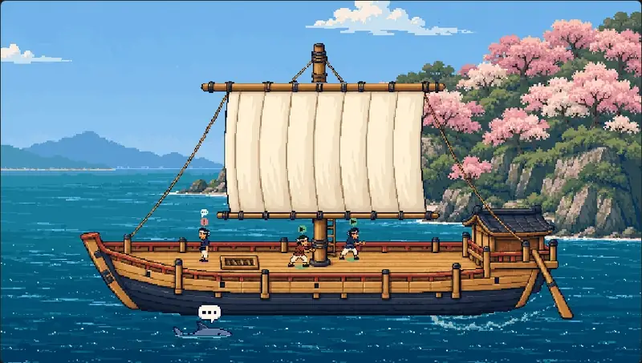

*Sakura coast, with time accelerated to show the evening transition. All screenshots and looping clips
use synthetic fixture data and current components, not a live fleet.
[Media sources and privacy review](docs/readme/README.md).*

## Install this fork

Requires **Paseo 0.11 or newer** on the daemon and app, a configured agent provider, Git, and the
`paseo` CLI on the daemon machine. Enable **Agent tools** when FirstMate prompts: the first mate
needs Paseo's agent tools to create workspaces and manage workers. An already-running mate needs to
resume or reload its session after the tool set changes.

Install from this repository:

```sh
paseo plugin install git:LiterallyBlah/firstmate
```

On Windows PowerShell, use `paseo.cmd` in place of `paseo`. The npm package
`@gpambrozio/paseo-firstmate` is the upstream release; it does not install this fork.

For a local checkout instead:

```sh
git clone https://github.com/LiterallyBlah/firstmate.git
cd firstmate
npm ci
npm run typecheck
paseo plugin install .
```

Use `npm.cmd` on Windows. After changing a local installation, `paseo plugin reload firstmate`
loads the new code. This fork includes Windows CLI launchers and Node-based watch support.

## Start a voyage

1. Open **FirstMate** in the sidebar. Choose a model and **Launch the first mate**, or adopt an
   existing agent. Launch in the configured home to enable the workspace shortcuts.
2. Describe a project and its delivery rules: “Use the demo repository. Prepare pull requests for
   review; ask before merging.” The first mate keeps project rules and working records in its home.
3. Give it a bounded task: “Add search to the sample catalogue and check keyboard navigation.”
   Follow the workers in List, Board or Deck, and answer decisions in chat.
4. Review the result and decide what happens next. The charter tells the first mate to ask before
   merging unless a project's standing instructions already permit it.

Use **Bearings** for the current decisions, completed work and next steps; **Ahoy** for a catch-up.
`/fm <message>`, `/bearings` and `/ahoy` also work from Paseo composers. The first mate owns dispatch
through Paseo's tools; the plugin supplies the interface and records. Its charter guides a model,
so the chosen model and the project's instructions matter.

## Deck: the crew as a scene

The Deck turns live workers into sailors on a pixel-art ship. **Pirate voyage** is the default;
**Sakura coast**, **Sky pirates** and **Ghost ship** offer other voyages. Pirate voyage and Ghost ship
use larger crew to match Sakura's crew-to-ship proportions; Sky pirates has a smaller increase.
Sky pirates has eight crew looks, including an aviator, engineer, navigator, rigger, cook and quartermaster.
**Sakura coast** sails past a blossom-covered island, with smoother layered water and its storm spirit rising through the scene's own sea.
Its eight crew looks mix straw hats, an apron, a grey topknot, a ponytail, headcloths and padded shoulders.
The **Scene** picker in Home and the Deck tab
saves one choice for the whole fleet, also available in settings.

| Ship's deck · day | Sakura coast · day |
| --- | --- |
| 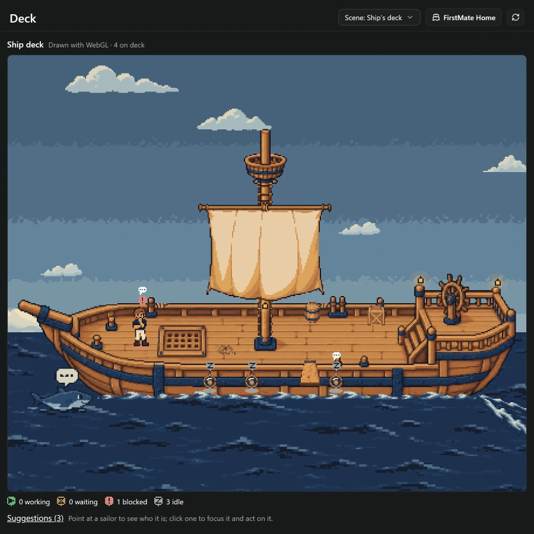 | 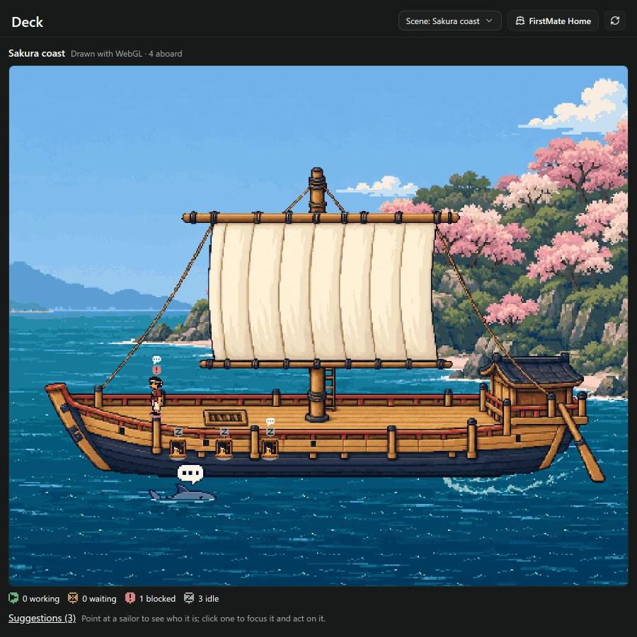 |
| **Ship's deck · night** | **Sakura coast · night and suggestions** |
| 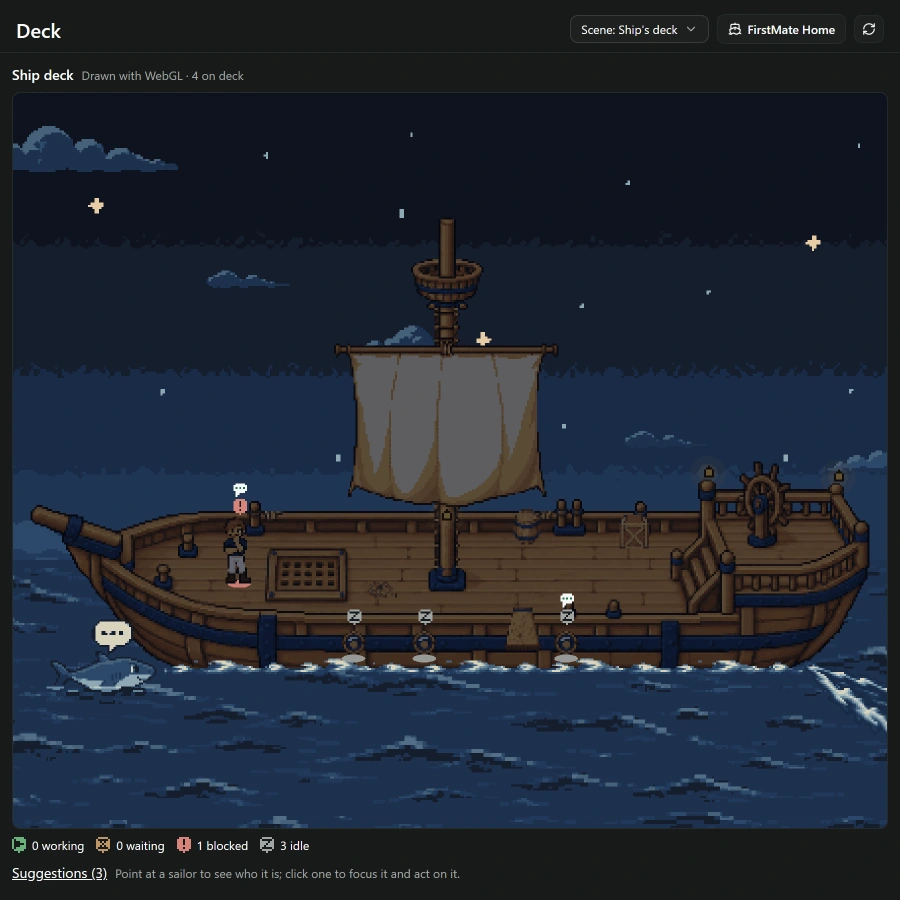 | 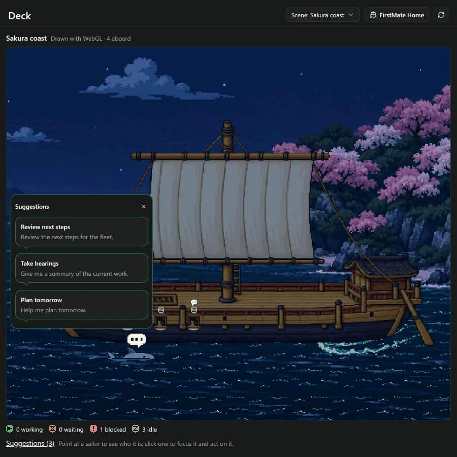 |

- **Read the crew at a glance.** Badges distinguish working, waiting, blocked and idle sailors.
  Crew walk between stations as their state changes; resting crew settle below deck.
- **Click a sailor to focus.** The camera moves in and opens its task panel, including Converse.
  Keyboard focus and Escape provide another way in and back out.
- **Ask the shark.** Click it, or use **Suggestions** in the legend, to open the first mate's
  suggestions as speech bubbles. Selecting one sends that prompt and returns to Home chat.
  Sailors also carry reply markers for suggestions linked to their own tasks.
- **Watch the scene change.** Local time drives day and night. Sails, water, clouds and crew animate;
  Ship's deck grows stormier as the fleet gets busy. Reduced motion keeps the scene calm, and hidden
  canvases pause. Sky pirates adds a rightward dragon flight through the open sky at peak storm.
  Each scene has its own particle rain: scattered drops at several depths, from drizzle to downpour
  as the fleet gets busy, with gently shifting wind and storm streaks over the hull, sails and water.
  Lite mode freezes the rain; reduced motion hides it.
  Ghost ship keeps its haunted sea at the surface, with a half-submerged anglerfish, falling storm
  rain and a crow's nest that moves rigidly with the mast. Its sea follows daylight and darkens
  gradually below the near waves.

Click the shark, choose a suggestion, and the prompt arrives in Home chat:

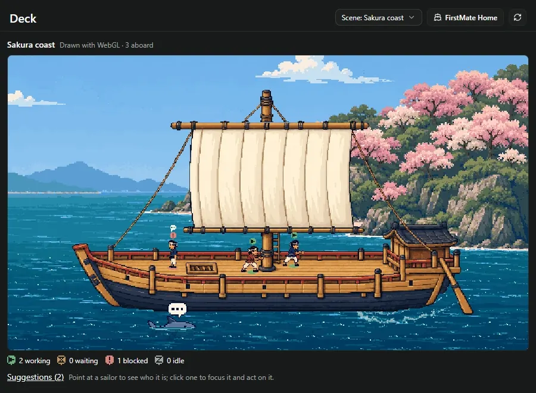

Switch scenes with the fleet-wide picker:

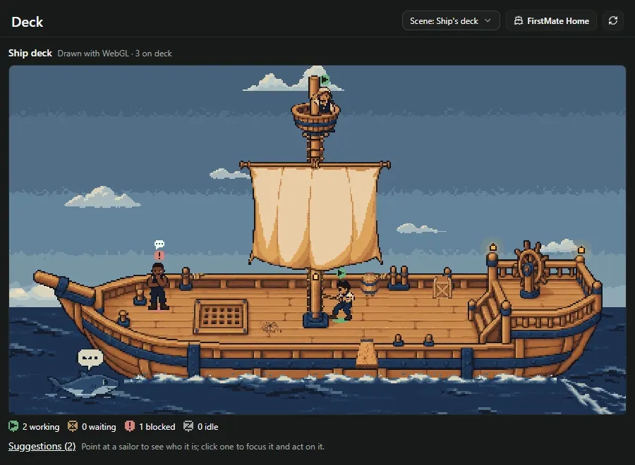

Click a sailor to bring its task into focus; Escape returns to the whole crew:


Deck needs a web renderer with WebGL. Home can show it in a narrow browser pane; native mobile clients
show an availability explanation. The standalone Deck tab has its own wide-layout requirement.
See [Sakura coast](docs/settings/japanese-ship/README.md),
[shark interactions](docs/deck-shark-suggestions/README.md) and the
[scene-pack authoring guide](docs/deck-settings/authoring.md).

Scene packs may serve up to 2,000,000 bytes of PNG images. Pack lint warns above 80% of the budget;
the manifest and base64 transport overhead are additional. See the [transport budget](docs/deck-pack-budget/README.md).

## Home and workspace tabs

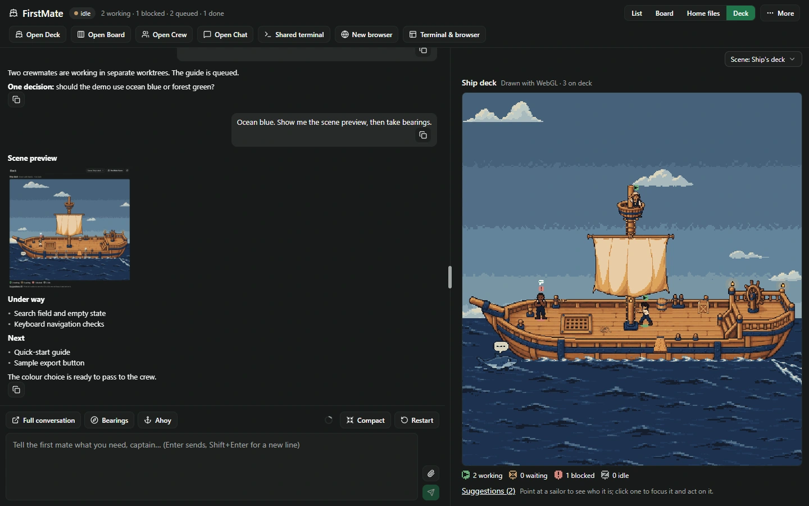

**Home** keeps the first-mate conversation beside **List**, **Board**, **Home files** or **Deck**.
Compact layouts switch between these and **First mate**. The divider and view choices are saved.
**More** holds watches, provider transfer, layout controls, updates, refresh and settings.

The shortcuts open dedicated **Deck**, **Board**, **Crew** (the grouped List) and **Chat** tabs in the
home workspace. Paseo handles tab order, splits and closing. Chat and Home share the same mate,
draft and attachments; **Full conversation** opens its native Paseo session.

**Shared terminal** reuses a terminal named **FirstMate shared**, or creates one when none exists.
The shortcut opens its workspace; select the terminal there. **New browser** asks for an HTTP(S) URL
and creates a native desktop browser tab. **Terminal & browser** returns to the workspace to select
an existing tab. Browser sharing with an agent requires Paseo's browser tools and a connected desktop
automation host; it is local to that desktop. Opening Home or restoring tabs creates neither resource.

**Home files** browses and edits the first mate's records, with Markdown previews and changed-file
checks on save. Keep standing instructions in `data/captain.md`, the opening in `data/opening.md`, and
charter customizations in `data/charter.md`; the generated `AGENTS.md` is rewritten by the plugin.
An edited charter is preserved, with a comparison offered when the shipped charter changes.

[Workspace behavior](docs/shell-phase1/README.md) · [Inline Deck](docs/home-deck/README.md) ·
[Chat tabs](docs/chat-tabs/README.md)

## List, Board, suggestions and tags

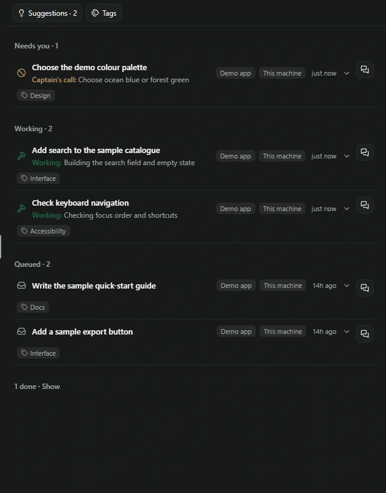

**List** is the default: attention items first, then working, queued, idle/stalled and completed work.
Done starts collapsed to a count. **Board** shows the same tasks in state columns that can be folded
and reordered. Expand a task for details and actions; choose Comfortable or Compact card spacing.

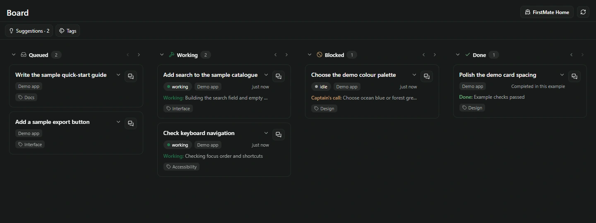

A worker that finishes waits in **Ready** for the first mate; **Done** follows the backlog's completed
record. A worker waiting on an external run can remain **Working**, marked “waiting”. Missing feeds
and stalled workers are shown explicitly.

**Suggestions** opens the first mate's proposed next requests. Inspect the full prompt, send it, or
remove it. **Tags** adds another way to organize tasks; filtering requires all selected tags and
combines with the **Machines** filter when remote hosts are present. List and Board share these controls.

[Task tags](docs/item-tags/README.md) · [List and Board design](docs/board-list/README.md)

## Converse with a worker

The conversation button on a task opens **Converse** beside or over the task view. Read the worker's
messages, expand tool activity, send a steer, and answer local questions or permission requests.
**Activity** exposes more detail; the task menu includes Interrupt, Relaunch and End where supported.
The first mate receives board exchanges in a quiet-period batch rather than a new note for every line.
A steer joins the active turn or restarts it, depending on the provider.

An item without a worker opens a discussion with the existing first mate. **Start work** is a separate
request to dispatch; opening or discussing the item does not start a worker.
[Item discussions and Converse](docs/converse-universal/README.md).

## Chat, images and native notes

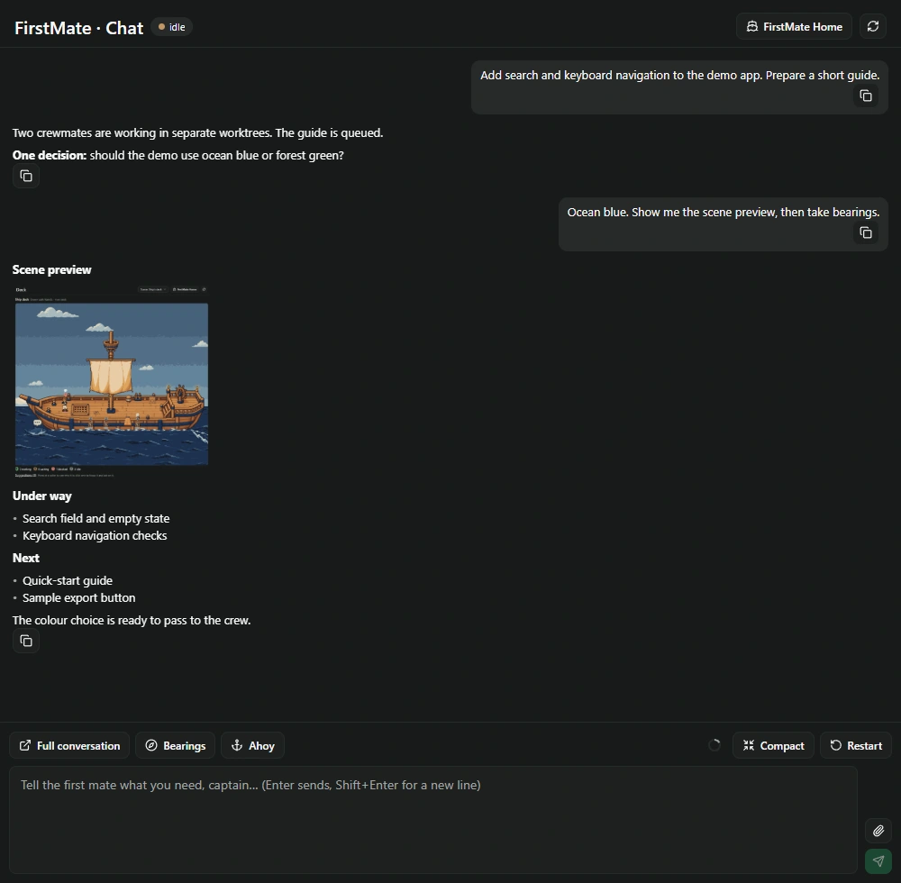

Home chat and the Chat tab support earlier history, copy controls, questions, permissions, a context
meter, **Compact** and **Restart**. Web clients can attach files and images by picker, paste or drop;
native mobile clients use text in this composer. Sent-image history is cached in the browser profile,
so it does not automatically follow to another device.

Image references in replies can open inline previews and an enlarged viewer. Local images are read
from the home or a registered local workspace, with path checks and a 10 MiB cap. Remote workspace
images are not fetched through this local route.

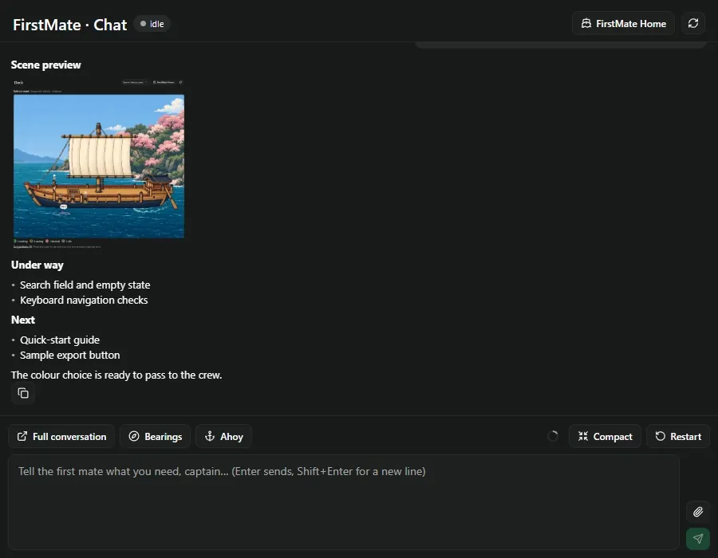

Workspace file links identify their destination and offer **Open workspace**; select the file in
Paseo's explorer. [File-link behavior](docs/workspace-file-links/README.md).

In **Paseo's native chat**, complete FirstMate watch and board notes become compact summaries with
**Show original** to reveal their text. Ordinary conversation and Paseo's own system notes retain
native formatting; the stored transcript is unchanged.

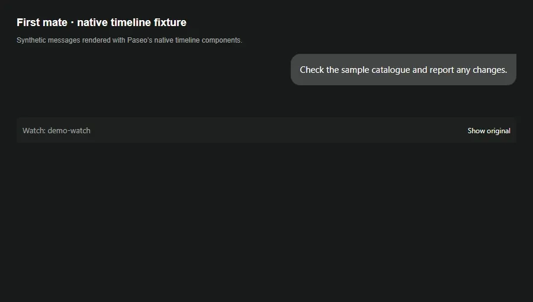

[Chat capabilities](docs/chat-parity/README.md) · [Local image previews](docs/local-chat-images/README.md) ·
[Native note formatting](docs/native-chat-format/README.md)

## Watches and managed inspections

Open **More → Watches** for schedules, enable switches, last output and failures. Built-in
**pr-watch** tracks changes to backlog pull requests through an authenticated `gh` CLI;
**remote-watch** reports remote completions and permission requests. Script watches run on the
daemon's local clock. Silent runs do not prompt a model; output waits for the first mate between turns.
Missed schedule minutes are not replayed while Paseo is stopped or the machine is asleep.

Managed watches add a saved inspection brief and explicit routing: use the **current first-mate
session**, or a **new isolated inspection session** with a supported reasoning level. New inspections
use the current mate's provider/model in read-only mode and return evidence; the first mate remains
responsible for action. Choose actionable-only notifications, every result, or retained reports only.
Failures still escalate. The optional **Board review** preset can retain quiet results without waking
the mate; isolated inspections themselves use model calls.

[Writing script watches](templates/watches/README.md) · [Managed routing and reports](docs/watch-routing/README.md)

The opt-in `launch-metrics.mjs` template silently measures new local and remote crew every 15 minutes
and preserves dated backlog snapshots. Unmeasurable hosts warn on stderr without failing the run;
their unseen launches remain eligible for retry. It is shipped without automatic installation. Its
[installation and report instructions](templates/watches/README.md#launch-metricsmjs-opt-in) cover
the 14-day manual baseline, comparison periods, and unknowns where Paseo does not expose evidence.

## Remote hosts

Saved Paseo desktop hosts sync to the daemon so the first mate can coordinate remote crew through
the home helper. Local and remote tasks share List, Board and Deck. **Machines** narrows the view
and exposes connection health; unavailable hosts retain their last known state.

Remote Converse reads the worker's text log and supports Steer, Interrupt and End for owned crew
when reachable. Remote permissions are handled on the host, and remote Relaunch goes through the
first mate. Followed sessions are marked separately and cannot be ended from the board.
The [remote access guide](templates/data/remote-access.md) describes setup, commands and limitations.

For new tasks in new worktrees, the first mate can optionally use
`node tools/launch.mjs help`. It validates and assembles a brief, emits arguments
for the first mate's own local MCP calls, or launches remotely through the existing
helper, then records the worker. Uncertain launches are never retried automatically.
Backlog writes retain a recovery line but remain best-effort; simultaneous edits
can be lost between compare and rename. The helper also renders editable art,
landing, deployment and reviewer messages without sending them.
See the [launch helper guide](docs/launch-tool.md) for commands, recovery and checks
that remain unknown on remote hosts.

## Settings, handovers and updates

**Settings → Plugins → FirstMate** controls the home, default crew model/mode, agent tools, refresh
interval, card spacing and Deck setting. Home's **More → Switch provider/model** transfers the
first-mate role to a new session with a saved handoff and the same records. The handoff is an excerpt,
not a transfer of provider memory. Checks protect workers from same-workspace archive cascades;
failed transfers expose recovery controls. [Provider handover details](docs/provider-migration/README.md).

The update control under **More** checks the installed source. When a verified update is available,
pressing it sends an installation request to the first mate; the control itself does not install or
reload. It follows the configured fork/source, and reports unavailable when it cannot verify it.
[Update behavior](docs/firstmate-update/README.md).

## Development

Optional record recall is supplied as `tools/recall.mjs` for approved slice 1 testing. It catalogs
existing home records and dated backlog history, with adoption pending a separate frozen-probe
trial. Home preparation supplies the helper and guide without running it or creating snapshots.
[Recall scope, privacy and validation](docs/recall-slice1.md).

Attention timing can be observed without changing notifications or using a model. Set the daemon
environment setting `FIRSTMATE_ATTENTION_OBSERVE=1` when starting the plugin (off by default).
It appends metadata to the configured home's `data/metrics/attention.jsonl` for 14 days from that
log's first observation, including across restarts. It never writes `launches.jsonl`.

Generate the read-only JSON report from the plugin checkout, with Node 24 or newer:

```sh
npm run report:attention -- /absolute/path/to/home/data/metrics/attention.jsonl
```

The report separates permission waits, fleet-state residence, later lead-turn associations and
bounds on explicitly targeted lead actions. Missing evidence stays unpaired. Remote observations
carry polling and clock-skew uncertainty; a cancelled turn's preceding event is an association,
not a cause. [Observation coverage and limitations](docs/attention-observation.md).

```sh
npm ci
npm run typecheck
npm test -- --maxWorkers=1
npm run lint:deck-packs
```

Use `npm.cmd` on Windows. Tests use temporary Paseo homes. UI fixtures and art review records live
under `docs/`, outside the npm package's file list. [AGENTS.md](AGENTS.md) maps the implementation and
its constraints; [CHANGELOG.md](CHANGELOG.md) preserves the change history, including upstream entries.

## License

The original MIT license applies to this copy. Gustavo Ambrozio's upstream copyright and permission
notice are preserved in [LICENSE](LICENSE).
