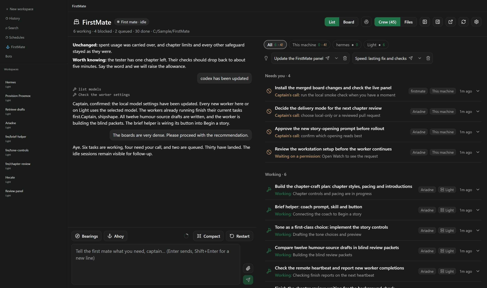

# FirstMate

A [Paseo](https://paseo.sh) plugin: talk to one agent, ship with a crew.

You talk to a single agent — the **first mate** — and it runs the crew for you. Every task goes to a
**worker**: its own Paseo agent, in its own git worktree, so parallel work on one repository never
collides. The first mate writes each worker's instructions, supervises it to the end, and brings you
finished pull requests, investigation findings, and only the decisions that are really yours. You are
the captain.

A **FirstMate** panel in the sidebar puts the conversation with the first mate beside a board of its
crew — Queued, Working, Blocked, Parked, Done, Failed, Idle and Ready — with each worker's last word on
what it is doing and a link to its pull request. A worker that ended its turn waiting on a gate, a run or
another worker stays in Working, marked "waiting"; one that has finished waits in Ready for the first
mate; Idle is for a worker that stopped without saying why, or stalled. The sidebar row shows how many
workers are working, ready or idle.

![A 30-second loop of FirstMate at work, zooming in on each step: one message to the first mate asks
for a dark mode toggle and a speed-conversion fix in a small web app; two cards appear in Queued and
move to Working, each worker in its own worktree; one worker is watched live, its commands and edits
scrolling past; each card reaches Done with "Captain's call: land branch …" beside the first mate's
report; the message "land both" sends them to main, and the first mate's Bearings report, with both
cards marked landed, closes it out.](docs/demo.webp)

This is a Paseo-native take on [firstmate](https://github.com/kunchenguid/firstmate) by Kun Chen, by
way of [ABorakati/paseo-firstmate](https://github.com/ABorakati/paseo-firstmate). Where those run the
crew in terminal sessions and supervise it with shell scripts, this one uses nothing but Paseo: the
workers are ordinary Paseo agents you can open, read and type into like any other, in worktrees Paseo
manages, and Paseo itself tells the first mate when a worker finishes, fails or asks for permission.
There is nothing else to install.

## What you need

- Paseo **0.11 or newer**, on the daemon and on the device running the app.
- **Paseo's agent tools turned on.** They are how the first mate starts its workers and hears back from
  them, and Paseo ships with them off. The panel says so and turns them on with one press; it is the
  *Agent tools* switch in the FirstMate settings too.
- A capable model for the first mate. It spends its day reading records and deciding who does what,
  and a small model gets the tools wrong. Claude Sonnet or better, or a comparable Codex model, works.
- The `paseo` command on the daemon machine, which a Paseo install puts there. It is used to find the
  plugin's own files, to interrupt a worker from the board, and to name the first mate's project in
  Paseo's sidebar.

## Install

This private copy includes Windows fixes. Install it from your local checkout with
`paseo plugin install "C:/path/to/firstmate"`; the npm command below installs the upstream release.
After editing the checkout, use `paseo plugin reload firstmate`.

On Windows, FirstMate uses the desktop Paseo launcher or an npm CLI entry point without a command
shell. Scheduled watches use Node (`#!/usr/bin/env node` or `#!node`); the built-in PR watch is
supported. Custom Unix shell watches need to be rewritten or wrapped in a Node watch on Windows.

```bash
paseo plugin install npm:@gpambrozio/paseo-firstmate
```

To hack on it, clone the repository and run `paseo plugin install "$PWD"` from this folder after
`npm install` and `npm run typecheck`. Everything the plugin writes into the first mate's home — its
charter, the records it starts with, the home's icon — is in `templates/`, as the files it becomes;
`paseo plugin reload firstmate` puts a change to work.

## Getting started

1. Open **FirstMate** in the sidebar, pick the first mate's model, and press **Launch the first mate**.
   If you already started an agent for the job, adopt it from the list below the button instead.
2. Tell it about a project: "the web app is at ~/code/web — ship through pull requests". It keeps a
   registry, so you only say this once.
3. Ask for work: "fix the flaky login test and add dark mode". Two workers appear on the board, each in
   its own worktree. Minutes later:

   > PR ready for review, captain: https://github.com/you/web/pull/42 (fix the flaky login test - risk: low - CI green)

4. "Merge it." The first mate never merges without your word, unless you have told it a project may.

## Talking to the first mate

- The chat in the panel — Enter sends and Shift+Enter starts a new line, as in Paseo — or open the
  first mate in Paseo for the whole session, every tool call and its output. The chat follows new
  messages while you are at the bottom; scroll up to read, and the round button at the bottom brings
  you back. A file in the home that the first mate names in a reply is a link that opens it in the
  Files view.
- **How full its memory is** — the ring at the end of the chat's buttons shows how much of the first
  mate's context window is used, the way Paseo's own chat does: amber from 70%, red past 90%. Hover
  over it, or tap it on a phone, for the share and the token counts.
  **Compact** has it summarise its conversation to free room, as `/compact` does in Paseo. **Restart**
  starts a new first mate from scratch, with the same model and settings, after asking you. Both wait
  until the first mate is between turns. On a restart its records carry over, the old conversation stays in
  Paseo's history, and workers already running keep going — the new first mate checks on them
  regularly, since Paseo tells only the agent that started a worker when it finishes.
- **Questions it asks you** — which option, whether to go ahead, a plan to approve — appear in the
  chat as a form you answer there, the same as in the first mate's own tab.
- **`/fm <message>`** in any composer sends the message to the first mate, from wherever you are.
- **`/bearings`** — where everything stands, in four sections: what needs your call, what landed,
  what is under way, and what is next. `/bearings file` also writes it to a dated report in the first
  mate's home; `/bearings include PRs` checks the live pull requests too.
- **`/ahoy`** — what happened since you last spoke, then every open decision, one at a time, with a
  recommendation.
- *Bearings* and *Ahoy* are also buttons above the chat, and *FirstMate: bearings* is in ⌘K.
- **Suggestions** — when the first mate has an idea of what you will want next ("Land web#42", "Review
  loop on web#42"), it shows as a button in a slim row above the crew, on wide screens and phones.
  Extra suggestions open under **More**. Pressing one sends that request to the first mate right
  away, just as if you had typed it and pressed Send, and brings the chat into view so you see it go
  out; anything you were typing stays in the message box. A suggestion too long to show whole gets a
  chevron that opens the full request, to read or copy, without sending it. The trash button
  beside a suggestion takes it off the list without sending it. With no suggestions the row is hidden.


## The crew: List and Board

**List** is the default. Each task occupies a full-width row with a state icon, one-line title,
project and host tags, time since it moved, and its most pressing status. Hover for the full title,
or press the row for the same details and actions as a board card. Tasks appear in **Needs you**
(blocked, permissions, Ready and failed), **Working** (including waits), **Queued**, **Idle / stalled**
(including parked work), then **Done**. Empty groups disappear. Done starts as **30 done · Show**
and expands in place; the whole list shares one scroll container.

The header's **List / Board** switch is remembered with the layout. Both views work in the phone's
**Crew** tab. Suggestions sit above either view; watches open from the header.




Each card is a worker, a backlog item, or both. At rest it shows only what you need at a glance: the
title, the worker's state, its project and host as small tags, when it last moved, and one line of
its latest status — a permission it waits on, an error, your call it waits for, or its own status line,
whichever matters most. Press it for the rest — task id, kind, mode, model, the full status line, the
pull request — and its actions:

- **Watch** — the worker's card beside everything it is doing, live, in place of the board: the brief
  it was given, its reasoning, each command and file it touched (press one for what it ran and what
  came back), its plan, and its replies. Anything it is waiting on — a question, a permission — is
  answered there. The chat with the first mate stays beside it; **Crew** takes you back to the board,
  and **Open in Paseo** shows the worker's whole session.
- **Steer** — a word straight to the worker. It counts as coming from you, and the first mate is told
  what you said and what the worker answered.
- **Interrupt** — stops the worker's current turn.
- **Relaunch** — asks the first mate for a fresh worker in the same worktree, with your note. The work
  on disk carries over; the conversation does not.
- **End** — archives the worker. Its workspace and worktree are left exactly as they are.


A column with nobody in it is hidden. In **Board**, wide screens show one row of full-height columns,
scrolling sideways when needed. Headers and count pills keep their width. Columns fold to a strip
and move with the arrows in their headers; on phones they stack in one scrolling view. The split between
chat and board drags. The layout is remembered, including where a hidden column goes when it fills
again. Board's Done column shows its three most recent cards, with **Show all** for the rest.

[Before-and-after desktop and phone renders, and the reproducible harness](docs/board-list/README.md).

Opening the panel counts as looking at the first mate: when it has finished a turn, its workspace in
Paseo's sidebar turns to done, as it would if you had opened the first mate itself. One waiting on
your permission stays flagged until you answer.

A worker's workspace and session also get a **FirstMate** tab showing its card, with a box for telling
the first mate something about it.

## The first mate's home

The **Files** view — next to the crew board, or its own tab on a phone — shows everything in the home
and opens any text file for editing, with a preview for Markdown. Cmd/Ctrl+S saves on a desktop. The
first mate writes these files too, so a save never silently replaces its newer version: you are told
it changed, and choose to load theirs or overwrite it with yours.

The first mate lives in a directory of its own — by default inside Paseo's plugin data, or anywhere you
choose in the settings. It writes there and nowhere else; your projects are read-only to it, and every
change is a worker's job.

In Paseo's sidebar the first mate's project and workspace are called **FirstMate** rather than after
the folder, and the project shows FirstMate's ship, from `icon.svg` in the home — Paseo picks up a
project's icon from its folder. Rename either, replace the file, or upload an icon in the project's
settings, and your choice is kept.

- `AGENTS.md` — its charter: how it takes requests, briefs and supervises workers, and talks to you.
  Written from `data/charter.md` every time the plugin starts or the first mate is launched, so do not
  edit it here.
- `data/charter.md` — **the charter itself, yours to change.** It starts as FirstMate's own charter, and
  while you leave it alone, a new version of the plugin brings its improvements. Once you edit it, your
  version is kept; if FirstMate's charter changes after that, the board tells you, **Compare** opens the
  new one beside yours (`data/charter.new.md`) and **Done** marks yours up to date. Saving it in the panel
  rewrites `AGENTS.md` at once; the first mate reads it at its next session, or when you ask it to re-read
  its charter. The note at the top lists the `{{placeholders}}` filled in for you, notes between `<!--`
  and `-->` are left out, and an empty file goes back to FirstMate's charter.
- `data/captain.md` — **your standing orders.** Anything you write here outranks the charter (except
  its hard rules: it never writes to a project, never merges without your word, never throws away
  unlanded work). Never overwritten.
- `data/opening.md` — **the first thing a new first mate is told**, when you launch it and when you
  restart it. Change the words, the language, or what it should do before anything else; keep asking
  it to read `AGENTS.md` and take the helm, which is what makes it a first mate. Notes between `<!--`
  and `-->` are left out, a restart adds a note of its own after yours about the first mate before, and
  an empty file means FirstMate's own wording. Never overwritten.
- `data/projects.md` — the project registry, and how each one ships:
  - `direct-PR` — the worker opens a pull request ready for review;
  - `reviewed-PR` — the worker also reviews its own diff, runs the full test suite and waits for CI;
  - `local-only` — no remote; the worker leaves a clean branch, and the first mate lands it when you say.
  - `+yolo` after the mode lets the first mate merge green work on that project without asking.
- `data/backlog.md` — every task, in flight, queued and done. The board reads it.
- `data/suggestions.md` — what the first mate thinks you will want next, one per line as
  `- <label> :: <what to send>`. The first mate keeps it up to date; the board turns it into buttons.
- `data/<task>/brief.md`, `data/<task>/report.md` — each worker's instructions, and an investigation's
  findings.
- `watches/` — scripts FirstMate runs on a schedule; see below.

Because all of it is on disk, a restart is a non-event: the first mate reads its records, checks them
against the live crew, and carries on.

## Remote hosts in this private copy

This copy follows all hosts saved in Paseo desktop. The app synchronizes connection profiles every
ten seconds while open, and the plugin retains them in the local daemon to work independently of
the app. On the first successful desktop sync, it enables Paseo's **Keep running after quit** setting
once. You can change that setting later; FirstMate will respect the change. Atlas must stay awake,
and each remote daemon must be running and reachable from Atlas. SSH authentication uses Atlas's
own keys/configuration.

The first mate uses `node tools/remote.mjs hosts` to discover remote hosts, projects, workspaces,
providers and workers, then routes CLI orchestration commands through that helper. Remote workers
use their remote repositories and models and get a stable owner label. `remote-watch` reports each
finished turn once, briefly (status, status line and final message), and each pending permission with
what it asks, to the local first mate. When you ask the first mate to steer one of your own sessions
on a remote host, it lists that session in `data/remote-follow.json` and the watch reports it too.
Following only reads the session and never labels or changes it. `data/remote-access.md` contains the full
agent instructions and command examples. The helper reports the remote CLI's own error messages
(with credentials and connection links removed), takes multi-line briefs from a file in the home
with `--prompt-file`, and adds each pending permission's latest tool calls. Remote times are shown as
the host reports them. Each remote run measures the host's clock against Atlas's, and the helper warns
while it is off by three minutes or more. Paseo 0.11's CLI cannot read files on a remote host, so remote
workers return reports in their final reply or push them.

Remote work is on the board with the local crew. A backlog item that names its host —
`(host: …)`, or `(on-host: …)`, by serverId, label or both — is matched to its worker on that host
by the agent id it records or the worker's `firstmate.task` label, and filed by the worker's live
status and last status line, refreshed about once a minute; a worker with no item gets a card of its
own. Each card names its host. **Watch** shows the worker's recent activity, read from the host every
ten seconds; **Steer**, **Interrupt** and **End** go to the worker through the same bridge, and are off
while its host is unreachable. **Relaunch** is off for remote workers: ask the first mate, which writes
the new brief there. A session the first mate only follows — one of your own, listed in
`data/remote-follow.json` — is marked as followed and never offered End. A card spells out each
permission its worker is waiting on, where the host says, with its latest tool calls. Times on a remote
card are corrected for the host's measured clock skew, and a host whose clock is three minutes or more
off says so in its health. The sidebar badge counts remote workers too,
followed sessions aside.

With remote hosts saved, tabs above the columns filter the board: **All**, **This machine**, then one
per host with an online or unreachable mark and its working and needs-attention counts. A host's tab
shows a compact, expandable health line at the top, including its worker count and any clock warning.
**All** shows health in the tabs, without a second list of workers. The
board remembers the tab.

Passwords and relay pairing data remain in `plugin-data/firstmate/remotes.json`, outside the mate's
home and this repository. Only public status is copied into `data/remote-hosts.json`. Removing a
host in Paseo removes its bridge access on the next sync, but leaves its workers running.

Automatic discovery and the one-time background setting use private Paseo 0.11 desktop storage/IPC
formats because the public plugin API doesn't export connection credentials. Unsupported saved
formats are reported and the last valid configuration is retained. Mobile clients do not export
their saved hosts. Remote commands that may change state are never automatically retried after
an uncertain failure: inspect before retrying.

## Watches

A **watch** is a small script in the home's `watches/` folder that FirstMate runs on a schedule, while
Paseo is running. When it prints nothing, nothing happens; when it prints something, all of it reaches
the first mate as one note, as soon as it is between turns — several at once arrive together, and the
chat shows them as one line naming the watches. FirstMate adds nothing to what a watch prints, so it
reaches the first mate as the script's own words: since the script is yours, what it says to do the
first mate takes as your instruction. A watch that passes on text from someone else — a pull request
comment, a web page — has to mark it as quoted, and the first mate treats what is marked that way as
news, not orders. `pr-watch` does, and says so.

FirstMate comes with **`pr-watch`**, which checks every five minutes on the pull requests in the
backlog — yours and those to other people's projects — and tells the first mate when one is merged or
closed, gets a review or a comment from someone else, or its checks go red or green. So a pull request
you merge on GitHub is cleaned up within minutes, and a maintainer's review reaches the worker without
you passing it on. It needs the `gh` command, logged in, and Node, on the machine Paseo runs on.
This private copy also includes **`remote-watch`**, which reports remote host and worker changes
every minute without an app connection.

A small **Watches** icon in the panel header opens the watch list on wide screens and phones. It
shows a badge and warning colour only when a watch is failing, invalid or switched off. The list shows each
watch with its schedule, when it last ran and what came of it, and what it last said (press it to read
it all). Its switch turns a watch off or on without touching the script, and a watch's name opens the
script in the Files view. A watch that fails is reported
to the first mate once, and shown in Watches until it works again.

To write your own, put an executable script in `watches/` with its schedule in a comment near the top,
crontab style, in the Mac's local time:

```sh
#!/bin/sh
# schedule: 0 9 * * 1-5
```

`watches/README.md` in the home has the details: the schedule syntax, and what a script is given to find
the home, the backlog, and a folder of its own to remember what it has already reported. Until you edit
`pr-watch`, a new version of FirstMate replaces it; once you have, yours is kept, and Watches says when
FirstMate's has changed. The first mate adds or changes a watch only when you say so.

## Settings

**Settings › Plugins › FirstMate** — or the gear in the panel's header, or *FirstMate settings* in ⌘K.

- **First mate** — which agent it is, and *Release* to forget it (the agent keeps running).
- **Home directory** — where the first mate lives. It can be moved only while no first mate is aboard.
- **Crew model and mode** — what every worker runs, unless you tell the first mate otherwise for a
  task. "Let the first mate choose" gives workers its own model.
- **Agent tools** — Paseo's switch, described above.
- **Refresh every** — how often the board polls.
- **Card spacing** — Comfortable, the default, or Compact to fit more cards on the screen. A card
  shows the same few things either way.

## Limitations

- **Nothing is merged or thrown away without you.** Workers push their own branches and open pull
  requests, but merging needs your word (or `+yolo` on that project), and a worker's worktree is only
  cleaned up after its work has landed.
- **A worker you prompt by hand** in its own tab is not watched by anyone until the first mate next
  reviews the fleet (it keeps a half-hourly check while work is under way). Steer from the board
  instead, and the first mate hears about it.
- **The first mate's model, thinking and mode** are changed from its own tab in Paseo, not from the
  board.
- **Attachments** — images, files — go to the first mate from its own tab, not from the panel's chat.
- **Watch shows a worker's latest activity**, not its whole history; a long-running worker's earlier
  work is in its own session in Paseo.
- It does not reproduce firstmate's second mates, relay to X and Discord, away mode, or the
  `no-mistakes` pipeline (`reviewed-PR` stands in for the last).
- **Watches run only while Paseo does**, and a run missed while the Mac was asleep is not made up. After
  the plugin is reloaded, what a watch prints waits until any agent works or the panel is opened.
- The panel has not yet been checked on a phone.

## License

MIT — see [LICENSE](LICENSE).
