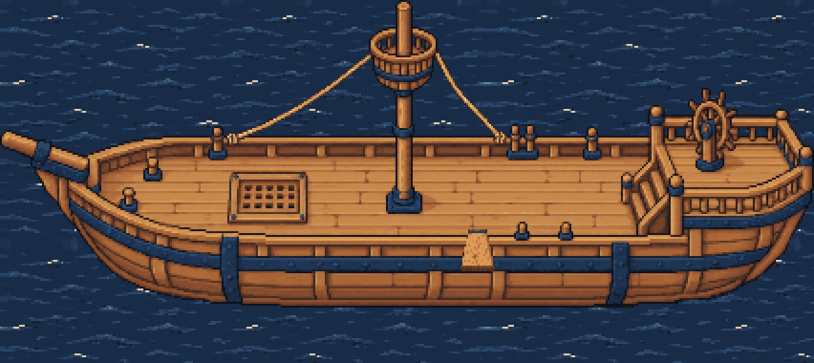

# Generated walk-the-plank board

**Verdict: usable.** `plank.png` is the game asset: one generated wood board, 18 × 22 logical pixels, RGBA with binary transparency, quantized to the exact shipped hull C palette. Its grain, knot, iron strap and dark end edge come from the generated source, not drawn primitives. Two built-in image-generation calls were used; the second was selected and mechanically cleaned.

## Placement contract

All coordinates are unscaled hull C pixels, origin at the upper left, positive Y down. Place the sprite's upper-left corner at **(241,120)**, scale **1**. Equivalently, place its local rail anchor **(9,1)** at **(250,121)**. Use nearest-neighbor sampling, no rotation or mirroring, and the same ship bob/transform as the near rail.

The board is physically horizontal. Its projected long axis points **down the screen toward the viewer**, matching `client/deck-plank.ts`; rotating it into a left-to-right beam would break the existing walk. It lies between the mast (around X=211) and first near-rail bollard (X=271). The metal strap is at the top/inboard end, the dark cut end at the bottom/outboard end.

| Meaning | Sprite-local | Hull C |
| --- | --- | --- |
| Open-deck approach, before stepping up | (9,-2), outside sprite | (250,118) |
| Rail / inboard walking anchor | (9,1) | (250,121) |
| Halfway along walking line | (9,10) | (250,130) |
| Last standing / jumping anchor | (9,18) | (250,138) |
| Front edge of top face, exclusive boundary | Y=19 | Y=139 |
| Dark front thickness and lower edge | Y=19..21 | Y=139..141 |
| Splash center after the jump | outside ship transform | (250,168), before existing drift |

The walking surface is the top face and its low iron strap, from local Y=1 through Y=18. The safe standing-foot region is X=5..12, Y=1..18 inclusive; keep the animation centered on X=9. The generated silhouette widens from 10 pixels at the inboard end to 18 at the tip. This is slightly wider at the tip than the code board's 16 pixels, but uses exactly its rail, approach and tip anchors. `manifest.json` gives the full row-by-row support bounds and coordinate conventions.

Draw above the near rail and below the walking sailor: the existing `PLANK_DEPTH = depthOf(null, 0) + 1` is the intended depth. The sailor on the plank uses `PLANK_DEPTH + 1`; the existing jump switches to the sea layer. The dark edge is baked into the sprite; there is no separate cast-shadow texture. Replace the old `plankPixels()` graphics when integrating; do not draw both.

## Files and verification

- `plank.png`: only the runtime sprite, transparent outside the board.
- `manifest.json`: dimensions, palette, hashes, placement, walking surface, provenance and cleanup recipe.
- `verification.json`: measured palette/alpha/bounds, connectivity, and support checks against the existing walking anchors.
- `source-generated.png`: untouched selected built-in output, with its original soft alpha, for provenance and rebuilding. It is not the runtime texture and is not palette-constrained.
- `prompts.json`: exact prompts for both calls; backend model was not disclosed by the tool.
- `plank-16x.png`, `detail-8x.png`, `hull-fit-native.png`, `hull-fit-3x.png`, `walk-fit-6x.png`: nearest-neighbor inspection images. Hull composites use the existing water tile and hull; walk panels show rail, midpoint and tip. These are offline fit evidence, not screenshots of a wired live feature.

Cleanup is mechanical block-median sampling into 18 × 22 cells, alpha thresholding and nearest-color mapping to all 48 opaque atlas colors, without dithering or repainting. Transparent RGB is zero. The detailed recipe and source hashes are in the manifest. The enlarged art's little iron rivets and knot become small clusters at game scale; grain is deliberately modest at 18 pixels wide. No human cleanup is required for integration, although an artist could refine those clusters later.

The original geometry projects the tip in front of the hull side in screen space, above the waterline, then jumps to near sea at Y=168. This asset preserves that geometry; it does not move the tip below the hull silhouette. Runtime wiring and visual verification in the live renderer remain integration work. All changes in this branch are confined to this asset folder; no client code, service manifests, installation or reload is included.
