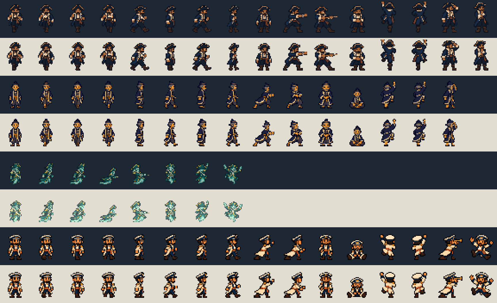
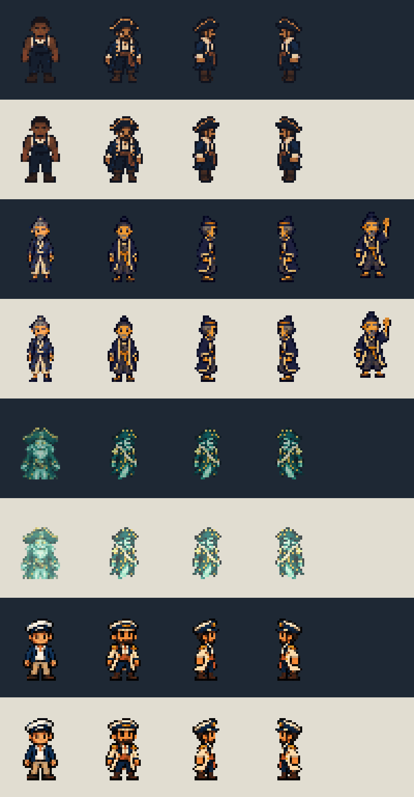

# A1 — the first mate on deck

Assets-only delivery for the approved needs-you design, 19 October 2026. Based on
`origin/main` at `e9d933e`, on branch `fm/fm-attention-firstmate-art`.

Four original first-mate identities were generated with the built-in
`image_gen__imagegen` tool, using the installed crew art as reference. Sources,
[exact prompts](prompts.json), [provenance](provenance.json), mechanical registration
and review sheets are retained here. All deliverables are under `docs/`: the pack
linter forbids unregistered images in `art/settings/`. No installed PNG, runtime
manifest, engine, layout or post position is changed.

| Setting | Original-size transparent sheet | Existing lane | Physical poses / pose names | Painted alpha | Colours used |
| --- | --- | --- | --- | --- | --- |
| Ship | [128×160](output/ship/firstmate.png) | `bosun` | 16 / 18 | 255 | 50 |
| Sakura | [480×36](output/japanese-ship/firstmate.png) | `indigo` | 15 / 15 | 255 | 31 |
| Ghost ship | [192×28](output/ghost-ship/firstmate.png) | `ghost-0` | 8 / 8 | 184 | 32 |
| Sky pirates | [512×36](output/sky-airship/firstmate.png) | `navy` | 16 / 16 | 255 | 30 |

The design's “15 poses” describes Sakura. The other current packs have different
contracts; these sheets preserve **every pose in the actual lane**, including
Ship's `side-idle` and `leaning` aliases. Ship uses the existing 4×4 grid of 32×40
cells; Sakura and Sky pirates retain 32×36 cells in one row; Ghost ship retains
eight 24×28 cells in one row. Tight rectangles, feet, roles and breathing metadata
are copied without changes into each companion `manifest.json`.

The identifying clothes are a navy coat and brass-edged bicorne on Ship; indigo
haori with cream edging, ochre sash and a low officer cap on Sakura; an ivory sash,
high collar and gold epaulettes on Ghost ship; and a cream coat with navy lapels,
peaked cap and coral sash on Sky pirates. All silhouettes use the native cast scale.

## Review

The contact sheet shows **Ship, Sakura, Ghost ship, Sky pirates**, top to bottom.
Each setting occupies two rows: dark background, then light. Poses run in the
native sheet order, left to right. Empty cells after Sakura and Ghost ship are
intentional; those packs have fewer than sixteen physical poses.



The comparison below uses the same setting order and background pairs. Columns
are **existing crew reference, new first mate standing, right-facing stand,
left-facing stand, optional raised hand**. The last column is populated for Sakura.



The source PNGs were visually checked for identity, pose order and transparency.
The final sheets were checked on both backgrounds at integer magnification.
The coat/cap contrast survives reduction; Ghost ship keeps its existing 184/255
translucency. These are asset contact sheets, not an installed Deck or wheel-position
test. Generated walk/climb drawings are distinct after reduction, but this task does
not claim hand-authored animation timing or an in-engine movement review.

## Standing directions and the optional pose

Every output folder also contains `standing-directions.png`: **right, left** in
two adjacent tight frames, at native scale. Left is an exact horizontal mirror
of the existing lane's new standing image, matching the renderer's current
mirroring convention. Its local foot X is mirrored too. The companion manifest
records both rectangles and anchors. Ship/Sakura/Sky pirates use `side-idle`;
Ghost ship uses its right-facing three-quarter `stand`.

Sakura also has [hand-raised.png](output/japanese-ship/hand-raised.png), a 32×36
transparent cell with its own recorded feet. It comes from the sixteenth generated
source pose. It does not replace one of the fifteen existing poses and has not
been added to the pack lane.

## Handoff contract

Each `output/<setting>/manifest.json` is an **asset handoff record**, not a
`firstmate.deck-setting` runtime manifest. It includes:

- The source pack and reference image SHA-256, existing lane name and exact lane data.
- Native image sizes and SHA-256 digests for registration.
- The fixed RGB palette, alpha convention, frame order, source crop and output bounds.
- Left/right standing rectangles and feet, plus Sakura's optional raised-hand anchor.

`firstmate.png` can be sampled with the named existing lane, using the setting's
normal scale and no coordinate changes. It is the reserved first-mate identity;
this delivery does not add it to the randomly assigned ordinary crew looks.
The separate build owns runtime image registration, reserved-role selection,
wheel placement and all needs-you behavior. Sources and review PNGs stay in `docs/`.

## Registration and verification

Node 24, using the repository's existing dependency-free PNG reader/encoder and
art helpers:

```powershell
node docs/attention-firstmate-art/build.mjs
node docs/attention-firstmate-art/verify.mjs
npm.cmd run lint:deck-packs
```

The offline build writes only this directory. It bounds each generated figure
inside its source cell, reduces with nearest-neighbour sampling and registers
about the inherited foot pivot. Narrow poses can require horizontal compression;
no silhouette is repainted. Source alpha below 180 is discarded; surviving pixels
use the pack's painted alpha, and transparent RGB is zero. Ship uses the established
64-colour palette. Each other sheet uses at most 32 colours selected from actual
existing cast pixels, fixed across every pose; no new RGB values are introduced.

[validation.json](validation.json) records successful checks for native dimensions,
frame containment, all 55 physical poses, identical lane/feet/roles/breathing,
sole or wisp baselines, transparent gutters, palette and alpha, distinct walk/climb
frames, left/right mirrors, digests and the 2 MB pack payload cap after adding the
new atlas. `npm.cmd run lint:deck-packs` passed **86 tests across three files**.

The main atlases add only 5,820 / 5,232 / 2,638 / 6,057 bytes respectively. The
build performs no plugin installation, reload, live daemon access or pack writes.
