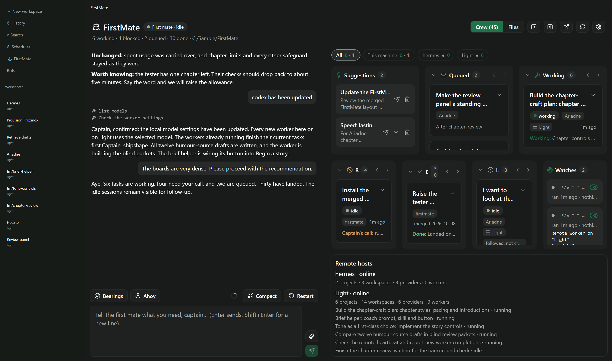
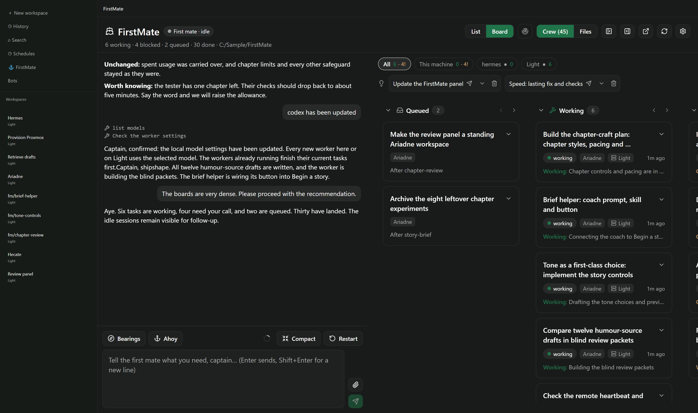
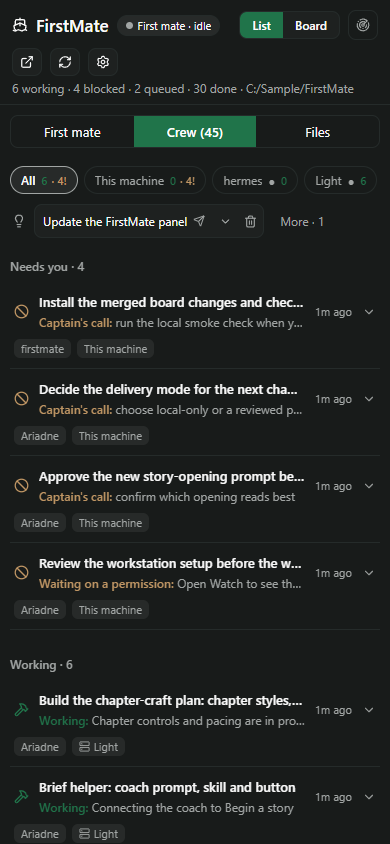

# Board density: List and Board

These renders mount the real `FleetSurface`, `MateChat`, `CrewCard`, task layouts, suggestion controls,
host tabs and `WatchList` through React Native Web. Paseo imports are stubbed: settings, RPCs,
timeline, icons and the host modal. No daemon or installed plugin is used. The sidebar and window
frame are only context around the actual panel.

The fixture contains **45 tasks**: 6 working (one waiting), 4 blocked (one permission), 2 queued,
30 done and 3 idle (one stalled, one followed session), plus 2 suggestions, 2 watches and 2 hosts.
Desktop captures are **2866×1694**, with the chat at **45%** of the available panel width and a 2×
desktop UI scale to reproduce the supplied screenshot's density. Phone captures are **390×844**.
All use Comfortable spacing and Paseo's default dark theme colours, projected from
[Paseo's theme](https://github.com/getpaseo/paseo/blob/main/packages/app/src/styles/theme.ts) and
[plugin theme mapping](https://github.com/getpaseo/paseo/blob/main/packages/app/src/plugins/theme.ts).
All content is synthetic; local paths and host ids are samples.

Before renders load the client/shared sources directly from **6264aa7**, main after PR #6 and before
this change, using `git show` during bundling. After renders use the worktree's components. Both
receive the same sample data and host stubs.

| View | Desktop | Phone |
| --- | --- | --- |
| Before: main | [2866×1694](before-wide.png) | [390×844](before-phone.png) |
| After: default List | [2866×1694](after-list-wide.png) | [390×844](after-list-phone.png) |
| After: Board | [2866×1694](after-board-wide.png) | [390×844](after-board-phone.png) |

Additional desktop captures show [List's collapsed Done count](after-list-done-wide.png) after
scrolling down, and [Board's Done and Idle columns](after-board-end-wide.png) after scrolling right.








To reproduce from this worktree, with Node and Microsoft Edge installed:

```sh
npm ci
npm ci --prefix docs/board-list
node docs/board-list/render.mjs
```

On Windows PowerShell, use `npm.cmd` if script execution policy prevents `npm.ps1`. The script bundles
the two revisions, serves them on an ephemeral loopback port, captures each viewport using headless
Edge and closes the browser and server. Generated bundles and scroll measurements stay in ignored
`.generated/`; only the harness and PNGs are committed. Use a separate worktree if comparing against
another before revision; the checked-in baseline is intentionally fixed.

The harness also asserts row counts, Done expansion, the full-title tooltip, keyboard expansion,
local and remote steer targets, suggestion expansion/overflow, the Watches dialog, host filtering,
folded Board columns and a non-wrapping Done count. List has no scrolling descendant inside its
one task scroll container, including when Done expands. The default main render has seven separate
overflowing vertical areas at this desktop scale; List has one. Board retains vertical scrolling
per tall column and a horizontal scroll across columns, with the full height available to each.

Native iOS/Android and live daemon integration are not exercised by this browser harness.
