# Queue layout review

Generated on 2026-10-30 and refreshed on 2026-10-31 with the real FirstMate chat
surfaces and synthetic host APIs.
The before revision is e8a1c0810805b9e05c85cce20d275f52c14917d9.

| Surface | Before | After |
| --- | --- | --- |
| Main chat, dark desktop | 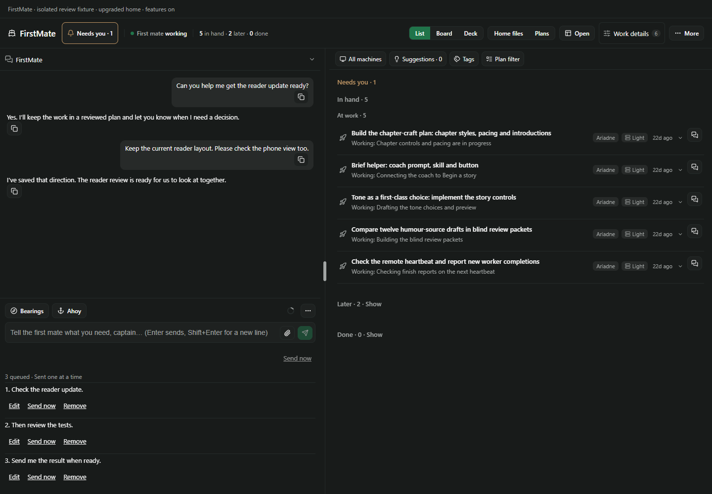 | 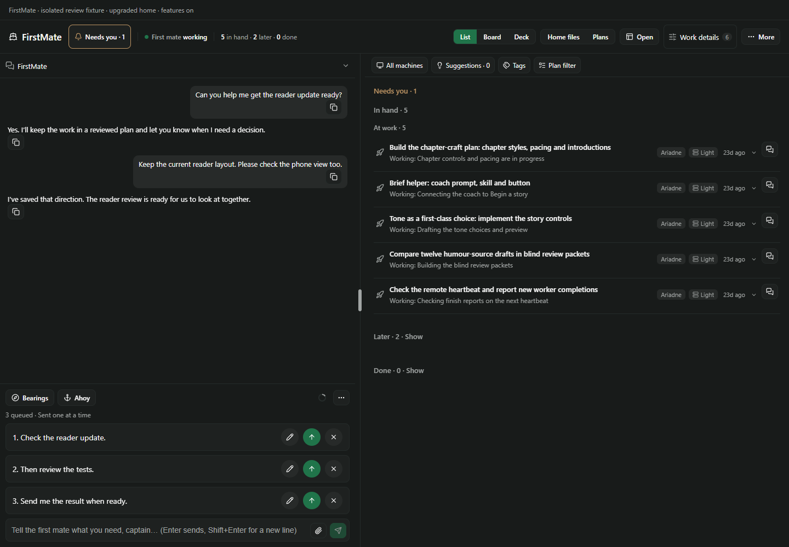 |
| Project mate, light phone browser | 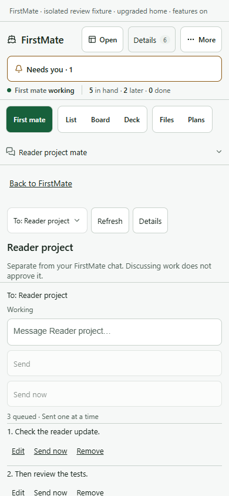 | 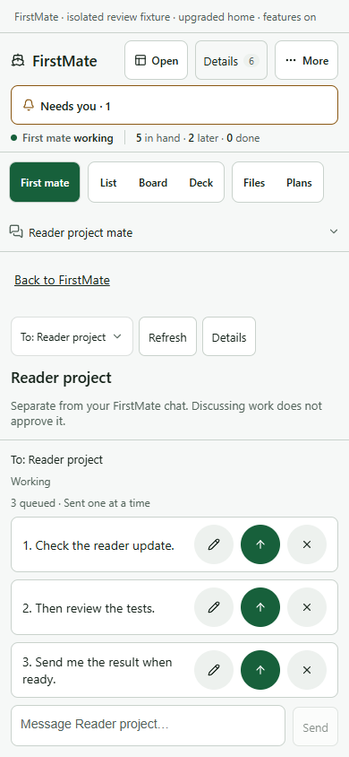 |

Paseo source reference beside the real shared FirstMate queue:

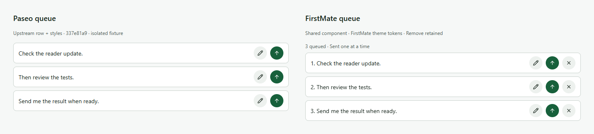
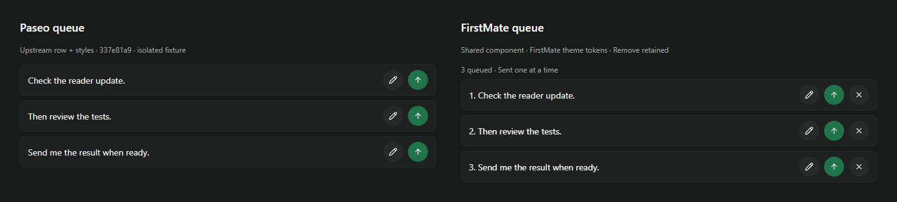

The reference renders the upstream `QueuedMessageRow` and its queue styles from
Paseo revision 337e81a9c6d4551dbcede5930c21408776d06b1b in isolation, using the same
host palette. It is not a live agent session. FirstMate keeps its queue count,
positions and Remove action, and uses 44px action targets on compact layouts.

Regenerate all theme/width/surface checks with `node docs/chat-queue/render.mjs`.
Generate the source comparison with `node docs/chat-queue/reference.mjs /path/to/paseo`.
Both tools write only to ignored `.local/chat-queue/ui/`; these selected review
images were copied here so PR screenshots remain viewable without a browser upload.

## Short-viewport correction

The independent review of b06dbbd found that three compact queue rows could push
input and Send below short viewports. The queue and Home footer now yield height;
scoped context/review/queue content scrolls above a fixed input-and-Send row.
Both chats reserve the input and Send row, then allow context and queue content
to scroll within the remaining height. A further 390x468 Home case checks that a
wrapped host header or slightly shorter pane still fits a complete 44px action.
Queue card spacing, action names, keyboard behavior and delivery remain unchanged.

| Short viewport | Reviewed head b06dbbd | Corrected layout |
| --- | --- | --- |
| Home, 320x640, three queued | 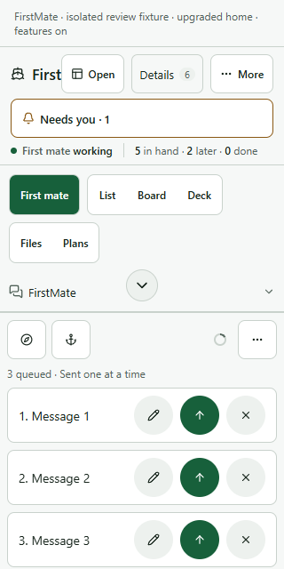 | 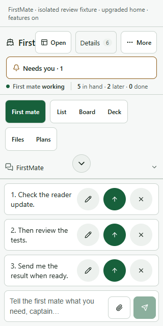 |
| Project, 390x480, three queued | 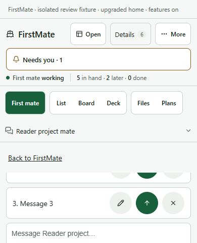 | 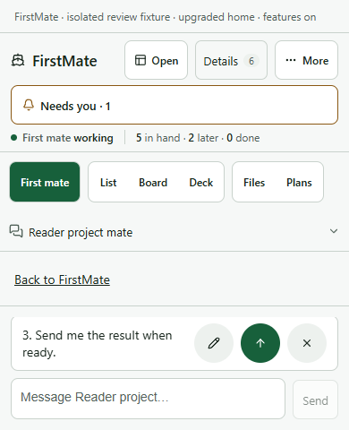 |

The project capture scrolls the bounded upper area to show queued work; input and
Send remain outside that scroller. Ten-message queues in both themes and surfaces
are also checked, including full visibility of the focused queued action:

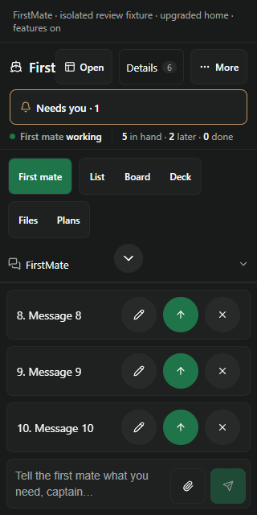
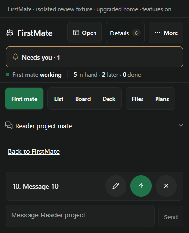

[Recorded short-viewport geometry](short-results.json) includes empty, three, ten
and emptied states, plus the independent review's original and rerun confirmation
measurements. The accepted status change from PR183 is integrated unchanged; no
status implementation is duplicated in this correction.

The first integrated head d7c5c54 failed both hosted Ubuntu runs at 390x480:
the host fixture's header wrapped onto a second line, leaving a 34px inner
queue viewport for a 44px action. Windows was cancelled after the Ubuntu
failure by the matrix's default fail-fast behavior. The bounded Home context
scroller removes that dependence on host header height; the 390x468 regression
failed locally before this correction. The harness now covers 26 cases across
both themes and chat surfaces, with three and ten queued messages. The extra
390x468 stress is Home-only; both surfaces retain 320x640 and 390x480 checks.

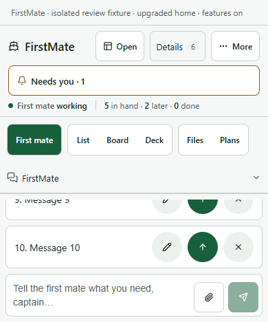
