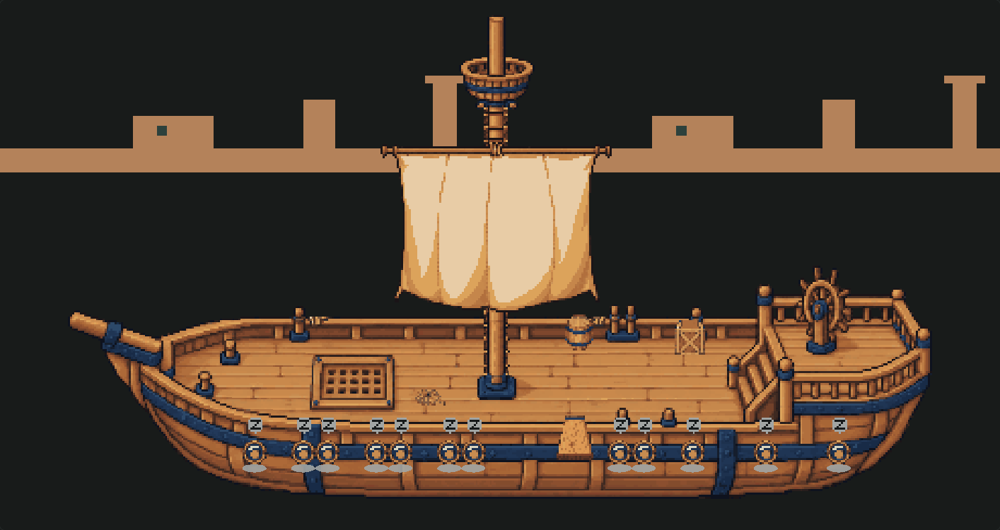
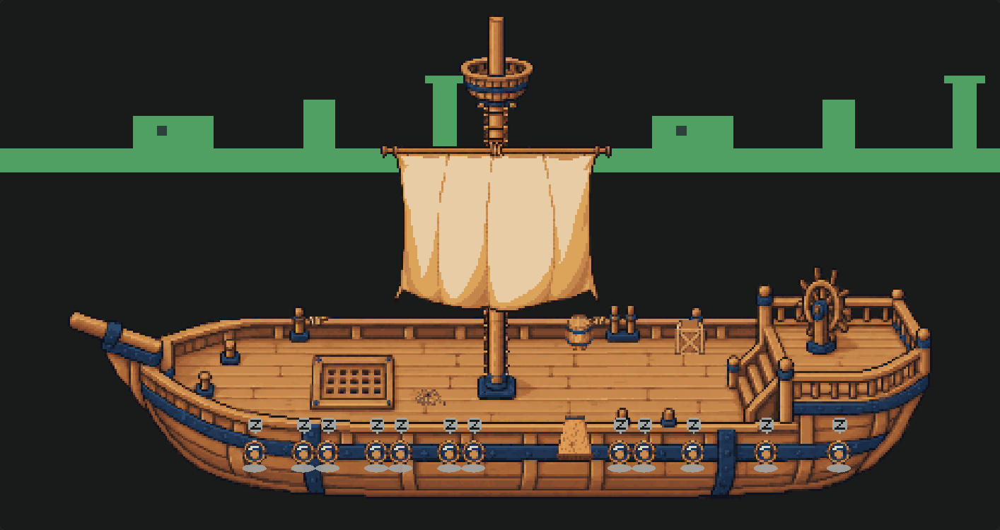
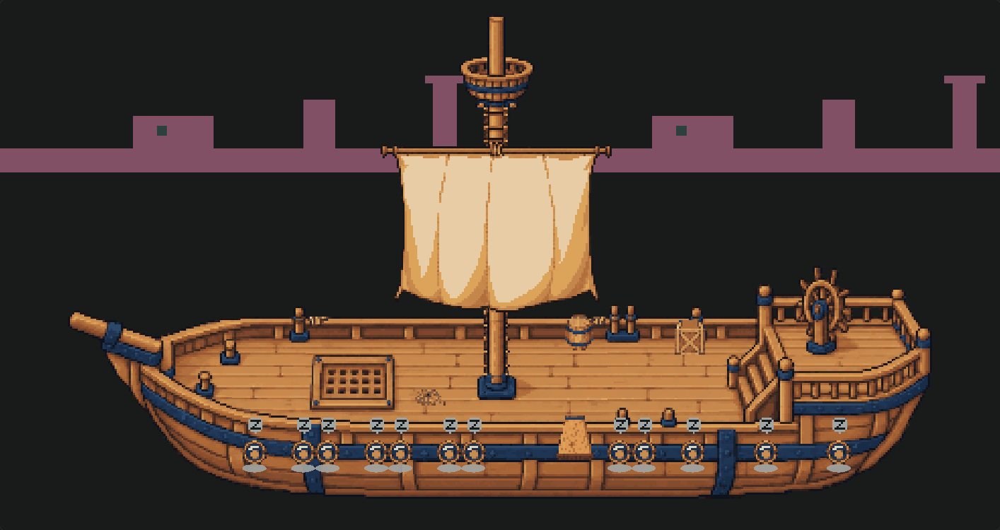
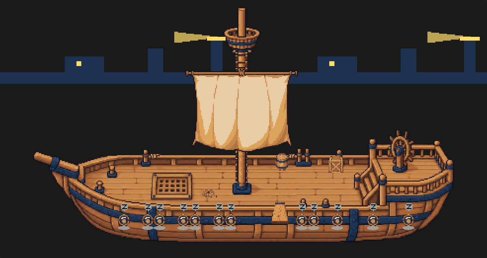
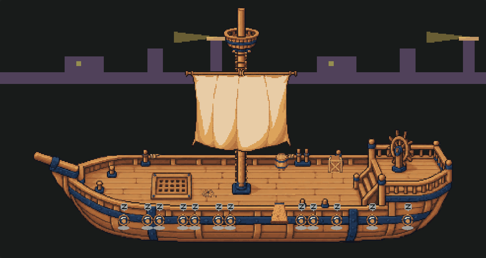
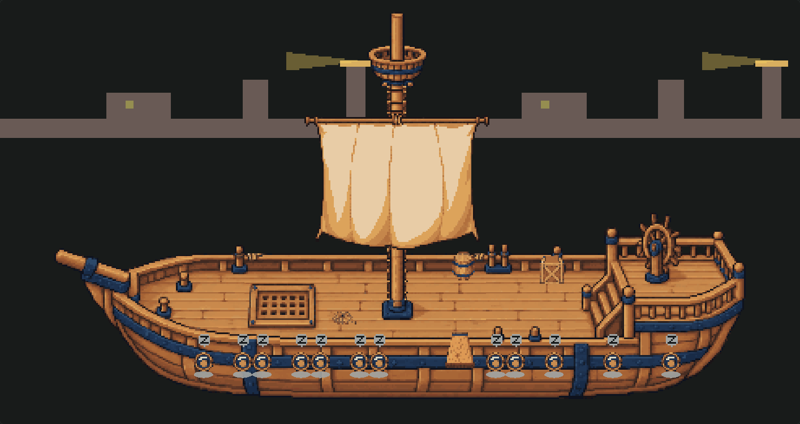
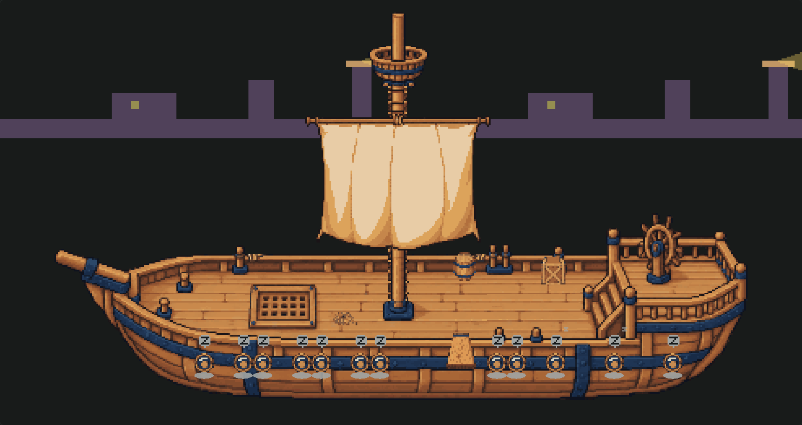
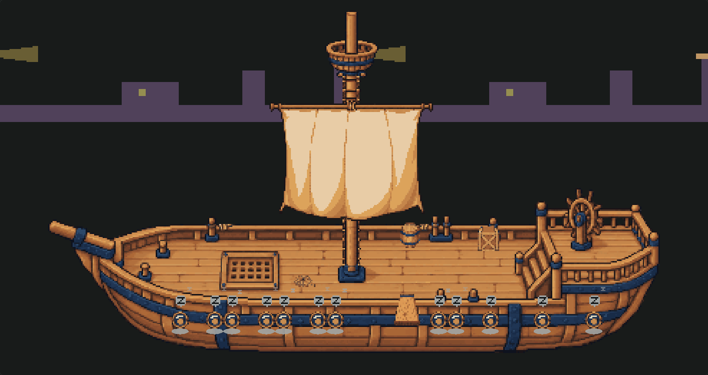

# Phase-strip engine review

`phase-strip@1` adds day-phase art to the existing strip placement, frame and drift path.
The required base, optional phase sets, deterministic missing-set resolution and motion policies
are specified in the [authoring contract](../deck-settings/authoring.md#phase-strips).
No installed manifest or PNG changes. The voyage remaster remains a later pack PR.

The [fixture](../../test/fixtures/phase-strip/scene.json) uses a reproducible 1,631-byte atlas of
schematic blocks, with four coast colours and a separate three-frame, 16-pixel-high beam strip.
It is test data outside `art/`, never discovered or shipped. The established render harness injects
its ambience through the test RPC response and retains Ship's stage/cast for context.

| Dawn | Day |
| --- | --- |
|  |  |
| Dusk | Night |
|  |  |

| Dusk to night, halfway | Night to dawn, halfway |
| --- | --- |
|  |  |

| Fixed dusk blend, moving | Two seconds later |
| --- | --- |
|  |  |

## Checks

- Typecheck passes. Full suite: **1,174 passed, three skipped, 99 files**, using
  `npm.cmd test -- --maxWorkers=2`.
- [Ship gate](ship-gate.json): **81/81 pixel-identical** against main `b09b3b0`, including
  full/lite/still, day/night, storm, focus, crew motion and departures. No masks or new expected changes.
- [Sakura and Sky pirates](unchanged-packs.json): exact matching SHA-256 canvas captures before/after
  at fixed noon, reduced motion, through the compiled-client renderer.
- [Compiler/Hermes](compile-results.json): both complete plugin clients parse with React Native
  0.81's Hermes. Client growth: **2,815 bytes**; Pixi and art remain served separately.
- [Fixture browser assertions](render-results.json): four anchor phases, both half-blends, fixed-blend
  drift, still holding frame/offset, and reduced motion enabled during movement. No browser errors.
  Opaque coast RGB matches the expected interpolation exactly; semi-transparent beam pixels match
  within one byte of expected rounding, fade both directions, and disappear at unlit anchors.
  [Before](still-before.png), [after two seconds](still-after.png), and
  [after enabling reduced motion](reduced-after-motion.png) have the same screenshot hash.
- Generic tests cover strict fields, phase/image/clock references, increasing spans, frame count,
  dimensions and crops, fixture hashes/budget, circular nearest-phase fallback and tie breaking,
  complete phase/base failures, identical-set coalescing, invalid time, midnight wrap, distinct frame
  and drift clocks, wraparound, synchronized beam crops, lite run/freeze/hide, still first-frame/hide
  and filter disposal.

The engine uses a built-in alpha filter to composite the weighted premultiplied phase sets once.
Ordinary source-over layering would dim opaque land or leave transparent beam ghosts. The filter is
viewport-clipped and released with the scenery; it adds one offscreen pass per opted-in element.
Long production panoramas still need the later pack's full-lap/resize profiling. No pack-controlled
filters, shader code, new timers, route state or setting-id branches are introduced.

The gate compiled the working tree before its first source commit, which is why its recorded
`compiledBranch` still says `b09b3b0`. The final source was recompiled at **`4e2df4f`**;
[bundle-identity.json](bundle-identity.json) verifies its complete client bytes have exactly the same
SHA-256 as the client used for the 81-shot gate and unchanged-pack captures. The fixture was then
rendered again from that final compilation. Later commits only record harness/evidence files.

These are synthetic browser fixtures, not an installed desktop or device test. No plugin was installed
or reloaded.

## Reproduce on Windows

```powershell
npm.cmd ci
npm.cmd ci --prefix docs/board-list
npm.cmd run typecheck
npm.cmd test -- --maxWorkers=2
node docs/ship-deck-canvas/compile.mjs
$env:PHASE_STRIP_REVIEW = '1'
node docs/deck-settings/render.mjs
Remove-Item Env:PHASE_STRIP_REVIEW
node docs/deck-phase-strip/check-packs.mjs
node docs/deck-settings/gate.mjs
```

The fixture pixels can be rebuilt with `node test/fixtures/phase-strip/build.mjs`.
The harness reads screenshots and public canvas attributes; it adds no Pixi-internals observer.
