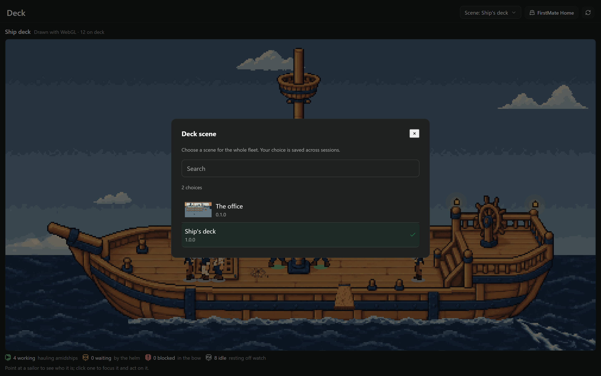
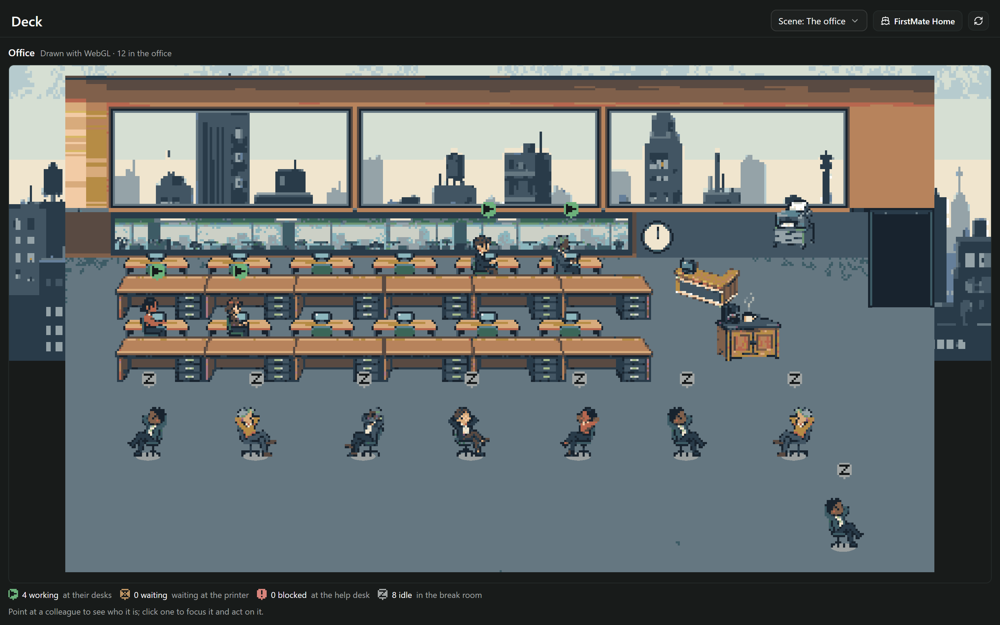
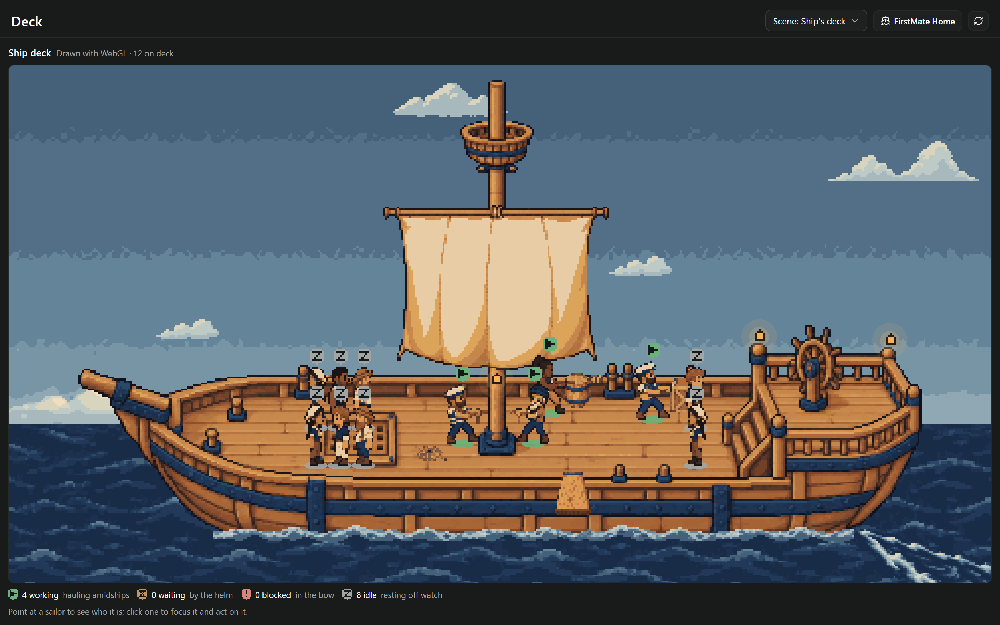

# Deck scene switcher

Investigation on `9693516` found both installed packs resolvable by the daemon. Office already rendered
through the compiled plugin with `deckSetting=office`, including its own caption, cast and scenery.
There was a user-facing picker in Settings > Plugins > FirstMate > Deck setting, but none beside the
scene. No rendering migration fix was needed. This branch was subsequently rebased onto `1a473e1`,
which moved Deck into a workspace panel.

The Deck workspace toolbar now has **Scene: Ship's deck / The office**. It lists the packs discovered
by the engine, includes previews and incompatible-pack reasons, and saves the same global
`displaySettings.deckSetting` document as plugin settings. It preserves other fields and supplies the
current document revision. While saving, it rejects duplicate choices; a failed save reports an error
and leaves the drawn choice alone. The host's saved value drives both the toolbar and scene, including
changes from another client. No renderer or pack data changed.

## Reproduce

```powershell
npm.cmd ci
npm.cmd ci --prefix docs/board-list
npm.cmd test -- --maxWorkers=4
npm.cmd run typecheck
npm.cmd run lint:deck-packs
node docs/ship-deck-canvas/compile.mjs
$env:CHECK_SWITCHER='1'
node docs/deck-settings/render.mjs '?setting=ship'
$env:MASK_TOOLBAR='1'
node docs/deck-settings/gate.mjs
```

The render harness runs the real compiled client and server pack readers in Edge, with host APIs
stubbed. The switcher check uses browser storage to stand in for the persisted host settings document;
it does not modify a running Paseo install. It exercises ship → office → ship through visible buttons,
reloads after both saves, failed saves, external settings updates, single-canvas lifetime, and control
visibility at 1100 and 1440 pixels. Results are in [results.json](results.json).

The ship gate compares all 81 existing shots against `origin/main`, masking only the intentionally
changed toolbar. The canvas and everything below the toolbar remain a full pixel comparison, in the
same viewport coordinates. It caught a one-pixel header growth in the first implementation; the inline
picker now uses the existing 28-point toolbar height. See [gate results](../deck-settings/gate-results.json)
and [compiler results](../deck-settings/compile-results.json).

Self-review covered global persistence, document revision conflicts, preservation of unrelated settings,
duplicate saves, pack compatibility, scene remounting, toolbar geometry and the client bundle boundary.
The first unbounded test run hit the existing remote-helper background-poll race; bounded concurrency
passed the full suite without changing its expectations or remote code.




