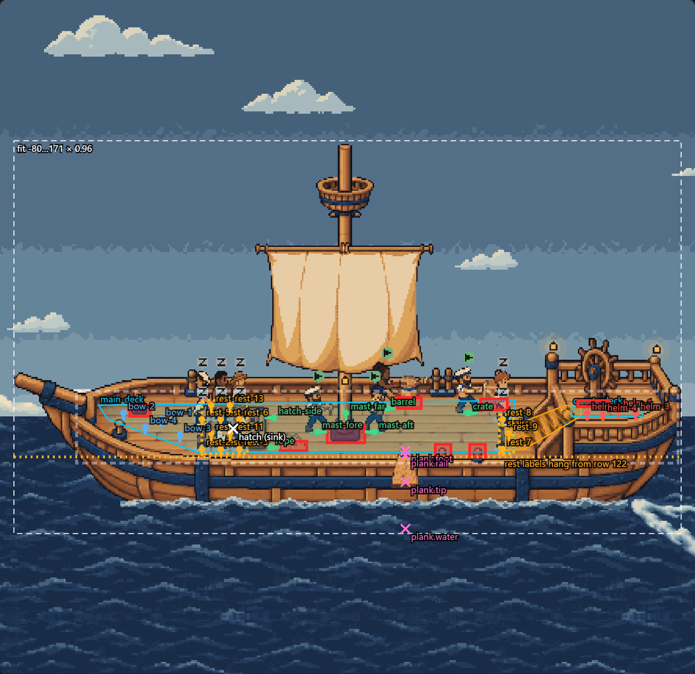

# The deck as a scene engine and setting packs: the migration's gate

The Deck is being split into a setting-independent **scene engine** and the ship as a pure-data **setting
pack** (`art/settings/ship/setting.json` and the PNGs it names), in nine reviewed steps. Every step has to
draw the ship exactly as main does. This folder is the check that holds each step to that.

## The gate: the ship, pixel for pixel, against main

```sh
npm install --prefix docs/board-list     # once: esbuild, Playwright, react-native-web
node docs/ship-deck-canvas/compile.mjs   # Paseo's compiler on this checkout and origin/main; Hermes; no `class`
node docs/deck-settings/gate.mjs         # needs Edge
```

`gate.mjs` takes origin/main as files, answers each checkout's deck RPCs from that checkout's own server code
and art, and renders each compiled bundle in headless Edge through one host (`host.jsx`, `stubs.jsx`) that
imports neither checkout's deck code — so the two can differ in every module and every RPC and still be
compared. Each scenario is rendered for both at the same moments and the screenshots, the whole window, are
compared pixel for pixel:

| Scenario | What it covers |
| --- | --- |
| `still-*` (reduced motion) | noon dark at 2× and light, night, dawn, dusk into night, eight working (still calm), all idle (the rest area's crowd), the feed lost (grey) |
| `moving-noon` | a minute of the sea, foam, wake, sail, bob, sway, clouds and gull on Playwright's fake clock, at 2× |
| `moving-storm` | eight working: the storm's variants, spray and overcast every five seconds for two minutes, and the first four lightning flashes as they show |
| `moving-night` | the night sky moving |
| `moving-crew` | state changes and the walk, a crewmate climbing out of the hatch, one done and walking the plank (shark and splash), one closed, at 2× |
| `focus` | a sailor focused from the keyboard, the camera's zoom and the way back out |
| `lite-software-renderer` | SwiftShader: the lite plan, at its own pace |

The deck draws only from its clocks, never `Math.random`, so a render is deterministic: `CONTROL=1` renders
main twice and compares it with itself first, and it is identical. Now and then a GPU rasterizes one edge pixel of a frame
differently (seen once, a lantern's edge at 1×), so a scenario that differs is rendered again on both sides: a
difference that does not come back is recorded under `flakes` and does not fail the gate, one that does fails it
(`RERENDER=0` turns this off). `ONLY=<names>` renders some scenarios;
`SAVE=1` keeps the branch's shots in `docs/ship-deck-canvas/.generated/gate/shots/`; on any difference the
main, branch and diff images go to `docs/ship-deck-canvas/.generated/gate/`. Results are in
[`gate-results.json`](gate-results.json), and the compile's in [`compile-results.json`](compile-results.json).

## Step 1 — the package diet

`art/` is in the package's `files`, so everything under it went to every install: 155 files, about 11.5 MB, of
which 63 files and about 300 KB are what the deck serves. The other 92 — generation sources, prompts,
provenance, verification records, contact sheets, fit previews and review renders — moved to
`docs/ship-deck-art/` under the same relative paths (`docs/ship-deck-art/README.md`). The three tests that
compare the served art with its own generation records read them there. `server/ship-deck.test.ts` now fails on
any file under `art/` that no served manifest names, or on a name with no file, and on `art/` passing 400 KB.

Gate: every shot pixel-identical to main. The client bundle differs from main's only in five comments that
name the moved READMEs (+25 bytes); Hermes parses it, and it has no `class`.

## Step 2 — the format, the ship as a pack, and serving it

- **The format** is `shared/deck-setting.ts`: `firstmate.deck-setting`, format 1, as zod, with
  `settingProblems` — every image, pose, zone, exit, mark, effect, clock, channel, day phase and element a manifest
  names must be there, ids must not repeat, and `requires` must equal what it uses (`capabilitiesUsed`) — and the
  closed behaviour catalogue, `ENGINE_CAPABILITIES`. It is the report's §3, settled against the code: a part's
  `cutout`, `replacesPiece` and `fallback` say how the tall mast and the hull's own masthead stand in for each
  other; a piece's baseline can be `{ over: "near" }` (the plank); a choreography segment's `layer` and `layerAt`
  say when a worker steps in front of a piece; effect keys `alignX` a named point over a mark (the shark's mouth);
  the lanterns' glyph, glow and flicker waves are data; and the sky's overlays say `night` or a curve, `dayOnly`,
  and which overlays hide them (`hiddenBy`).
- **The ship is `art/settings/ship/`**: `setting.json` and the 60 images it names, moved from `art/ship-deck/`
  under the same paths. `docs/settings/ship/from-legacy.mjs` wrote the manifest once from the three manifests the
  deck was served (now records in `docs/ship-deck-art/legacy/`) and the constants in the deck's code, so every
  number came from where the deck had it. `client/ship-pack.test.ts` holds it equal to both while they last:
  read back as the old manifests (`legacyViews`) it is them exactly, and every constant it replaces — anchors,
  polygons, the plank's timeline, fidgets and breath sampled against `idleMotion` and `breathSink`, the bob and
  sway against `shipBob` and `mastSway` at every heave, the lanterns' flicker bit for bit — is what it holds.
- **Two RPCs replace three**: `firstmate.deck.settings` lists the packs, `firstmate.deck.setting` sends one whole
  (`server/deck-settings.ts`; contracts in `shared/deck-rpc.ts`). `firstmate.deck.art`, `.environment` and
  `.extras` are gone, with their manifests; the client and server bundles ship together, so the swap is atomic.
- **The client** fetches the pack once a session by id, decodes each image on its own, and reads it through
  `legacyViews` into the art, environment and extras the engine already draws from (`client/deck-mount.ts`'s
  `packArt`), with the old fallbacks: no backdrop, no deck; any of the sky and still sea missing, a plain sea;
  any extra missing, drawn without it. The format's rules stay on the server: the client bundle is 4.5 KB
  smaller than main's.
- **The pack linter**, `test/deck-settings.test.ts`, runs over every pack in `art/settings/`; the floor, zones
  and marks checks join it in step 3.

Gate: every shot pixel-identical to main.

The per-feature harnesses under `docs/ship-deck-*/` drove the RPCs and modules of their own PRs, and are kept
as those PRs' evidence; they are not maintained through the migration. This gate is how the deck is checked.

## Step 3 — the stage, floor, zones and portal marks from the pack

- **`client/deck-stage.ts`** compiles a pack's stage once (`compileStage`): its size and fit box, the floor, the
  zones each activity state sends a worker to (`zoneOf`), the entry, the exits and their marks, the props. The
  compiled stage rides with the art (`DeckArtImage.stage`) into `startDeck`; there is no module-level "the setting".
- **`client/deck-geometry.ts`** is any setting's floor: `createFloor` from the pack's areas, obstacles (props'
  footprints included) and grid, and `walkable`, `areaAt`, `findPath`, `sharedSpot` and `restSpot` take it.
  The grid and the open points are cached on the floor, not the module. An area marked `spill: false` (the ship's
  stairs) is crossed but never crowded onto.
- **The crew** (`createCrew(stage, …)`) reserves posts in its state's zone — `ordered` zones fill in order,
  `nearest` ones by distance (in order when placed at once) — and overflows `beside` a post or `pack`s into the
  zone's areas, at the zone's spacing; it rises at the entry, sinks at the hatch exit, queues at the plank's `foot`
  mark (`queue.spacing`, new in the format), and walks at the floor's pace.
- **The plank's marks** are the pack's (`plankExit` and `plankPixels` take them); its timeline is still code
  until step 7, its code-drawn board until step 5. **The scene** carries no size; **the fit** is `deckBox(stage, …)`
  with the pack's fit box and margin; **the hover label** hangs from its zone's `labelFloor`; **the focus shot**
  sizes to `stage.actorHeight`; the gull, the sky and the code wake take the stage's width.
- **Deleted from code**: `DECK_WIDTH`, `DECK_HEIGHT`, `DECK_PROPS`, `WALKABLE`, `OBSTACLES`, `ANCHORS`, `HATCH`,
  `REST_AREAS`, `REST_SPACING`, `PLACES`, `WALK_SPEED`, `PLANK`, `PLANK_SEA_BOTTOM`, `REST_LABEL_ROW`,
  `FOCUS_FIGURE_HEIGHT`, the fit's 0.96 and the grid's bounds. `client/ship-pack.test.ts` lost their checks; the
  ship's own tests read them off the pack.
- **The pack linter gained the floor** (`test/deck-settings.test.ts`, from `deck-motion.test.ts`'s pixel checks,
  for any setting): every walkable point on the backdrop and hidden behind a front piece only on a `spill: false`
  area; every post, the entry, every exit and queue on open floor; everything reachable from everything else and
  never far round; a packing zone's posts in its areas and apart, no other zone's there; the fit taking in every
  part, the flyby's whole sprite and every effect where its choreography puts it.
- **The debug overlay**, `overlay.mjs`: the deck drawn still, and over it the pack's floor, obstacles, posts by
  zone with ids and facing, overflow areas, label floors, the entry, every exit's marks and the fit box, placed
  with the deck's own fit ([`overlay-ship.png`](overlay-ship.png)). Run after `compile.mjs`.



Gate: every shot pixel-identical to main. Client bundle +115 bytes; Hermes parses it; no `class`.

## Step 4 — the cast from the pack

- **`client/deck-cast.ts`** compiles a pack's cast once (`compileCast`): each lane's poses with their frames and
  feet, the looks (each with its image and lane, and whether it must draw), and the roles the engine asks poses
  of — `stand`, the front and side walk cycles with their `stepMs` and `rise`, and each activity state's settled
  pose, mirrored by facing, by the worker's seed, or never. **Poses are an open set**: the engine never names one.
- **Fidgets are keyframes** (`fidgetAt`): a loop of whole-pixel offsets per state, out of step by the worker's seed,
  `towardFacing` turning a step the way it faces. **The breath** (`breathSink`) sinks the top rows of a worker
  settled in its state. **Looks** are handed out by identity over those whose image arrived (`availableLooks`,
  `lookFor`), and each is drawn with its lane's frames from its own image.
- **The crew** (`createCrew(stage, cast, …)`) and the renderer ask the cast: `settledPose`, `walkPose`, `fidgetAt`,
  `breathSink`, `standing`; the plank's sailor is cropped at the stand pose's rows. **Hit-testing and badges**
  (`client/deck-hover.ts`) read the cast's frames; a figure carries its look's `lane` (it was `outfit`). **Props**
  are drawn from the stage's own sprites and feet; **the pack's images** reach the renderer by id
  (`DeckArtImage.images`).
- **Deleted from code**: `SAILOR_POSES`, `SAILOR_OUTFITS`, `DECK_PROP_NAMES`, `STATE_POSES`, `STEP_MS`, the walk
  cycles, `idleMotion`, `looksFore`, `BREATH_ROWS`, `BREATH_MS`, `FRONT_ROWS`, `ATLAS_LOOKS`, `crewLooks` and
  `lookLane`; the legacy views lose the atlas's crew and props and the extras' looks.
- **The pack linter** packs two dozen workers into each packing zone with every other zone's posts held, and holds
  each in its areas, in sight, clear of the crew at work and in the pointer's reach — `deck-motion.test.ts`'s
  crowd check, now for any setting.

Gate: every shot pixel-identical to main (which has the re-angled wake). Client bundle +1,424 bytes; Hermes parses
it; no `class`.

## Step 5a — the sky, its overlays, the lightning, the clouds and the gull from the pack

- **`client/deck-ambience.ts`** compiles a pack's ambience once (`compileAmbience`, in `packArt`): which elements are
  drawn and in what order, from which images. **Each element stands alone**: one whose images did not all arrive is
  left out by itself, and so is what is drawn in it or under it — an overlay or drifters in a backdrop's space, a
  flash under drifters — or what `needs` it; a `fallback` is drawn only in place of the element it stands in for.
  Drifters lose a sprite at a time (its image, or its slot masks, did not arrive), and a sprite's variant on its own.
  `missing` names what was lacked, and the mount warns once per image. So a sky without its dawn is no sky, no stars,
  overcast, clouds or lightning — and the gull still flies; before, any of the sky, the still sea and the gull missing
  was a plain sea and nothing else.
- **Motion by the element's own word** (`elementMotion`): full motion runs everything; on a software renderer and
  under reduced motion an element runs, holds still or is not drawn as its `lite` and `still` say. The ship's were
  set to what the deck did (`MotionPlan.ambient`), so nothing moves differently.
- **The behaviours read the pack**: `backdrop-cycle@1` — the day's blend from `dayCycle` (`dayBlend`: its phases,
  `fadeMinutes`, `night` and `fallback`), placed by its `placement` (`backdropPlacement`), tinted towards its `tint`
  by its level (`tintToward`, `levelAt`; the ship's is the `mood` channel); `overlay@1` — `night`, or a curve, by day
  only, in its space's tint, hidden by others as far as they show; `drifters@1` — lanes, margin, top, palettes,
  sprites and speeds, on its clock (`clockOf`); `flash@1` — frames with their times and alphas, size and anchor, under
  its drifters; `flyby@1` — slot, chance, start, speed, margin, rows, wobble, flap, poses, glide, night limit and
  how many at once (`flybysAt`, `flybyPose`). A flyby that takes longer than a slot to cross is followed for as many
  slots as it needs.
- **Deleted from code**: `SKY_FADE_MINUTES`, `skyHorizonRow`, `skyBlend`, `skyPlacement`, `gullPose`, `gullsAt`,
  `GULL_SLOT_SECONDS`, `GULL_SPEED`, `GULL_MARGIN`, `GULL_LOWEST`, `CLOUD_LANES`, `CLOUD_MARGIN`, `CLOUD_TOP_MIN`,
  `drawnClouds`, `drawnFlashes`, `STORM_SHADE`, `moodTint`, `SKY_PHASES` and `GULL_POSES`; the legacy views lose
  the environment's sky and gull and the extras' clouds, mood overlays, flashes and cloud variants. Labels in the
  scene graph come from element ids (`sky:under`, `sky:overcast`, `flash:lightning`, `clouds:wisp`, `gull`).
- **Fixed on the way**: in a flash of three or more frames, each frame from the second on ended at the wrong time (the
  loop added the time of the frame after next); the ship's lightning has two frames, so nothing it draws changes.
- Until 5b moves the sea, the foam and the wake onto the pack, the still sea is still the legacy view's, and the
  ambience's back slot is drawn behind all of the sea and its front slot in front of it.

Gate: every shot pixel-identical to main. Client bundle +5,045 bytes; Hermes parses it; no `class`.

## Step 5b — the sea, foam, wake and spindrift from the pack

- **`compileAmbience` takes every kind now**: tiles, strips and cycles join the sky's elements. Each needs all its
  frames; its variants are left out one at a time when a frame did not arrive or they do not line up — as many frames
  as the element, each its frame size. The ship's still sea and foam are what they always were in the pack, the
  animated ones' `fallback`: drawn only in their place, and **under their name** (`AmbientElement.place`, so the
  scene graph's `sea:back` is the sea whichever art fills it). **A tile is never a hole**: one with neither its own art
  nor its fallback's is filled flat with the pack's `fallbackFill` across its bands (`flats`).
- **The behaviours read the pack**: `tile@1` — frames on its clock, repeated both ways in each band from the band's row
  on one tile origin (the second band's first row cut to line up), drifting whole pixels at `drift.pxPerSecond` on its
  clock; `strip@1` — frames repeated within `span` from `top`, cut into as many crops as the span can need; `cycle@1` —
  frames at `at` less `anchor`, at its opacity's level (the wake's the `wake` channel, the spray's a curve). Each in
  its slot by `order`, under its variants, holding its first frame and drift on a lite or still deck as it says.
- **Deleted from code**: `HORIZON`, `WATERLINE`, `SEA_FALLBACK`, `FOAM_SPAN`, `FOAM_TOP`, `FOAM_HEIGHT`,
  `environmentComplete`, `drawnWater`, `drawnVariants`, `variantsOf`, `waterFrame`, `waterDrift` and `wakeTopLeft`;
  the legacy views lose the environment's still sea and foam (the whole environment view) and the extras' animated
  water, variants and cycles. The atmosphere's clocks are read by the names the pack gives them (`clockOf`).
- **The code wake stays one more step**: where the pack's wake did not load it stands in its place (`codeWakeSpot`,
  the front cycle whose opacity reads a channel), with its own waterline, until 5c retires it.
- **What changes, and only where art fails to load**: before, the animated water stood in front of a still sea that
  had to load whole, so a missing still tile was a flat sea under everything even with the animated sea there. Now
  each element falls back on its own: the animated sea draws without the still one, the foam with the sea flat. The
  spindrift's label is its id (`spindrift`, was `cycle:spindrift`), and the sea's bands are `sea:back` and `sea:front`
  (were `sea:far` and `sea:near`).

Gate: every shot pixel-identical to main. Client bundle −5,189 bytes against main; Hermes parses it; no `class`.

## Step 5c — the stage's parts, pieces and lights from the pack; the plank and wake drawn in code retired

- **`client/deck-parts.ts`** compiles a pack's stage furniture once, in `packArt` (`compileParts`): which **parts** are
  drawn, under the ambience's rules (`resolveDrawn`, now shared) — the ship's tall mast, its topmast (which `needs`
  the tall mast, and falls back to the hull's own masthead, drawn in the topmast's `place`), and the sail (which
  needs the tall mast); what the backdrop is cut round (the drawn parts' `cutout`s, bounded); the **pieces**, each at
  its row (`depthOf`), a drawn part's `replacesPiece` in its place (the tall mast's own rows for the mast piece), one
  `{ over }` another just in front of it (the plank over the near rail); and the **lights**. A part or piece that is
  not optional and did not load fails the stage as the backdrop does (`required`); any other is left out with a
  warning. `top` is how high the drawn parts reach, for the fit.
- **How it moves** is the pack's, by the same functions for any setting: the stage's bob (`bobAt`, `bob@1`), a part's
  sway (`swayAt`, `sway@1`, on its clock with its phase and limit), a part's cycle held past its first frame for its
  duty (`dutyFrame`, the sail's billow), and a light's flicker (`flickerAt`, `flicker@1`), its glow's alpha and its
  glass's tint (`glassTint`), its glyph drawn by ink as runs (`glyphRects`). The weather hands them the sail's and the
  swell's clocks and the billow and heave channels (`Weather` grew them, read by name: `clockOf`, `channelOf`). The
  veil and the stale tint and alpha are the palette's (`DeckStage.palette`).
- **Retired, per the captain's call (not baked to PNGs)**: the plank's board drawn in code (`plankPixels`,
  `PLANK_COLOURS`) and the wake drawn in code (`client/deck-wake.ts`): without the plank's image there is no board,
  without the wake's frames no wake.
- **Deleted from code**: `MASTHEAD`, `LANTERNS`, `lanternFlicker`, `shipBob`, `mastSway`, `HEAVE`, `PLANK_DEPTH`,
  `VEIL_COLOUR`, the stale tint, `mastLayout`, `drawnMast`, `drawnSail`, `drawnPlank`, `sailFrame` and
  `client/deck-extras.ts`; the legacy views lose the atlas's view and the extras' sail, mast and plank — what is
  left is the shark and splash, until step 7. Labels in the scene graph are the parts' places (`tall-mast`, `topmast`,
  `sail`), `piece:<id>` (`piece:mast:tall-mast` for a stand-in) and `light:<id>`.
- **What changes, and only where art fails to load**: the tall mast's rows standing in for the mast piece are cut as
  the pack has them, below where the sail hangs, whether or not the sail loaded (before, without the sail they began
  at the piece's own top).

Gate: every shot pixel-identical to main. Client bundle −5,227 bytes against main; Hermes parses it; no `class`.

## Step 6 — atmosphere channels and clocks from the pack

- **`compileAtmosphere`** (`client/deck-atmosphere.ts`, called by `packArt`) compiles the pack's table, channel names,
  clock bindings and calm values once. Each mount keeps its own clock state. `atmosphereAt` linearly interpolates every
  channel; `stepAtmosphere` advances every named clock by step times its channel's pace, clamped against reversal.
  `Weather` carries channel and clock maps, so `channelOf`, `clockOf` and every existing behaviour can read new names
  without an engine change. No atmosphere means empty maps; unclocked behaviours use scene time.
- **Intensity stays engine-owned**: state weights, six weighted workers at the top, and three-second easing are unchanged.
  **Reduced motion stays calm**: live clocks hold, the target intensity updates without a ramp, and the renderer uses the
  pack's `delivered` channels with null intensity. Variants, curve-driven overlays/cycles and flashes stay off.
- **Removed**: the code's `ATMOSPHERE`, fixed `AtmosphereParams`/`Weather` fields and clock/channel switches, and
  `client/deck-water.ts` (`WaterMotion`, `WaterClock`, `CALM_WATER`, `advanceWater`). The ship's table and art are unchanged.
  The weather layers already migrated in 5a/5b remain generic `variants`, `flash`, `overlay` and `cycle` behaviours;
  thresholds and tint come from the pack.
- **Validation** now requires strictly increasing table intensities, a valid id for each channel, matching channels in
  every row, and one delivered value for every channel. Tests cover arbitrary channel/clock names, shared pace channels,
  single-row and absent atmospheres, independent mounts, clamped and invalid times, and pause/resume without a phase jump.
- **Flash guards closed**: the schema and runtime enforce at most two frames, at most 3500 ms total, opacity ≤ 0.6,
  and no flashes in lite or still even if a pack requests them. Starts remain seeded in fifteen-second slots' first
  halves, leaving at least four seconds dark between events. Format 1 permits **one flash element**: multiple independent
  emitters would evade that interval and need a shared scheduler capability before they are supported. The ship already
  has one two-frame, 200 ms flash at opacity ≤ 0.28, so these caps change none of its pixels.

Gate: **81/81 pixel-identical** to main, with no flakes or page errors. Client bundle −696 bytes; Hermes parses it;
no `class`. Full suite: 70 files, 956 tests passed, three skipped (`npm test -- --maxWorkers=2`; default concurrency
hit a pre-existing remote-service polling race). Typecheck, the pack linter and `git diff --check` pass; this repo
has no separate lint script. Results are recorded in `gate-results.json` and `compile-results.json`.
