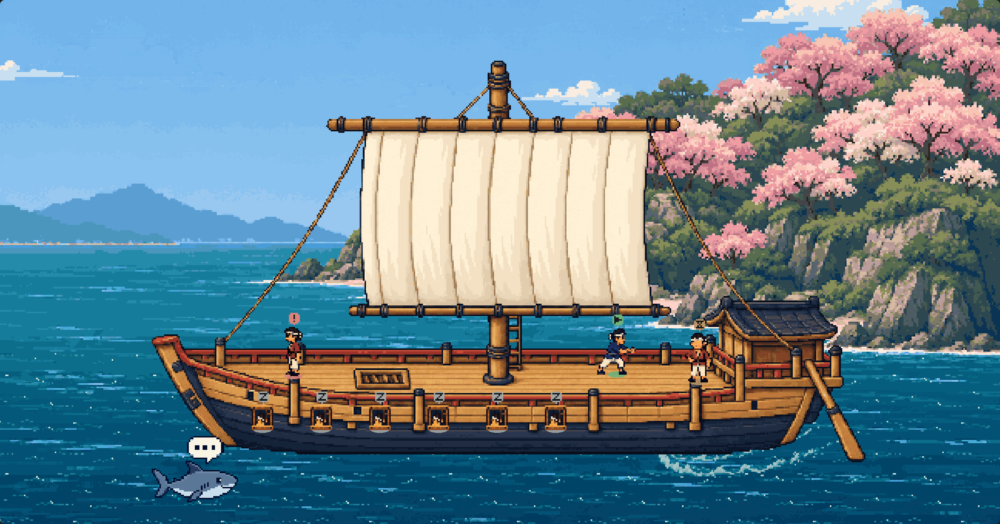
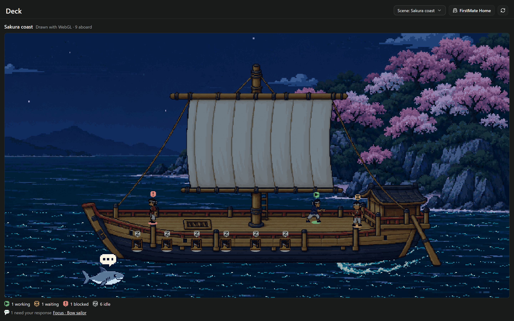
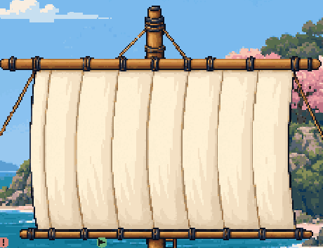

# Sakura coast

The current pack's [parity review](parity/README.md) adds the sea-dragon plank departure,
masthead lookout, umibozu storm, six-phase day, night sky, chochin, cranes, petals and
six crew looks. Its captures and verification supersede the historical counts and
two-phase-day limitations recorded below.

A Japanese coastal merchant ship rounds a rocky island covered in pink and ivory
sakura, shown in a level side-on broadside with the original ship's slight top-down
camera. Warm cedar, an indigo hull, a cream sewn sail, and practical indigo/russet
crew keep the scene readable as pixel art. The curved shoreline and stern wake
suggest the turn; the existing engine supplies billowing cloth, swaying upper rigging,
drifting clouds/water, cycling wake and shark, gentle heave, fidgets, and walking crew.
This is the second installed setting, selectable
as **Sakura coast** in both scene pickers. The original ship remains the default.







The [element-by-element animation audit](motion-review.md) compares the original Ship,
the approved broadside before this fix, and the finished motion. The old sail was static;
the new one demonstrably changes texture and cloth pixels independently of hull bob.
[Whole-scene animated preview](review/day-motion.gif).

The revised hull follows the approved art review's camera correction: horizontal
keel and long deck rails, a modest bow at the stern's rail height, and a visible open
deck. The mast stays vertical; its ladder lies flat against it and disappears behind
the sail. Crew posts, hatch entry/exit, sleepers, mast/ladder depth crops, and the
stern shelter are registered to the new hull. The same wake is moved to its new
waterline. The original 48-colour ship palette is locked in `ship-palette.json`.
The island's day/night pixels, both crew sheets, sleeping-window sprite, water, wake,
reply shark, and their original first frames are preserved. Clouds are now detached
from the sky and independently animated; new wake/shark frames and crew fidgets fill
the remaining motion gaps, as the animation audit details.
The historical [broadside audit](broadside-audit.json) records unchanged hashes for those eight
images, the unchanged behaviour data, the retained palette, and the central keel's
single horizontal pixel row. This revision rebases cleanly onto `e5c7f75`, preserving
the inline Deck and chat-parity work in #77 and #79 without modifying their source.

The shipped pack is only `art/settings/japanese-ship/setting.json` and twenty PNGs.
It uses 19 existing catalogue capabilities, without engine, schema, client, server,
tab chrome, or footer changes. The office remains withdrawn. Image payload is
about 361 KB, including the picker thumbnail. The original ship's files are untouched.

## Art provenance and registration

All source images were generated with the built-in `image_gen` tool on
2026-10-16 for this task. No downloaded stock art or new hand-drawn vector stand-ins.
[prompts.json](prompts.json) records the initial prompts and
[broadside-prompt.json](broadside-prompt.json) records the camera correction, with
the original `art/settings/ship/deck.png` as camera reference and the approved
Japanese hull as the edit target. [sources/](sources/) contains the unmodified tool
outputs, including the superseded `ship-three-quarter.png`. The russet crew is an edit of the indigo sheet;
the night coast is an edit of the daytime coast. Prompt IDs map to sources as follows:

| Prompt ID | Source file | Delivered image | Registration |
| --- | --- | --- | --- |
| ship-broadside | ship.png | ship.png | 480 × 320; transparent stage, approved 48-colour palette |
| coast | coast.png | coast.png | 600 × 400 opaque daytime backdrop, 64 colours |
| night | coast-night.png | coast-night.png | 600 × 400 opaque nighttime backdrop, 64 colours |
| crew | crew-indigo.png | crew-indigo.png | 384 × 36 atlas; twelve 32 × 36 cells |
| crew_russet | crew-russet.png | crew-russet.png | Same atlas contract, separately registered poses |
| water | ripples.png | ripples.png | 96 × 64 transparent tile, 8 colours |
| wake | wake.png | wake.png | 128 × 36 transparent turning wake, 8 colours |
| shark | reply-shark.png | reply-shark.png | 56 × 44 transparent carrier with speech bubble, 12 colours |
| sleep | sleep-window.png | sleep-window.png | 14 × 16 transparent sleeping window, 12 colours |

`build-art.mjs` performs deterministic nearest-neighbour registration, weighted
palette reduction and binary-alpha cleanup. The revised hull maps to the exact
approved palette instead of choosing new colours. It crops each generated pose separately,
centres it in its atlas cell, and records its actual rectangle and feet anchor.
Crew frames use up to 24 colours each. The twelve roles are stand, three front walk
frames, side idle, three side walk frames, two rope-pulling poses, waiting, and rest.
Source SHA-256s, delivered SHA-256s, dimensions and all frame anchors are in
[registration.json](registration.json). The 384 × 202 picker preview is a nearest
resize of the real renderer's reviewed daytime screenshot, not concept art.

Only derived art and JSON ship. Sources, prompts, generators and review captures
remain under `docs/`, which `npm pack --dry-run` excludes.

The subsequent motion sources and registration are recorded in
[motion-prompts.json](motion-prompts.json) and [motion-review.md](motion-review.md).
`build-motion.mjs` runs after `build-art.mjs` to separate the approved rig/clouds and
register the generated billow and clear skies. It preserves the original hull and
uses only existing palette colours; its frame-zero reconstruction is asserted.

## Scene contract and review

`build-pack.mjs` describes the existing catalogue, validates the schema, and writes
the manifest. The open deck has distinct working, waiting and blocked posts, with
the mast foot blocked from walking. The hatch connects to a non-spill hold; sleeping
windows draw ahead of the hull's front piece and remain individually focusable.
Every route and all packed targets are checked against the opaque ship pixels.

The renderer's row-sorted mast, flush ladder and stern shelter put crew on the correct side of
those objects. The foreground hull covers the hidden hold passage. The wake sits
behind the stern, with a visible curve outside the hull. Day/night use matching
coastal compositions and the existing stage tint; badges and focus remain legible.
Reduced motion freezes activity, and software WebGL uses the existing lite policy.

Self-review covered composition, silhouette, sprite edges, frame registration,
floor/depth alignment, contrast at night, below-deck identity, real picker persistence,
shark focus, and the condensed footer in narrow panes. Review captures:

- [Night](review/night.png), [moving](review/moving.png), [software WebGL](review/lite.png)
- [Floor/depth overlay](review/floor-overlay.png), [24 sleepers](review/sleepers-24.png)
- [Picker](review/picker.png), [shark focus](review/shark-focus.png), [stale feed](review/stale.png)
- [900-pixel pane](review/split-900.png), [640-pixel pane](review/split-640.png)

The real compiled-browser [interaction check](check-scene.mjs) verifies all four
states, both carrier hit areas, no navigation or message sending, 24 distinct sleeping
targets, persistent selection and save failure, stable reduced motion, moving
pixels, day/night, stale-feed handling, and footer bounds. Results are in
[interactions.json](interactions.json) and [lite.json](lite.json).

## Reproduce

From the repository root, with Node 24, installed root and `docs/board-list`
dependencies, Paseo's compiler and Edge:

```powershell
node docs/settings/japanese-ship/build-art.mjs
node docs/settings/japanese-ship/build-motion.mjs
node docs/settings/japanese-ship/build-pack.mjs
npm.cmd run typecheck
npm.cmd test -- --reporter=dot --maxWorkers=4
npm.cmd run lint:deck-packs
node docs/ship-deck-canvas/compile.mjs
$env:CHECK_JAPANESE='1'
node docs/deck-settings/render.mjs '?setting=japanese-ship'
Remove-Item Env:CHECK_JAPANESE
$env:CHECK_JAPANESE_LITE='1'
node docs/deck-settings/render.mjs '?setting=japanese-ship'
Remove-Item Env:CHECK_JAPANESE_LITE
node docs/deck-settings/gate.mjs
```

The first art build can omit the optional preview until a day render exists.
Rebuild art and manifest after changing the reviewed day composition. No test or
preview command installs the plugin or modifies the live daemon.

The ship gate compares all 81 full interface captures against main `e5c7f75`,
including the condensed footer. This addition expects **zero changed pixels**:
`docs/deck-settings/expected-changes.json` has an empty shot map. Historical shark
and ladder evidence remains preserved in its own reviews.

The [completed 81-shot gate](../../deck-settings/gate-results.json) passes with every
capture pixel-identical, no masks, no expected differences, no flakes, and no browser
errors. This includes motion through a two-minute storm, crew entry/departure, camera
focus, and software rendering, as well as the complete condensed footer.

Typecheck, all 1,101 tests in 93 files (three existing skips), and all 51 pack-lint
checks pass. [validation.json](validation.json) records the protected-file audit and
byte-identical client bundles; [compile-results.json](compile-results.json) records
Paseo compilation, zero bundle growth, and Hermes parsing. The bundle contains no
`class` tokens. The compiler and gate pin the motion implementation revision recorded
in those JSON files; the following evidence commit changes documentation only.
