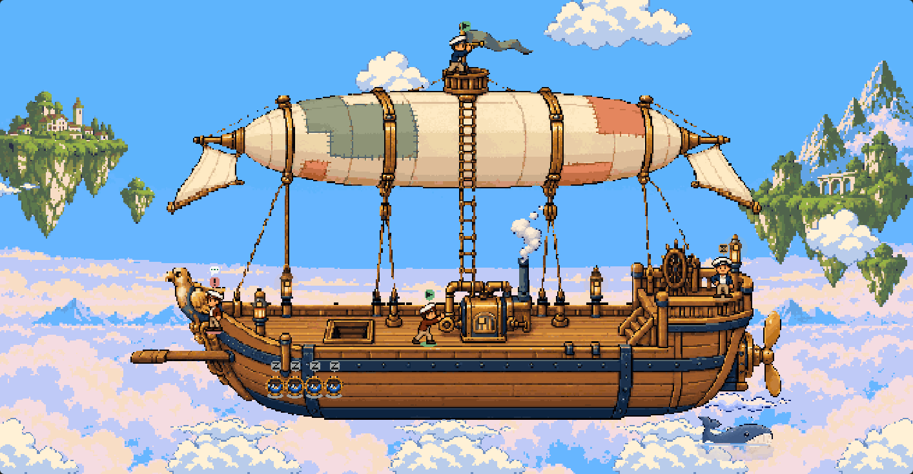
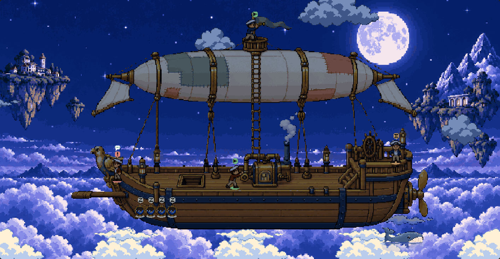
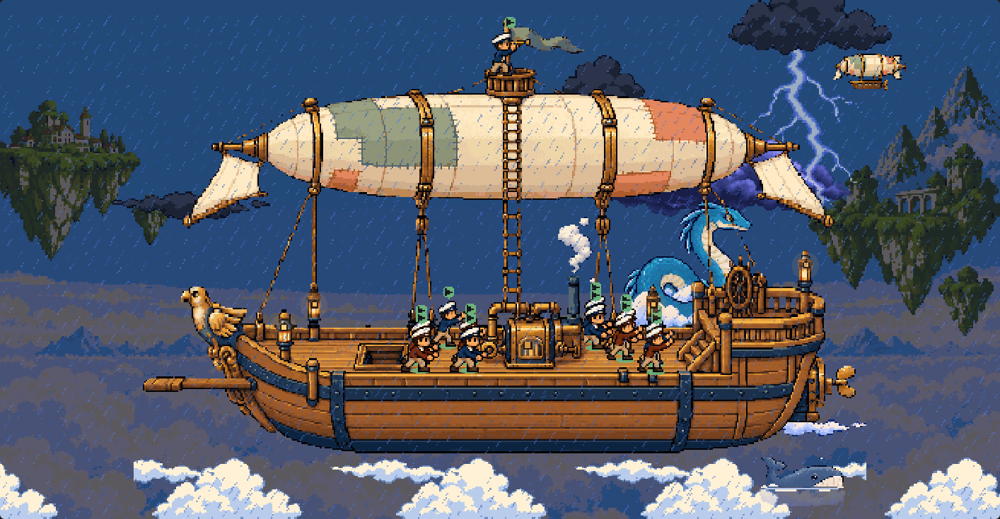

# Sky pirates

A level broadside pirate airship riding a sea of clouds: patched cream, sage and
coral balloon, brass machinery, white-capped sailors, floating islands and sky whales.
The approved [concepts](concepts/README.md) became a native 480 × 320 setting with a
shallower balloon and a smaller suggestion whale, away from the plank.





[Scene alive](review/scene-alive.gif) · [Whale departure](review/whale-departure.gif) ·
[Suggestion whale](review/suggestion-whale.gif) · [Arrival and lookout](review/hatch-and-lookout.gif) ·
[Storm motion](review/storm-alive.gif) · [Motion audit](motion-review.md)

## Pack and provenance

Only `setting.json` and its referenced PNGs ship in `art/settings/sky-airship/`.
The 80 PNGs total **383,606 bytes** (budget: 1,000,000). The pack uses 26 existing catalogue capabilities. There are no engine, schema,
client or server changes, new dependencies in the plugin, timers or runtime scripts.
The picker names it **Sky pirates**. Both existing packs remain untouched.

Seven new image-generation outputs, recorded in [production-prompts.json](production-prompts.json),
are kept in [sources/](sources/). `build-art.mjs` registers their generated pixels
at native scale with nearest-neighbour sampling, binary transparency and bounded
palettes. The balloon compression preserves the hull's level rail and keel.
It extracts separate moving plates, registers finite breathing/billow/propeller
frames, and anchors each generated crew/whale pose. The russet crew palette is
derived from the navy sheet; both retain white caps. Day and night are generated
sources; dawn and dusk are colour transfers. [registration.json](registration.json)
records source and output hashes, dimensions, palette-derived assets and anchors.
The picker thumbnail comes from the actual renderer, not the concept sketch.

Rebuild with Node 24:

```powershell
node docs/settings/sky-airship/build-art.mjs
node docs/settings/sky-airship/build-pack.mjs
npm.cmd run lint:deck-packs
```

Sources, generators, diagnostics and review captures remain under `docs/`, outside
the published package. The offline GIF recorder uses `gifenc` installed under the
ignored `.generated/motion-tools` directory; it is not a plugin dependency.

## Geometry and interaction

Working sailors crank amidships; the primary working post continues up the rope
ladder to the balloon lookout. Waiting sailors stand at the raised stern wheel;
blocked sailors use the bow beside the figurehead. Arrival rises through the hatch.
Departure queues for the plank, falls into a cloud puff, and is swallowed by the
breaching whale using the existing finite shark/splash choreography slots.

Sleeping sailors occupy round hammock windows ahead of the hull front. The
[before](crowd-engine-before.json) and [after](crowd-engine-after.json) dumps compare
all 24 resolved posts and hit rectangles against Ship's deck. Odd 13-pixel spacing
on a 2-pixel grid expanded to 14 pixels; the final sleeper then fell back over its
neighbours. The old check also clicked authored rather than resolved centres.
The corrected row spans x=96..418 at 14-pixel intervals, with a wider hold and
matching overflow. All 24 hit boxes are disjoint and every resolved centre picks
its own sailor. [Browser clicks](crowd-focus.json) verify the corresponding labels.

Original collision: Sleeper 9's hit rectangle `(402,249)-(416,274)` overlapped
Sleeper 7 `(397,249)-(411,274)` and Sleeper 8 `(411,249)-(425,274)`.
Ship's deck uses eight posts plus two packed overflow strips at 12-pixel spacing;
its 24 resolved centres remain individually selectable. Foreground pieces were
not the cause. The suggestion whale sits below this row and at the opposite end
from the departure path, with a tinted lower half and moving mist arcs.

## Review

The established `docs/ship-deck-canvas/compile.mjs` and
`docs/deck-settings/render.mjs '?setting=sky-airship'` (also with `&overlay=1`)
exercise the real compiled plugin, RPC loader, art and renderer. `review.mjs`
reuses that same fixture host and server to run `check-scene.mjs` against full,
still and software-WebGL lite modes. It uses DOM interactions, canvas pixels and
public canvas diagnostic attributes only: no Pixi texture introspection.

The host fleet is synthetic; these are compiled-client browser checks, not a
claim of an installed plugin or physical-device test. Nothing was installed or reloaded.

The motion audit describes static scenery and engine limits explicitly. Existing
focus, reply bubbles, suggestion action and picker behavior remain engine-owned.
The existing keyboard suggestion button retains the engine's accessibility label
"Shark suggestions"; the visible carrier art is the sky whale. Format 1 does not
expose that label as pack data, and no engine wording was changed.

[Validation](validation.json): pack lint 66/66; typecheck passes; full suite
1,155 passed, three skipped across 97 files. [Ship gate](ship-gate.json): **81/81
pixel-identical** to pinned main `47e305d`, no page errors. [Compiler/Hermes](compile-results.json):
both plugin bundles parse, zero client/server bundle growth. These engine checks
were compiled at `8419011`; subsequent changes are the pack preview, balloon/rain
pixel registration and documentation, with engine and existing-pack files unchanged. [Full](motion-full.json) and
[lite](lite.json) browser reviews pass without page errors. The package dry run
contains exactly 81 new pack files and no `docs/` files.

```powershell
node docs/ship-deck-canvas/compile.mjs
node docs/deck-settings/render.mjs '?setting=sky-airship'
node docs/deck-settings/render.mjs '?setting=sky-airship&overlay=1'
node docs/settings/sky-airship/review.mjs
$env:AIRSHIP_LITE='1'; node docs/settings/sky-airship/review.mjs
Remove-Item Env:AIRSHIP_LITE
node docs/deck-settings/gate.mjs
npm.cmd run typecheck
npm.cmd test -- --maxWorkers=4
```
