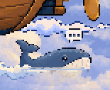
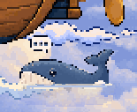

# Falling rain and a left-facing suggestion whale

The old weather variant sampled its source at `(x + 3f, y + 7f)`, moving the
visible streaks **up** seven pixels per frame. The four transparent base images
were a calm-weather placeholder; the visible storm variant did animate, but in
the wrong direction.

The revised base is the four actual rain frames. A transparent `clear-weather`
crossfade preserves the original intensity-to-opacity curve: no rain through
0.6, increasing to 0.5 at peak. A 32-row repeating source field advances eight
rows **down** per frame; frame 3 to frame 0 is exactly the same downward step.
The streaks are reflected to lean down-right, matching the rightward wind drift.
The 90 ms frame interval, 8 px/s drift and wind clock's busyness scaling are
unchanged. The low-intensity clips are deliberately faint, as before.

| View | Low (four working crew, intensity 0.67) | High (six, intensity 1) |
| --- | --- | --- |
| Wide | [Scene](after/wide-rain-low.gif), [rain detail](after/wide-rain-low-detail.gif) | [Scene](after/wide-rain-high.gif), [rain detail](after/wide-rain-high-detail.gif) |
| Tall | [Scene](after/tall-rain-low.gif), [rain detail](after/tall-rain-low-detail.gif) | [Scene](after/tall-rain-high.gif), [rain detail](after/tall-rain-high-detail.gif) |

Each scene clip is 2.56 seconds, captured from the actual compiled renderer with
a controlled clock. Detail clips show the same frames' sky region at 4× native
art scale. [Frame strip](rain-frames.png) shows the four source frames; the pixel
audit in `../crew-edge/verified-geometry-art.json` checks their downward loop.

## Whale orientation

| Before | After |
| --- | --- |
|  |  |

All four carrier frames are exact horizontal reflections. Their sizes and every
alpha row are preserved, so the same surface row 31, submerged tint/alpha, cloud
ripple and bubble remain registered. Horizontal loiter drops from two pixels to
one over the same 4.8-second period; vertical bob remains one pixel.

The departure whale is a separate upward breach with its open mouth toward the
falling crew. It remains unchanged, including its mouth anchor and cloud/puff
choreography; it is not a horizontally swimming carrier.

`build.mjs` reproducibly edits the saved original pixels and updates manifest
hashes. It does not rebuild other scene assets or touch engine code. The render
wrapper uses the established host and public diagnostics without Pixi observers.

## Travelling peak-storm serpent

[Wide crossing](serpent/wide-crossing.gif) and [tall crossing](serpent/tall-crossing.gif) show 38.4 seconds of the real renderer, including entry, horizontal travel, exit and the gap before another pass. Full-scene stills and reduced-motion captures sit beside the clips.

The existing `strip@1` capability supplies both horizontal drift and intensity variants. A transparent base and a peak-storm variant keep the serpent invisible through intensity 0.82, fading to 0.95 at peak. Both lite and still policies are `hide`; reduced motion selects still. No flyby, engine change or new timer is involved.

The current pack replaces the four coiled sprites with eight right-facing dragon flight frames.
The head stays fixed within each frame while a body wave travels toward the tail. The frames
hold for 180 ms on the swell clock (about 138 ms at peak); drift is 24 px/s on wind,
or 79.2 world pixels per second at peak. The 160-pixel-wide dragon appears once per
2,048-pixel strip. Top -80 places every painted frame between stage rows -77 and -42, above the
masthead, lookout and balloon throughout their rocking motion. The unchanged
back-slot order 6.1 draws the dragon in front of every distant floating-island
layer; their silhouettes pass behind its uninterrupted crossing. Span [-1200, 1680]
and storm gating are unchanged.

The supplied PNGs are shipped byte-for-byte. `strip@1` has no per-effect scale field;
nearest-neighbour sampling follows the scene's camera scale. The old `serpent.mjs`
script and earlier policy/render records describe the retired coiled art.
Current wide, square and tall-narrow crossing clips and three-position stills are uncommitted, in
`C:/Users/micha/.paseo/plugin-data/firstmate/home/data/sky-dragon-flight/evidence/clearance/`.

`serpent-lite-render.mjs` also captures wide/tall software-renderer views at intensity 1, asserts the public canvas motion mode is lite, and records zero browser errors. Reduced-motion captures show no frozen serpent.
