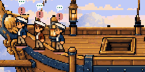
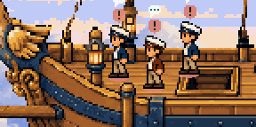
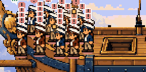
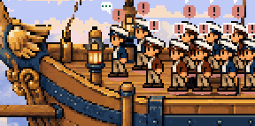

# Sky pirates crew edge margin

**Verification blocked: see [STATUS.md](STATUS.md).**

The bow posts used to start at x=66 beside the eagle figurehead; the standing floor
extended to x=64 and down to y=240 at the front rail. The revised posts begin at
x=112, and ordinary crowd floor begins at x=100, with its front limit at y=235 and
rear limit at y=220. Working posts at y=237�238 move to y=234. The stern floor and
helm posts also move inward, with the stair connection retained.

Standing crowd spacing increases from 14�5 to 14�10. When the bow or stern fills,
crew spread across the interior deck. The plank queue moves from (81,237) to
(108,232), keeping its existing walk, fall, cloud and whale choreography. The
lookout transit, hammock-window row, stage rocking and all images are unchanged.
Only `art/settings/sky-airship/setting.json` changes at runtime.

## Bow comparison

Crops preserve the normal wide-render pixel scale, without magnification.

| Crew | Before | After |
| --- | --- | --- |
| Three |  |  |
| 24 |  |  |

`before/` and `after/` also contain full canvases and authoring overlays at
1440�900 and 900�1400, with 24 blocked, working, waiting and idle crew.
The idle sailors retain their intentionally separate hammock windows; they do
not stand on the deck or use its crowd floor.

## Reproduction

```powershell
npm.cmd ci
npm.cmd ci --prefix docs/board-list
npm.cmd install --prefix .generated/motion-tools --no-save gifenc
node docs/ship-deck-canvas/compile.mjs
$env:EDGE_REVIEW='before'
node docs/settings/sky-airship/crew-edge/render.mjs
Remove-Item Env:EDGE_REVIEW
node docs/settings/sky-airship/crew-edge/render.mjs
node docs/settings/sky-airship/review.mjs
node docs/deck-settings/gate.mjs
npm.cmd run lint:deck-packs
npm.cmd run typecheck
npm.cmd test -- --maxWorkers=1 --testTimeout=30000 --hookTimeout=30000
```

The capture wrapper reuses the established compiled-client/RPC render host and
its public overlay. Crowd geometry uses the existing pure-engine diagnostic;
clicks find the visible hover label and assert the exact focus-panel identity.
No Pixi internals are inspected. These are synthetic browser fixtures, not an
installed plugin/device test. Nothing is installed or reloaded.
