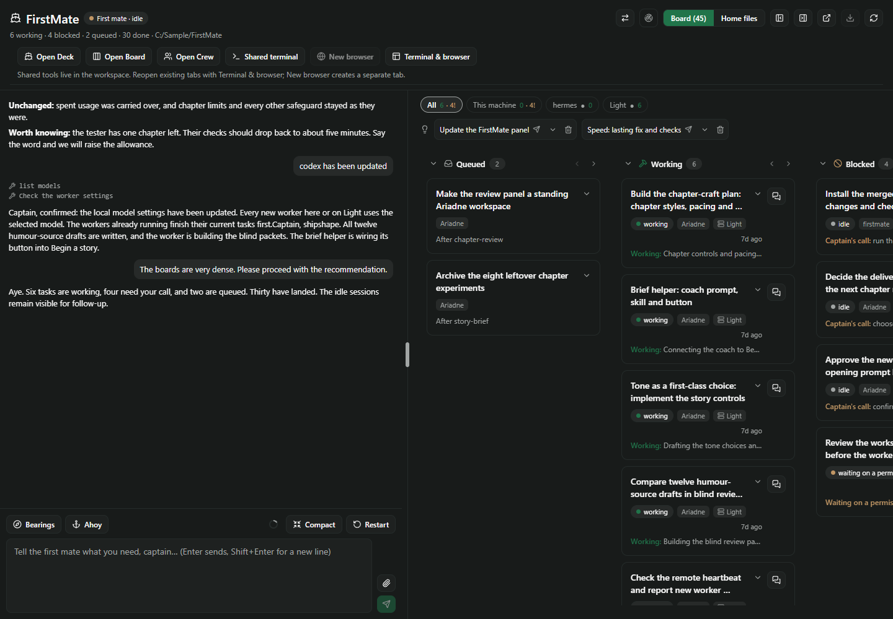
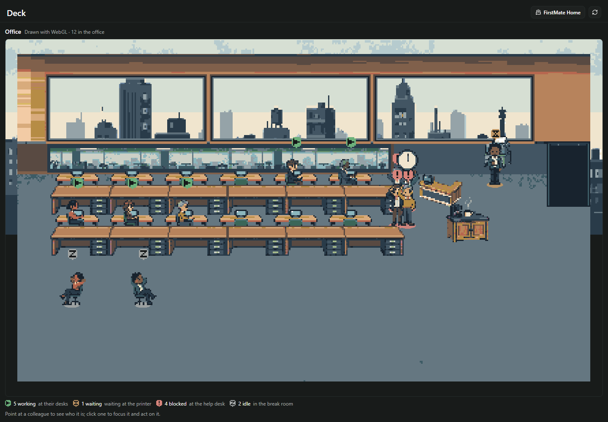
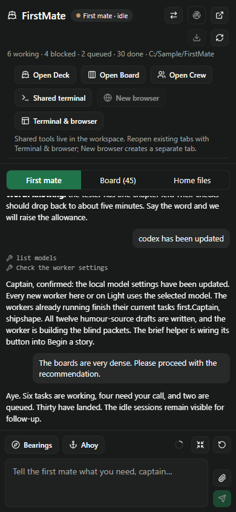
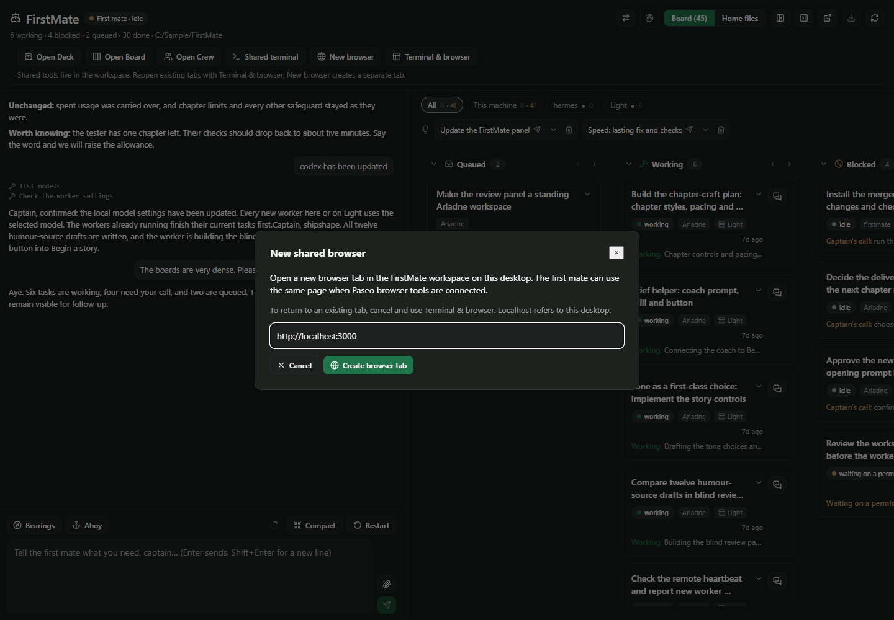

# Shell phase 1: Home and workspace tabs

Slice 1 builds on `9693516` (the landed Office scene pack). It registers Deck, Board and Crew as
workspace panels, keeps the sidebar screen as Home, and gives Home shortcuts into Paseo's workspace
shell. Home contains the first-mate chat, Board overview and Home files; Crew and Deck have one
canonical destination each. The old workspace/agent context panels remain available.

Paseo owns the tabs: fixed plugin panel identities are passed to `openPanel`, never copied into a
plugin tab manager. The home-workspace guard refuses an adopted mate's unrelated workspace and
redirects fleet panels opened elsewhere. Opening a workspace view does not mark the mate seen or
mount another first-mate composer. View-specific drawers do not follow the captain across panels.

## Native boundary approved for phase 1

**Terminal & browser** opens the home workspace, where the captain selects or adds native tabs.
Slice 2 adds explicit resource creation where the public SDK supports it, described below. Creation
never runs on mount or restore. No installed plugin or running daemon was changed for either slice.

The inspected 0.11 public API has terminal create/list/ref/keys/capture but no terminal navigation by
ID. `navigation.openBrowser({url, workspaceId})` always creates a browser, returns void and accepts
no existing browser ID. It is available only on Electron. Therefore exact shared native tab focus or
reuse by ID, a returned browser ID, and embedding live native panes remain deferred to a separately
approved upstream/fork phase. This slice uses no private host import, store, route or IPC.

## Validation and self-review

- Full suite: **81 files, 1,038 passed, 3 skipped**, `npm test -- --maxWorkers=4`. The initial unbounded
  run spawned 81 workers and failed three existing process/timing-sensitive tests (PR-watch budget,
  remote helper timing and update-source timeout). All passed with bounded concurrency, without
  changing production code or test expectations.
- `npm run typecheck`, `npm run lint:deck-packs` (51 checks), changed-code Prettier and `git diff --check`.
- `node docs/shell-phase1/check-bundle.mjs`: Paseo compiler 0.11.0, both halves compiled; **zero `class`
  tokens** in the client, no bundled Pixi/art, RN 0.81.5 Hermes parsed with default flags.
- `node docs/shell-phase1/render.mjs`: real components, real Office scene engine and real pack reads;
  synthetic host APIs and 45 tasks. Home → Crew/Board/Deck → Home, correct workspace shortcut,
  adopted/foreign-workspace guards, no attention clearing in the three views, exactly one Office
  canvas and its teardown, light/dark, 390×844 phone layout and Deck's compact unavailable state.
- Self-review checked installation-bound navigation, fixed restoration identities, no creation on
  registration/render, single first-mate composer, send-gate reuse, attention and canvas lifetime.
  Opening Home explicitly reveals chat after its settings load, including when chat was folded.

The browser harness does **not** prove live Paseo tab persistence, native iOS/Android behavior or
native terminal/browser interaction. Those remain installed-app checks for the captain. No install
or reload was performed. Earlier render harnesses that selected internal Crew/List/Deck modes
describe the old layout; this harness exercises the new destinations.

Reproduce with `npm ci`, `npm ci --prefix docs/board-list`, then the commands above. The bundle check
uses the installed npm Paseo compiler, or `PASEO_COMPILER`. Formatting uses
`node docs/board-list/node_modules/prettier/bin/prettier.cjs --check --print-width 120 --end-of-line auto` on changed code.
Screenshots and generated bundles/logs are in ignored `.generated/`; selected captures follow.

## Slice 2: shared native resources

**Shared terminal** serializes requests with first-mate lifecycle changes, validates the live home
workspace and lists its terminals. It reuses exactly one named `FirstMate shared` or creates a
default-shell terminal if none exists. Failed listings create nothing; ambiguous names require the
captain to select/rename them. Requests after lost creation responses rediscover the live terminal.
There are no process writes, kills, polling loops, stored commands or automatic recreation.

**New browser** opens a URL dialog only where Paseo advertises `openBrowser`. Submit accepts HTTP(S),
creates one new local native tab and navigates there. Cancel, invalid URLs, ordinary web and phone
clients do not call the native browser API. Errors leave the dialog available for retry. Existing
tabs continue through the workspace shortcut. The first mate's charter now explains discovery of the
same terminal/browser via MCP, conditional browser automation availability, and desktop-local URLs.

Server tests cover simultaneous clients, repeated requests, killed/renamed resources, ambiguous
names, foreign/missing/archiving workspaces, archived/released/adopted mates, offline listings and
lost create responses. The render harness also covers explicit creation, correct workspace and URL
arguments, no request on mount, pending-request UI, navigation after success, no navigation after
unmount/failure, URL validation, browser cancellation, capability gating and browser error/retry.
No live daemon process or native browser was created during these fixture checks.

Self-review: no additional tab manager or host-private API; the terminal and charter share one name
constant; current server state validates terminal scope; native API errors cannot cause automatic
retries; a browser ID or reusable focus handle is never fabricated. The pinned charter fingerprint
is deliberately updated for the new instructions.

Validated after rebasing onto `0d2f672` (including the collector merge): **83 files, 1,048 passed,
3 skipped** with four workers; typecheck; pack lint (51 checks); changed-code formatting (native line
endings) and diff whitespace checks. Paseo 0.11 compiled both bundles; the 635,685-byte client has
zero `class` tokens and parses under Hermes default flags. The expanded browser harness passed.
Native daemon/browser APIs remain fixture-backed here; this is not an installed-app smoke test.

