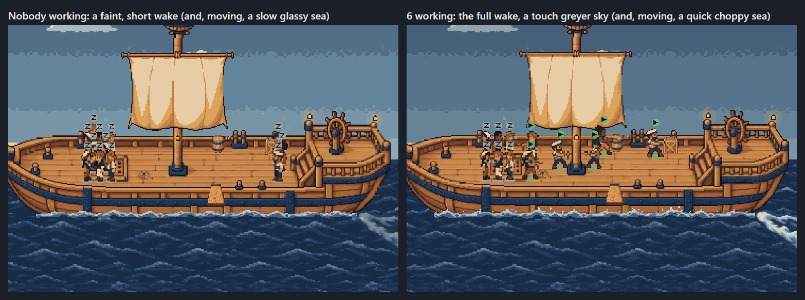
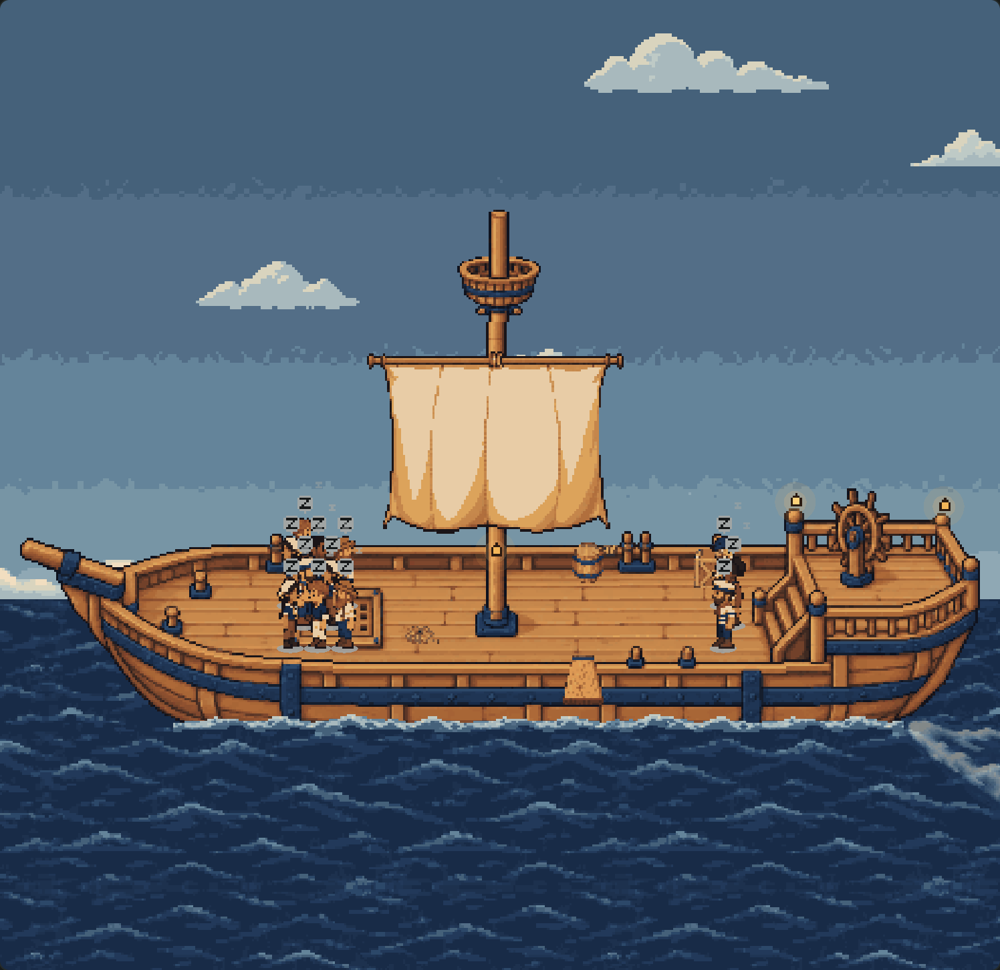
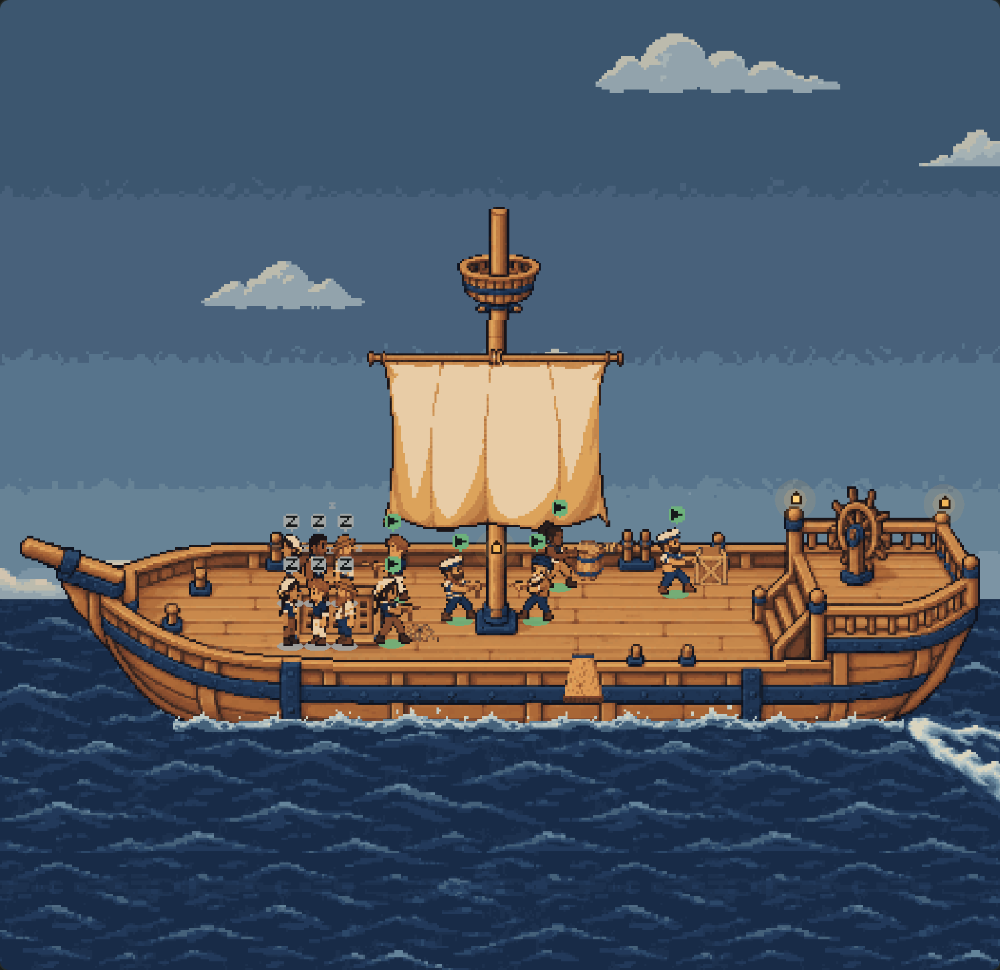

# The weather follows the work: evidence

The more of the crew is working, the livelier the deck: the sea plays its frames and drifts faster, the clouds run
before a fresher wind, the sail snaps quicker and stays billowed longer, the ship bobs a little harder, the wake fills
out, and at the top the sky turns a shade greyer. Nobody working is a glassy, slow sea. All of it is the existing art,
driven harder in code; nothing new was drawn. `client/deck-atmosphere.ts` holds the rules and the one table.

| Nobody working | Six working |
| --- | --- |
|  |  |

A still can show only the wake and the sky; the rest is speed. Three seconds of each, 150 ms a frame on the fake
clock (an APNG-capable viewer, which any browser is, plays them):
[nobody working](animated-0-working.png), [two working](animated-2-working.png), [six working](animated-6-working.png).
Measured on the open sea ahead of the bow, the share of pixels that change from one frame to the next is **0.20** with
nobody working, **0.30** with two and **0.42** with six ([render-results.json](render-results.json)).

## How busy the crew is

- **Work in progress counts**: each sailor on deck by its state — working 1, waiting on a job ¼, blocked and idle 0 —
  and a greyed one (its feed lost) 0, local and remote alike, since the deck's scene holds both. Six is the top of the
  dial (`BUSY_CREW`); more change nothing, so a crowded fleet stays readable.
- **Eased**: the drawn intensity closes on the crew's with a three-second time constant (`EASE_SECONDS`): put six to
  work and it reads 0.28, 0.49, 0.63, 0.74, 0.81, 0.87 at each second, 0.95 by nine ([the ease](render-results.json)).
  The deck opens in the crew's weather, as the crew already aboard is simply there.

## What it drives (`ATMOSPHERE`, one table, interpolated)

| | Nobody working | Two working | Three | Four | Six or more |
| --- | --- | --- | --- | --- | --- |
| Intensity | 0 | 0.33 | 0.5 | 0.67 | 1 |
| Sea, foam and wake frames | ×0.5 (480 ms a frame) | ×1 (the art's 240 ms) | ×1.23 | ×1.45 | ×1.9 (126 ms) |
| Sea and foam drift | ×0.5 (5 px/s) | ×1 (10 px/s) | ×1.3 | ×1.6 | ×2.2 (22 px/s) |
| Clouds' drift | ×0.5 | ×1 | ×1.5 | ×2 | ×3 |
| Sail: alternations / share billowed | ×0.55 / 40% | ×1 (850 ms) / 50% | ×1.35 / 54% | ×1.7 / 58% | ×2.4 / 65% |
| Bob and sway: pace / heave | ×0.8 / 1 px | ×1 / 1.2 (a pixel) | ×1.09 / 1.3 | ×1.18 / 1.4 | ×1.35 / 1.6 (two at the crest) |
| Wake (generated: opacity; code: length) | 0.55 | 0.85 | 0.89 | 0.92 | 1 |
| Sky's mood (tint towards `#DDE1E8`) | none | none | 25% | 50% | 100% |

Two working is the art exactly as delivered. A stormier top end is the last row's change.

**Every animation runs on its own clock**, advanced each frame by the step times its current pace, and the pure
frame functions (`waterFrame`, `scrollOffset`, `cloudX`, `sailFrame`, `shipBob`) are handed that clock. Multiplying the
scene's clock by a pace that changes would have jumped the sea and the clouds whenever a crewmate started or finished.
`client/deck-atmosphere.test.ts` turns the crew from idle to busy and back over a minute and holds every clock to
moving on, by no more than a frame's worth at the top pace.

## Nothing else changed

- **Reduced motion**: drawn exactly as before (`deliveredWeather`): calm first frames, no drift, the whole wake, the sky
  untinted, held a second later even with six working ([still, busy](still-busy.png)). Its intensity follows the crew's
  unseen, so motion resumes in the right weather. The canvas says `data-firstmate-deck-weather="still"`.
- **The software renderer's lite plan**: the sea and clouds still do not move (`plan.ambient`); the sail, bob and
  wake's strength follow the crew. **The 30 fps cap and the pause when hidden** are the loop's, untouched: the weather
  only changes what a frame draws.
- **Depth**: no layer moved; the tint is on the sky's sprites and the clouds' colours, the wake's opacity on its own sprite.
- **Click to focus** and back out on a busy deck ([after](busy-focus-back-out.png)), the plank, the crew's rest, the
  trimmed mast and sail, resize: the existing suites pass unchanged except the four water and cloud tests that timed the
  art at the scene's clock, which now run with two crewmates working, the weather the art was made for.
- **The bundle** ([compile-results.json](compile-results.json)): Paseo 0.11's compiler builds it, 5,190 bytes bigger
  than main's, and React Native 0.81's `hermesc` parses it with default flags: no `class`.

Rendered by [render.mjs](render.mjs) through [host.jsx](host.jsx) (`?working=N`), after `node docs/ship-deck-canvas/compile.mjs`.

## What a pixel artist could still improve

- **A rough sea.** Faster frames and drift read as livelier, not higher: the four sea frames are one gentle chop. A
  second set with taller crests and scattered whitecaps, crossfaded or swapped in above about half intensity, would
  make the busy sea look rough as well as quick.
- **Spray.** A few frames of bow spray and flecks off the wake's knot at the top end.
- **The sail.** Two states can only alternate faster; a third, fuller billow, and a luffing in-between, would let a
  fresh wind fill the cloth rather than flicker it.
- **Wind on the rig.** A pennant or streamer at the masthead that streams harder with the wind would carry the wind's
  strength in one glance.
- **A greyer sky.** The mood is a multiply tint; a hand-made overcast backdrop per time of day would read as weather
  rather than a filter.
