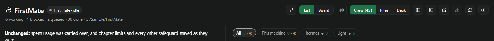
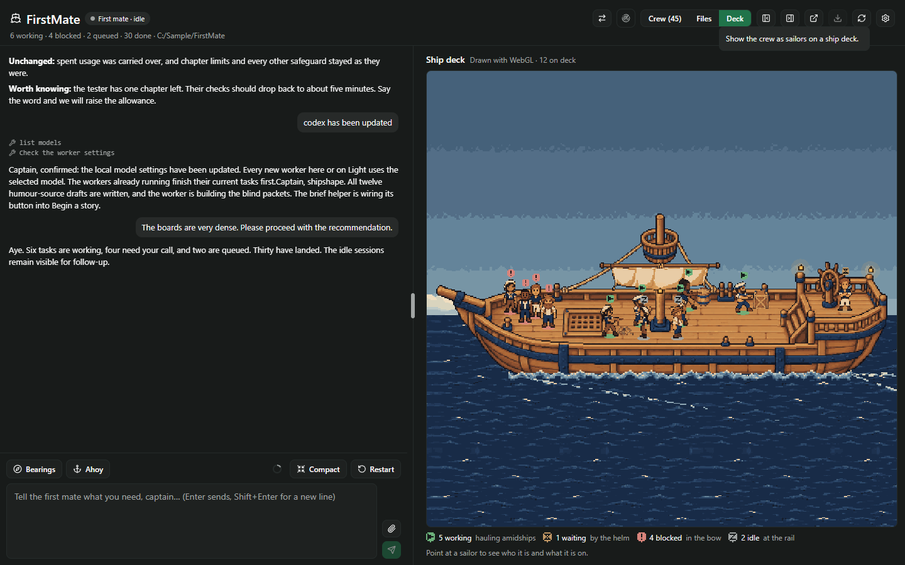
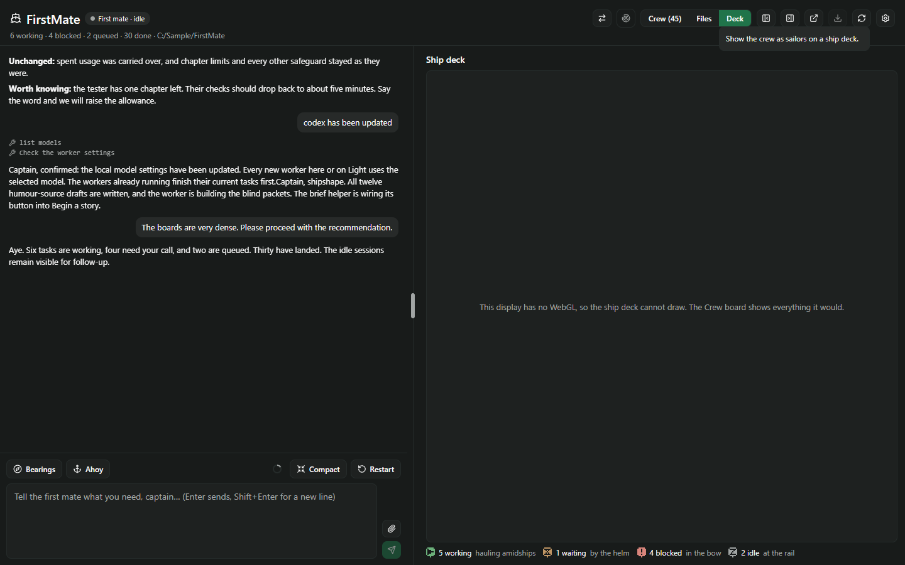

# The ship deck as a standard feature: evidence

The Deck is no longer a preview behind `FIRSTMATE_SHIP_DECK`. The desktop app's wide layout always offers
it beside Crew and Files. A phone or a narrow window is not offered it, and a display without WebGL is
told in words why it cannot draw — the same fallbacks as before. Nothing has to be set or restarted, and
the daemon ignores the old variable.

## What changed

- **`server/ship-deck.ts`**: `shipDeckEnabled`, `withShipDeck`, `SHIP_DECK_ENV` and the refusal are gone.
  The four reads (`readDeckEngine`, `readDeckArt`, `readDeckEnvironment`, `readDeckExtras`) always serve,
  and take no environment.
- **`shared/fleet.ts`, `index.server.ts`**: the fleet load no longer carries `shipDeck`. The board load is
  now exactly what it was for everyone who had the switch off, which was everyone by default. A stray
  `shipDeck` from an old daemon is dropped by the contract.
- **`client/deck-scene.ts`, `client/fleet.tsx`**: `deckOffered(os, compact)` — a web renderer, the wide
  layout. The tooltip drops "(preview)".
- **`client/ship-deck.tsx`**: the caption reads "Drawn with WebGL · N on deck", without "Preview".
- **Docs**: README, AGENTS.md, CHANGELOG, `vendor/README.md` and the art READMEs describe a standard
  feature. Each earlier evidence README (`docs/ship-deck-{canvas,motion,environment,polish,tweaks}/`) opens
  with a note that it describes the switch as it was. Their harnesses now call the reads without an
  environment.

Untouched: the receipt journal (`FIRSTMATE_RECEIPT_JOURNAL`), the watches' variables and every other
switch. `server/receipts.ts`, `server/receipt-observers.ts`, `server/watches.ts` and the journal's wiring
in `index.server.ts` have no diff.

## What was checked

`node docs/ship-deck-default/render.mjs` (after `node docs/ship-deck-canvas/compile.mjs`), headless Edge,
Paseo 0.11.0's own compiler, `render-results.json`. The page's fleet carries no switch.

1. **Narrow, 390 px** (the compact layout): the screen's DOM is origin/main's, character for character.
   No deck RPC is called.
2. **Wide, 1440 px**: React's generated ids are renumbered, since one more tooltip moves them. Then take
   out the Deck segment and its tooltip, and give Files back the rounded right end it has as the last
   segment. What remains is origin/main's screen, character for character. No deck RPC is called until
   Deck is pressed.

   
3. **Deck, with no switch**: pressing it draws with WebGL. The caption is "Drawn with WebGL · 12 on deck",
   and the engine, art, environment and extras are each fetched once.

   
4. **No WebGL** (Edge with `--disable-webgl --disable-3d-apis`): Deck is still offered. Pressing it shows
   "This display has no WebGL, so the ship deck cannot draw. The Crew board shows everything it would."
   There is no canvas, and nothing is fetched.

   

On this branch, `docs/ship-deck-tweaks/render.mjs` was also run without its switch-off step, which this
check supersedes. The still deck still matches its independent composite at 31,500 of 31,500 art pixels.
The sail and wake move, it draws 31 frames a second, and the idle crew breathe. Those outputs were not kept.

`compile-results.json`: the client bundle has no `class` syntax and parses under react-native 0.81.5's
`hermesc` with default flags, 11.2 KB over origin/main's (the deck work since then, less the switch).

`npm test` holds the rest. `server/ship-deck.test.ts` shows the reads serve with the variable unset or set
to `0`, that the fleet contract has no deck key, and that the code reads no `FIRSTMATE_SHIP_DECK`.
`client/ship-deck.test.ts` shows `deckOffered` is true only for a web renderer on the wide layout.

## Only an install can confirm

Install the plugin from this branch and reload it; there is no daemon variable to set. In the desktop app,
open FirstMate: the header's switch reads Crew, Files, **Deck**. The Deck draws as before, captioned
"Drawn with WebGL · N on deck". A daemon still started with `FIRSTMATE_SHIP_DECK=1` or `=0` behaves the same.
