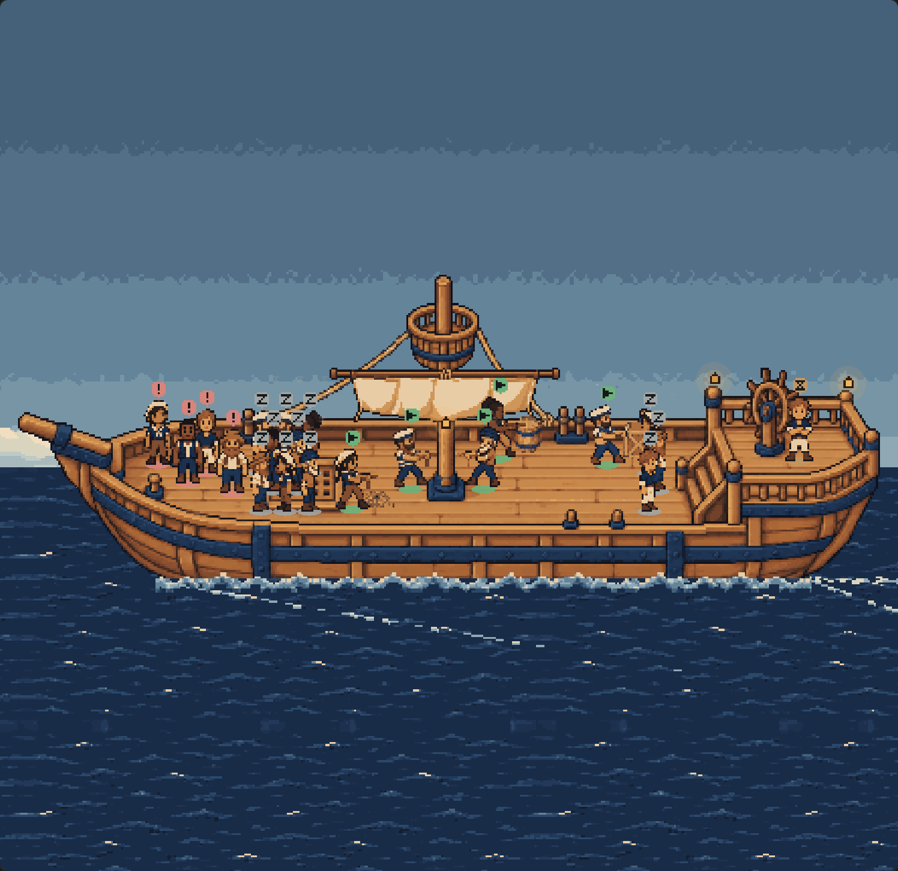
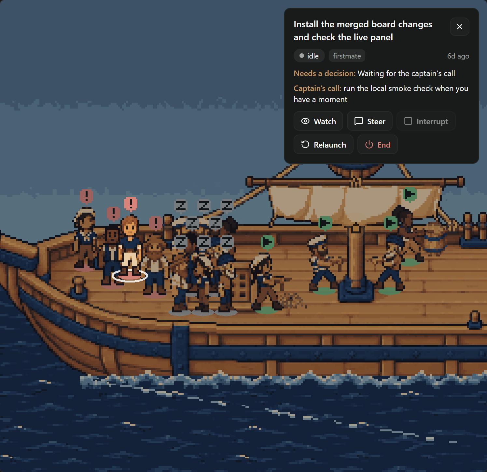
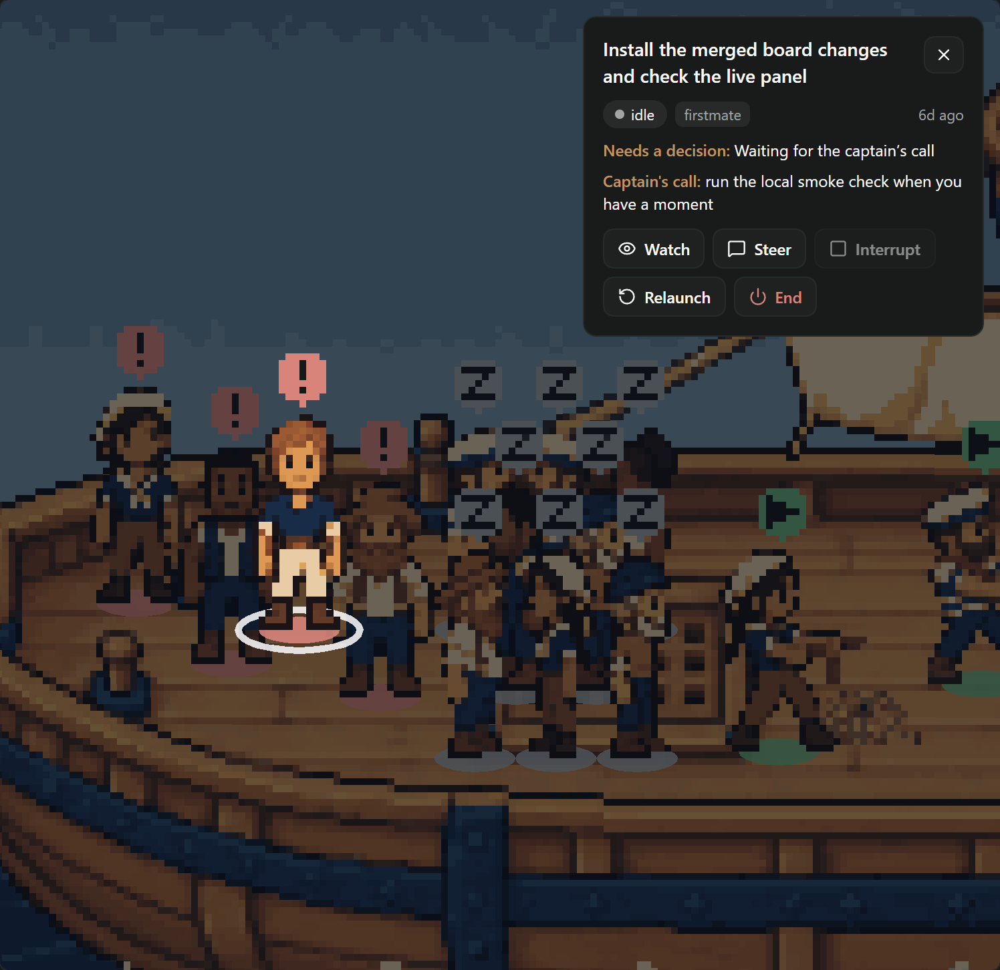
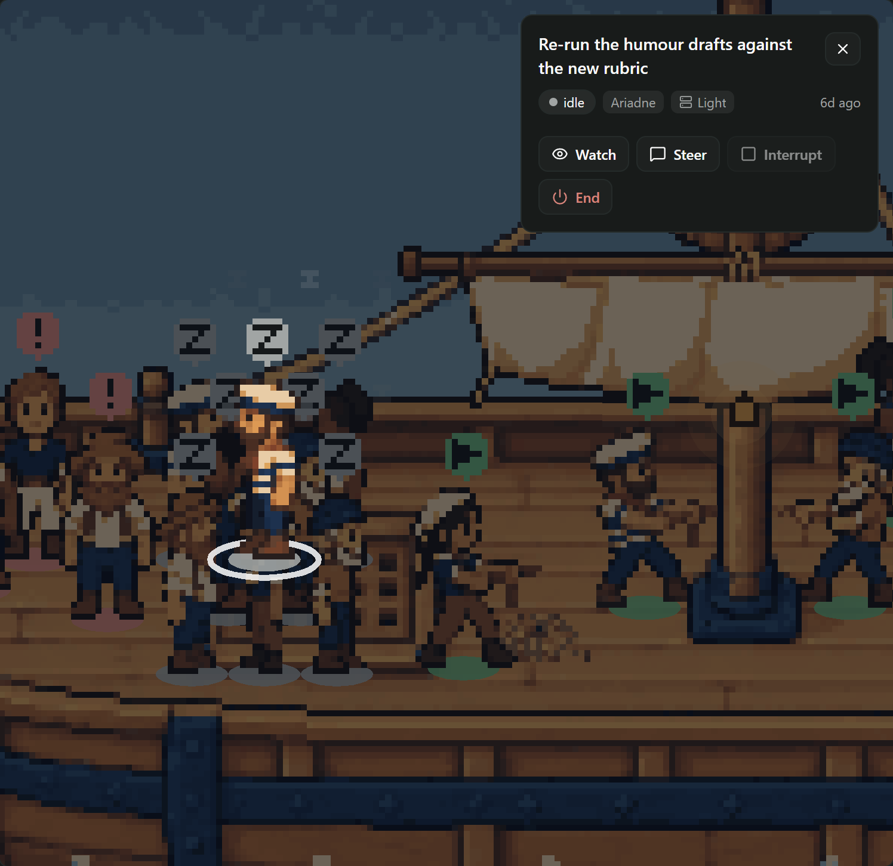
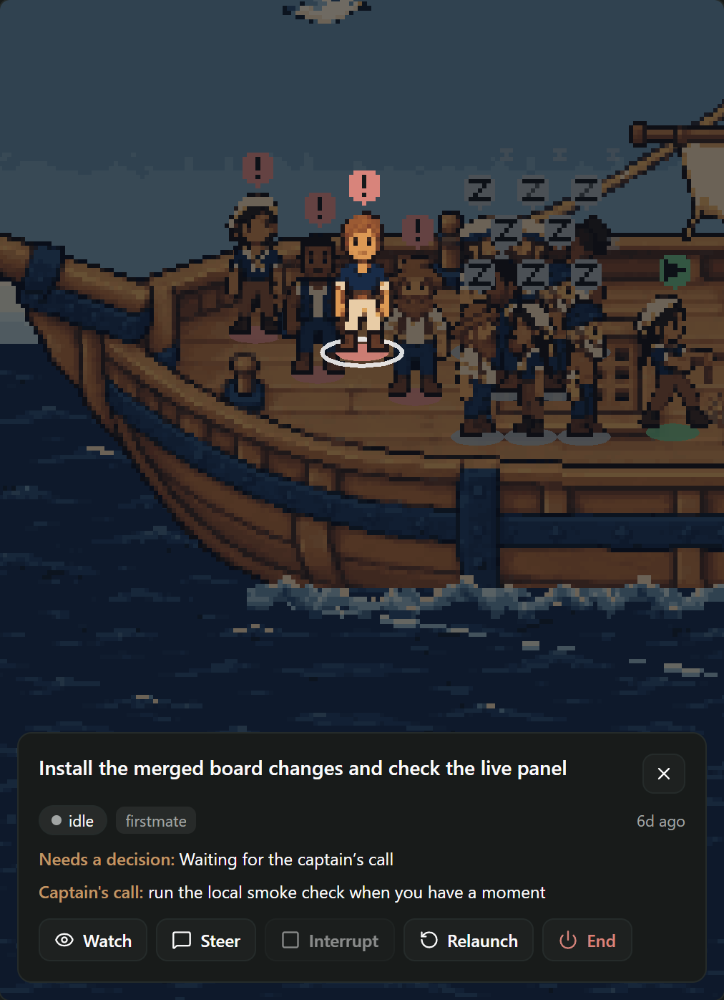
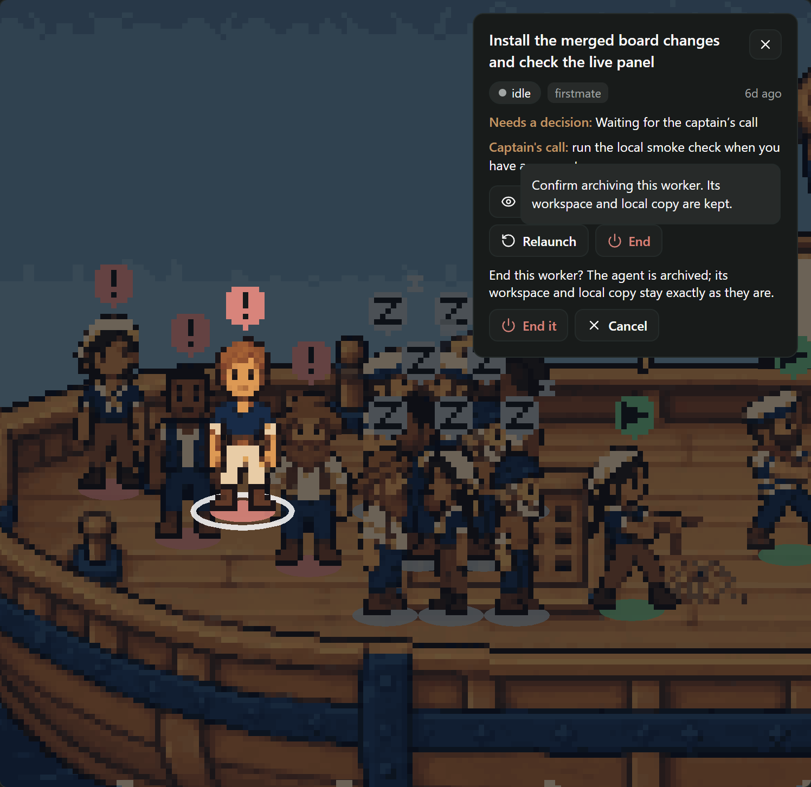

# Click a sailor to focus it: evidence

The deck used to be something you looked at; every action was on the Crew board. Now a click on a sailor
**zooms the camera in on it**, dims the rest of the deck, and opens a **small panel beside it with that
crewmate's own card** — its state, project and host, its status line, anything waiting on the captain, and
the card's buttons. Esc, the panel's ✕, or a click anywhere else on the deck pulls the camera back out.

| The whole deck | Mid-zoom (230 ms) | Focused |
| --- | --- | --- |
|  |  |  |

The crowded fleet of `docs/ship-deck-rest/` (eleven idle, five working, one waiting, four blocked), a moving
deck at noon, dark theme. The whole screen focused: [dark](focused-1440-dark.png), [light, 08:00](focused-1440-light.png).

## How it moves

- **One move, about half a second** (`FOCUS_MS`, 520 ms, eased in and out). The scale grows geometrically
  while the sailor travels in a straight line on screen to where the panel leaves room for it, so it reads
  as a single push in, not a slide then a swell. Out is the same move backwards, staying on the sailor it
  leaves. A change of mind mid-zoom turns back from where the camera is, never jumps.
- **The rest recedes**: a navy veil fades in over the world to 55%, and the focused sailor's sprites stand in
  a spotlight layer over it (riding the ship's bob), with the hover ring round its feet. Once the camera is
  back out it returns among the deck's pieces, so depth order is as before.
- **It follows the sailor**: if its state changes while focused, the camera walks with it.
- **Zoom**: the sailor fills about a third of the free room's height, never less than 1.6× nor more than 3×
  the exact fit, so it is enlarged but the deck around it still shows.
- **Where the panel goes** (`focusLayout`): beside the sailor, 300 px wide on the right, from a 620 px canvas;
  narrower, docked along the bottom with the sailor in the room above. The camera's anchor and the panel's
  place come from the same rectangle, recomputed from the canvas's size every frame, so a resize while
  focused re-fits both.

| A sleeper off the working deck | Narrowed while focused: docked |
| --- | --- |
|  |  |

## What the panel is

The board's own `CrewCard`, handed to the deck by the screen (`renderFocus`), in a `focus` presentation:
always open, a ✕ where the chevron was, and only the glance — title, state chip, project and host tags, when
it last moved, the status line, the captain's call, an error or a waiting permission (each cut at three
lines), the pull request link — over the card's actions. The tag editor, the plumbing facts (kind, task id,
mode, model, agent id), the report path, the remote Relaunch that is always off and its note stay on the
board. The actions are the card's own handlers, so their guards and confirmations come with them:

- **Watch** — the board's Watch (`watchOpener`, now shared by board, list and deck), which leaves the deck for
  the Crew pane showing the crewmate.
- **Steer** — the card's draft and `firstmate.crew.steer` (`firstmate.remote-crew.steer` on a remote host).
- **Interrupt** — off unless a turn is running, as on the board.
- **Relaunch** — the card's note to the first mate; not shown for a remote worker, where it is always off.
- **End** — the card's confirmation first ("End this worker? …"), then `firstmate.crew.exit`.

## Interaction and accessibility

- A click on the whole deck focuses the sailor under it, found through the camera as drawn (`sailorAt`,
  frontmost by depth). While focused, a click on that sailor keeps it; anywhere else lets it go.
- No hover label while focused, so nothing covers the panel; unfocused, hover labels are as before.
- The panel is a `role="dialog"` named "<title>: details and actions", takes the keyboard when it opens
  (the panel itself, so no tooltip pops), keeps Tab inside it, and gives the keyboard back to the deck on
  close. The deck is a Tab stop; an arrow key steps through the crew and Enter reopens the last one focused.
- **Reduced motion**: the camera snaps — the first frame after the click is the last.

## What was checked

`render.mjs` drives the compiled bundle (`node docs/ship-deck-canvas/compile.mjs` first) in headless Edge;
`render-results.json` has the results, no page errors or warnings:

1. A click on a blocked crewmate opens a dialog named for its card, holding the keyboard, with exactly Close,
   Watch, Steer, Interrupt, Relaunch and End; no hover label while focused.
2. Steer typed and sent from the panel made one call, `firstmate.crew.steer` with that agent's id; End
   showed the confirmation and Cancel sent nothing.
3. Esc, a click on open sea and the ✕ each close it, and afterwards the pointer finds a working sailor where
   the whole deck stands it — the camera is back at the exact fit.
4. A sleeper in the rest area's back row is focused by a click on its badge.
5. Narrowed to 1000 px while focused, the panel docks under the sailor and a click where the layout puts the
   focused sailor keeps it focused.
6. Under reduced motion the canvas stays `still` and frames 60 ms and 760 ms after the click are identical.
7. Keyboard: an arrow on the deck opens a sailor, twelve Tabs stay in the panel, Esc closes it and the deck
   has the keyboard back.

`client/deck-camera.test.ts` holds the camera's arithmetic (the exact fit at no zoom, the anchor at full zoom,
monotonic scale and a straight path, resizes, and every sailor of a crowded deck — two dozen sleepers
included — found by the pointer through the zoomed camera). `client/deck-environment.test.ts` drives
`startDeck` through a focus, a click, a zoom out, reduced motion and a resize; `client/ship-deck.test.ts` the
panel, the ways out and the keys.

`compile-results.json`: Paseo 0.11's compiler builds the client bundle at 506,047 bytes (+12,917 over main),
still without `class` syntax, and Hermes parses it.

## What an artist or designer could still do

- **A proper close-up.** The zoom enlarges the 24-pixel sprites nearest-neighbour; a larger portrait or a
  focused pose (turning to face the camera, a wave) would make the moment feel more alive than scale alone.
- **The veil** is a flat navy wash. A vignette or a soft spotlight pool round the sailor would read warmer,
  but needs a texture (served, not bundled) since the deck has no shaders.
- **The panel** is the board's card, styled as on the board. A designer might give it a pointer to its
  sailor, or a state-coloured edge, to tie the two together.
