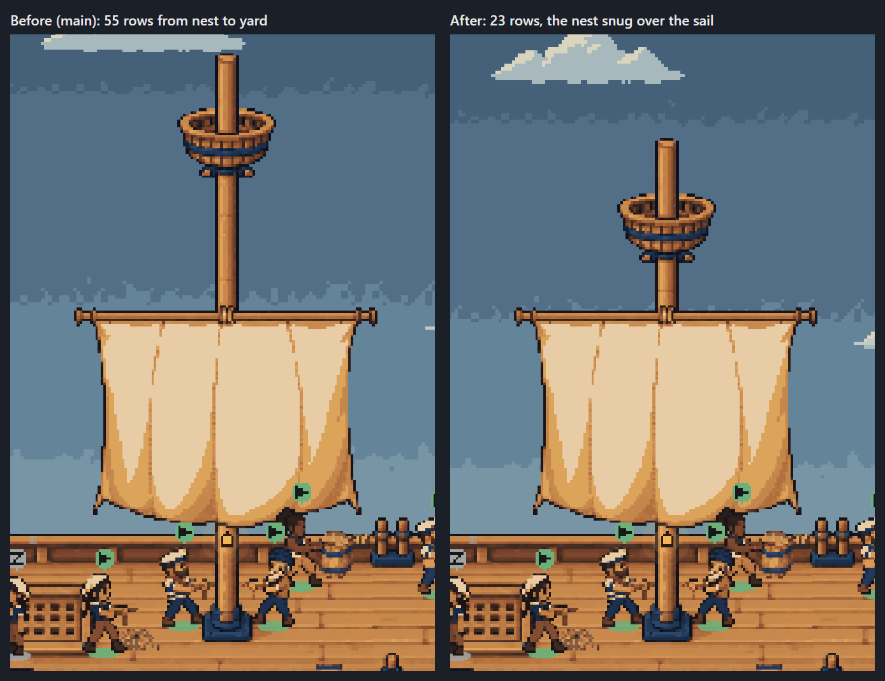
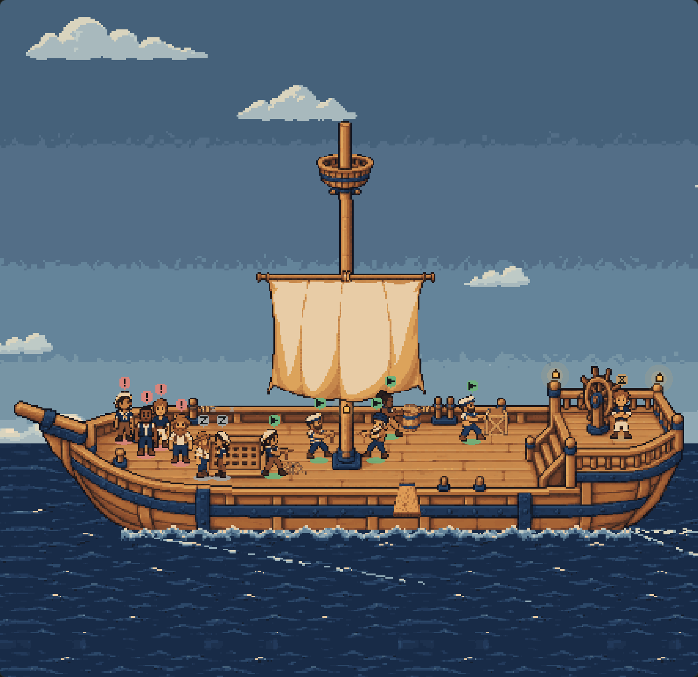
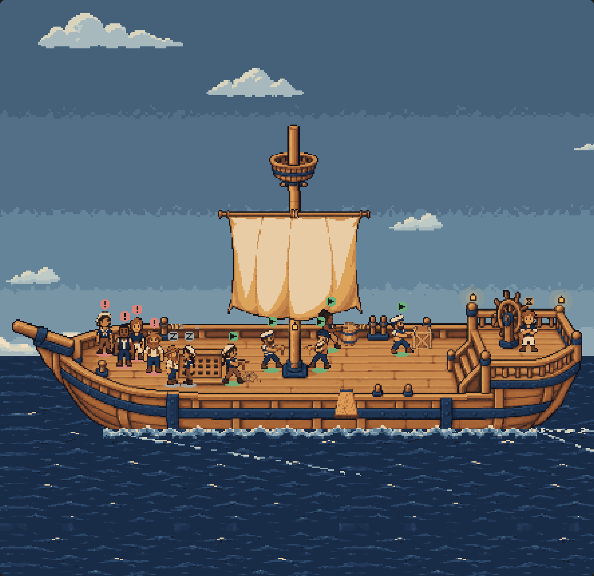

# The trimmed mast: evidence

The tall mast left a long bare stretch of pole between the crow's nest and the sail's yard. The deck now draws
**the trimmed generated mast** (`art/ship-deck/mast/`, from `fm/deck-mast-trim`): 32 px shorter, with the
nest brought down from 55 clear rows above the yard to 23. The art is the generated sprite as delivered,
placed where its manifest says (`integration.metadataToApply`); nothing was drawn or adjusted by hand.



| Before (main) | After |
| --- | --- |
|  |  |

The canvas harness's fixture fleet, 1440 × 900, dark, noon. After, light at 16:30: [light](after-deck-light.png);
[dusk](after-deck-dusk.png); [night](after-deck-night.png).

## What changed

- **`extras.json`'s `mast`**: size 48 × 224 → **48 × 192**, position (187, -112) → **(187, -80)**. Its `sway`
  (52 rows), `clears` and `replaces` are unchanged.
- **The nest is lower, everything below it is where it was.** The tip is at hull row -78 (was -110), the nest at
  rows -58 to -36 (was -90 to -68). The sprite's rows from the yard down are the previous mast's, pixel for
  pixel, so the yard's lashing is still hull (211, -12) and the foot still the hull's own; the sail stays at
  (154, -15), and its yard meets the pole exactly as before (`client/deck-extras.test.ts`).
- **The sway follows the nest.** The masthead is the mast's top 52 rows, measured from its own top, so it now
  swings hull rows -80 to -29: the nest, its lugs and three rows of pole, 13 rows above the sail's top edge.
  [One end](after-sway-a.png) and [the other](after-sway-b.png), half a period apart.
- **Depth is unchanged.** The mast's depth piece is still its rows from the sail's hem (row 69) to its foot,
  43 rows at baseline 110, so a sailor behind the foot is still covered and the cloth never is.
- **The fit** takes in 32 fewer rows above the hull. Panes that are wide and short draw the ship bigger again:

| Pane | Shows rows | Scale |
| --- | --- | --- |
| 1440 × 900 | -170 to 261 (was -186 to 245) | 1.69, unchanged (width-bound) |
| 2300 × 560, wide and short ([before](before-pane-wide-short.png), [after](after-pane-wide-short.png)) | -85 to 176 (was -118 to 177) | **1.48**, was 1.31 |
| [1000 × 1100, narrow](after-pane-narrow-tall.png) | -348 to 439 | width-bound |
| [1203 × 911 at 1.25×](after-pane-fractional.png) | -209 to 300 | width-bound |

## Everything else, still there

The plank and the shark ([on the board](plank-1-on-the-board.png), [splash](plank-2-splash.png),
[chomp](plank-3-chomp.png)); [click to focus](after-focused.png) and [back out](after-focus-back-out.png);
[reduced motion](after-still.png) (still, unswayed, the sail at rest); the idle crew resting on the foredeck;
the sky, clouds, stars and lanterns. No page errors or warnings ([render-results.json](render-results.json)).

**The bundle** ([compile-results.json](compile-results.json)): the client bundle is byte for byte main's
(557,317 bytes, 0 growth) — the mast is art served by `firstmate.deck.extras`, and this branch changes no
client code. Paseo 0.11's compiler builds it and React Native 0.81's `hermesc` parses it with default flags: no
`class`.

## What a pixel artist could still improve

- **Rigging.** The lugs under the nest (hull (203,-34) and (219,-34)) still have no ropes; shrouds from them to
  the rail would make the mast read as rigged rather than a bare pole.
- **The joint where it sways** is now at hull row -28, in the 19-row generated join between the lugs and the
  yard. The topmast moves a pixel against the pole there; a band or cap at that row would hide it.
- **The generated join** (sprite rows 49–67) has slightly different grain from the pole above and below at
  large zoom, consistent with the rest of the shipped art but visible at 4×.
- **The nest** is a plain basket at native size; a rail or a deeper basket would carry the height better.

## Reproducing

```
node docs/ship-deck-canvas/compile.mjs     # origin/main's bundle and the branch's, through Paseo's compiler
node docs/ship-deck-mast-trim/render.mjs   # headless Edge; writes the pictures and render-results.json
```

`docs/board-list/` holds the harness's own dependencies (`npm ci` there first). `compile.mjs` rewrites
`docs/ship-deck-canvas/compile-results.json`; this folder's copy is from the same run.
