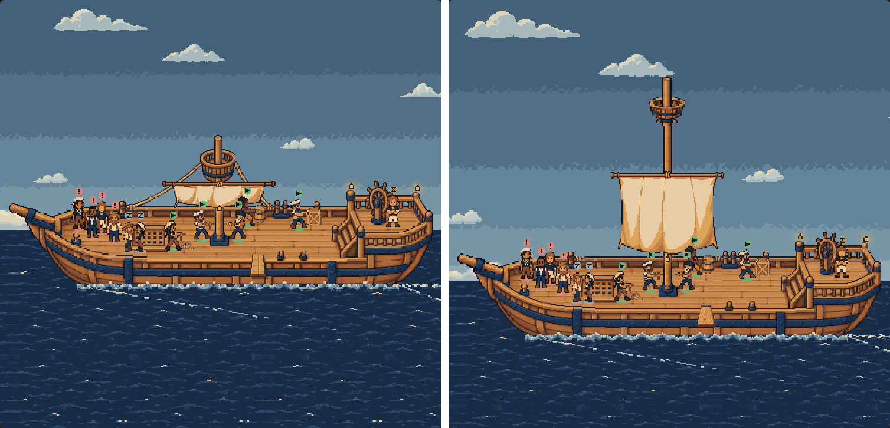
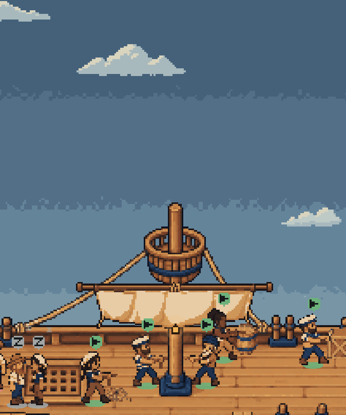
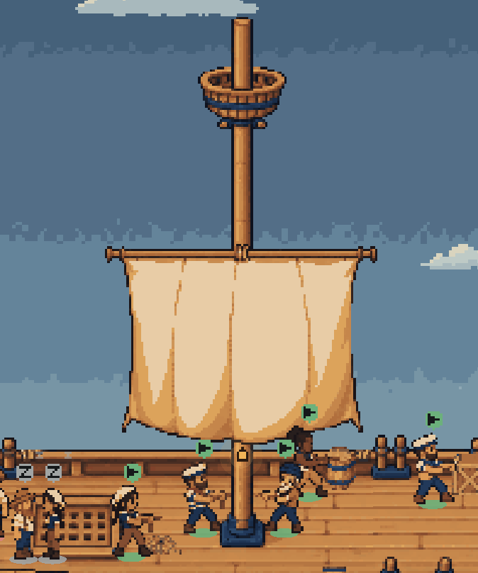
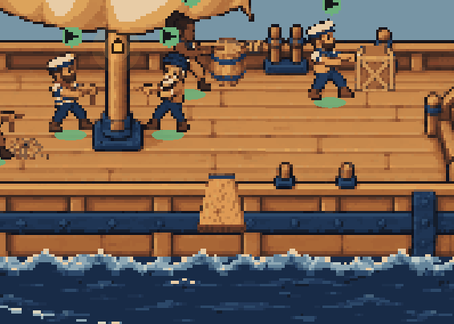
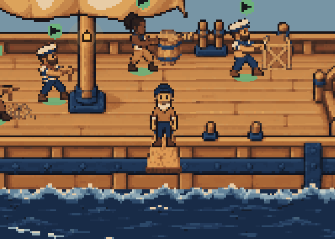
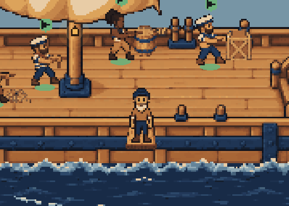
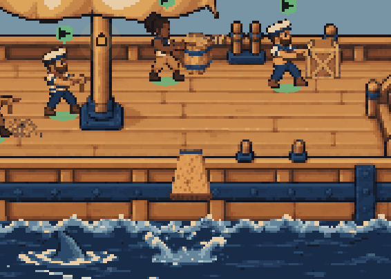
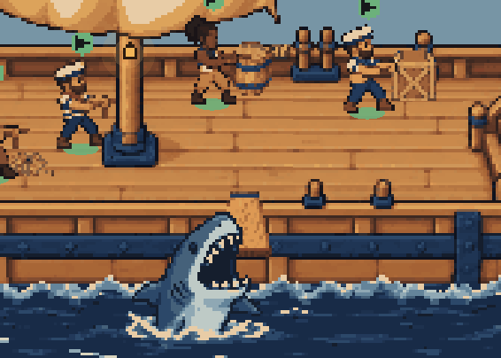
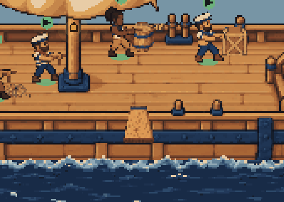

# The tall mast, its taller sail and the generated plank: evidence

The captain found the mast too short: the crow's nest sat barely above the crew's heads. The deck now draws
**the generated tall mast** (`art/ship-deck/mast/`, from `fm/deck-mast-art`) in place of hull C's own short
rig, with **the generated taller sail** (`art/ship-deck/sails/main-sail.png`, from `fm/deck-sail-art`) hung on
it. The plank sailors leave by is now **the generated board** (`art/ship-deck/plank/`, from `fm/deck-plank-art`)
in place of the one drawn in code. No art here was drawn, stretched or edited by hand or in code: all three
are the generated sprites as delivered, placed where their manifests say.



| Before | After |
| --- | --- |
|  |  |

The rig at the same scale (the canvas harness's fixture fleet, 1440 × 900, dark, noon). Light at 16:30:
[after](after-deck-light.png); [dusk](after-deck-dusk.png); [night](after-deck-night.png).

## The mast

- **111 px taller.** The tip is at hull row -110, where it was at row 1: 220 px from the deck's mast row (110)
  to the tip instead of 109, so twice the height. The crow's nest is at rows -90 to -68, where it was at about 14 to 50:
  about 140 px of open sky between its floor and the heads of the crew working at the mast, where there
  were some 20.
- **The foot is the hull's own.** The mast's rows 73 to 111 are pixel for pixel the shipped lower mast, so
  it stands on the deck exactly as the old one did (`client/deck-mast.test.ts` checks every pixel).
- **The short rig is left out.** The hull's own crow's nest, upper mast and both stays lie in open sky above
  the rail (`clears`, x 117–265, rows 0–70 of the hull); the hull is drawn in slices around them. The stays
  ended at the old nest, and nothing generated replaces them yet (see below), so they go rather than hang
  in the air.
- **It sways as the masthead did.** Its top 52 rows (the crow's nest, its lugs and the topmast) sway a pixel
  each way behind the bob, as the cut-out masthead always has; the shaft and foot ride the bob only.
- **The sail** is the generated taller one: two 114 × 84 states (the old was 114 × 27), its yard included.
  It hangs at hull (154, -15), the sail manifest's own place, so its yard lashing (57, 3) meets the tall mast's
  at hull (211, -12), about 55 rows under the crow's nest; its hem is at row 68, above the rail. Its rest and billow
  alternate every 850 ms as before, with the yard and corners still, and it rests under reduced motion. It
  rides the bob but not the masthead's sway, and hangs behind the crew, as the old sail did.
- **Depth.** The tall mast is drawn behind the sail and the crew, like the hull's mast; on the deck's layer,
  its own rows from the sail's hem (row 69) down stand in for the mast's depth piece, on the same row (110),
  so a sailor walking behind the mast's foot is still hidden by it and the mast never paints over the cloth
  (`mastLayout` in `client/deck-extras.ts`). The old cloth occluder (`sails/mast-occluder.png`), the mast
  with rows cleared behind the short sail, is not needed any more and is no longer in the manifest.
- **Without the tall mast's image** (a failed decode) the short rig is drawn bare, with its own mast piece:
  the taller sail is fitted to the tall mast and hangs on nothing else.

## The fit

The deck is fitted from the mast's tip (row -112) to the plank's sea under the shark (row 171) instead of
the hull's 161 rows (`deckBox` in `client/deck-pixi.ts`), so neither the tip nor the shark is ever cut:

| Pane | Shows rows | Scale |
| --- | --- | --- |
| [1440 × 900](after-deck.png) | -186 to 245 | same as before (width-bound) |
| [2300 × 560, wide and short](after-pane-wide-short.png) | -118 to 177 | 1.31, was 2.30 ([before](before-pane-wide-short.png)) |
| [1000 × 1100, narrow board pane](after-pane-narrow-tall.png) | -364 to 423 | width-bound |
| [1203 × 911 at 1.25×](after-pane-fractional.png) | -225 to 284 | width-bound |

The cost is in a wide, short pane: the ship is drawn smaller there (57 % in the 2300 × 560 pane) because
the mast now needs the height. Every other pane keeps its scale; the fit is still exact, with no steps.

## The plank

The generated board, 18 × 22, at hull (241, 120) on the same rail and tip anchors, in the depth slot the
code board had (just in front of the near rail, behind whoever walks it). The walk, the teeter, the jump,
the splash and the shark are untouched:

| On the deck | On the board | At its end | Splash | Chomp | Gone |
| --- | --- | --- | --- | --- | --- |
|  |  |  |  |  |  |

It is served with the extras (`firstmate.deck.extras`, `extras.json`'s `plank`), never bundled; where it does
not load, the code board (`plankPixels`) is drawn instead, so a sailor never walks out on nothing.

## Everything else, still there

[Click to focus](after-focused.png) and [back out](after-focus-back-out.png); [reduced motion](after-still.png)
(still, unswayed, the sail at rest); the clouds, sky, stars and gull behind the rig; the crew, badges, wake
and lanterns. No page errors or warnings in any of it ([render-results.json](render-results.json)).

**The bundle** ([compile-results.json](compile-results.json)): Paseo's compiler and React Native 0.81's
`hermesc` with default flags parse it, no `class`; the mast and the board are art served by the daemon,
about 5 KB more of it, the cloth occluder no longer among it, and the client bundle grows 4 KB over main.

## What a pixel artist could still improve

- **Rigging.** The tall mast has rigging lugs under the crow's nest (hull (203,-66) and (219,-66)) but no
  ropes, and none are drawn here: the old stays are gone with the short rig. Stays or shrouds from the lugs
  to the rail, as a generated sprite, would make it read as rigged rather than a bare pole.
- **The crow's nest** is smaller than the old one (37 × 23 against about 37 × 36) and, at native size, a little
  plain; a deeper basket with a rail would carry the height better.
- **The sail**'s billow is two keys of fold shading with a small hem lift; a few more frames, and cloth that
  fills and slackens, would make it sail. Above the yard the mast is bare to the nest: a topsail would fill it.
- **The seam where it sways**: the topmast moves a pixel against the shaft at hull row -60, as the old
  masthead did at row 48. An artist-cut joint (a cap or a band there) would hide it.
- **The plank**'s rivets and knot are small clusters at game scale (`art/ship-deck/plank/README.md`).

## Reproducing

```
node docs/ship-deck-canvas/compile.mjs   # origin/main's bundle and the branch's, through Paseo's compiler
node docs/ship-deck-mast/render.mjs      # headless Edge; writes the pictures and render-results.json
```

`docs/board-list/` holds the harness's own dependencies (`npm ci` there first). `compile.mjs` rewrites
`docs/ship-deck-canvas/compile-results.json`; this folder's copy is from the same run.
