# Walking the plank: evidence

A crewmate leaving the deck used to walk back to the hatch and climb down. Now there is **a plank over the
gunwale amidships**, and a departing crewmate **walks to it, out along it, jumps, splashes, and a shark has
it** — then the sea is empty again.

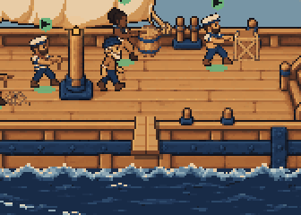

| Walking to the plank | On the plank | Teetering at the end |
| --- | --- | --- |
| 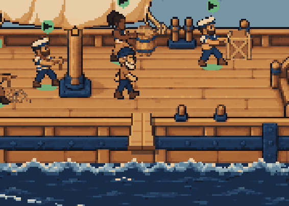 | 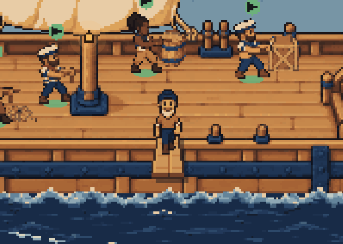 | 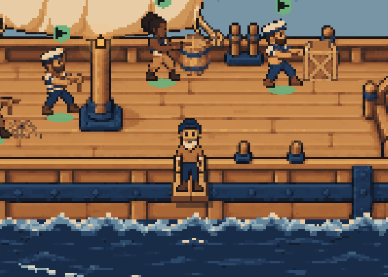 |
| **Over the side** | **Splash** | **The fin** |
| 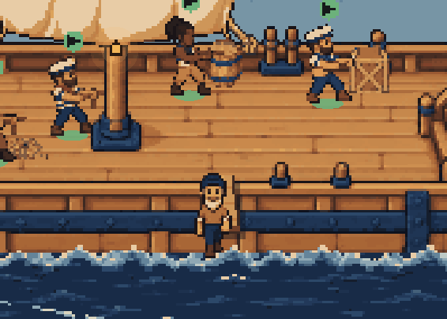 | 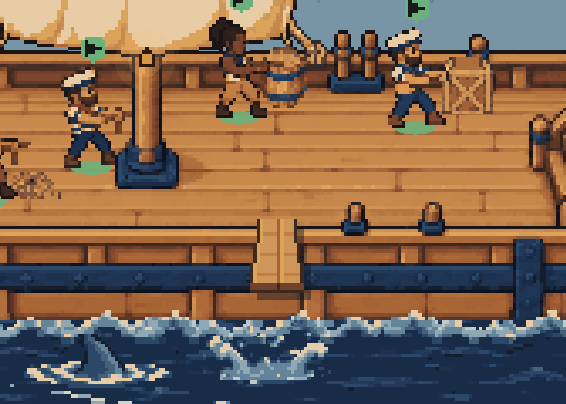 | 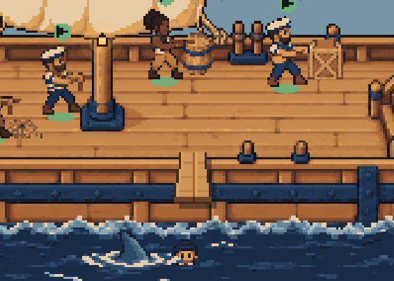 |
| **Chomp** | **Under it goes** | **Gone** |
| 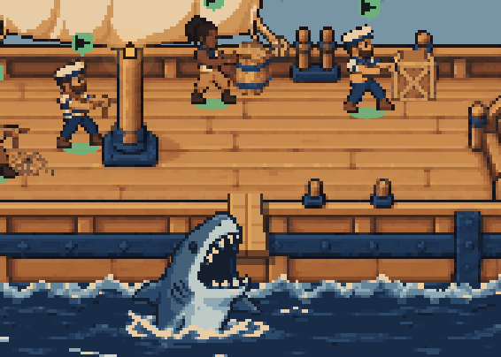 | 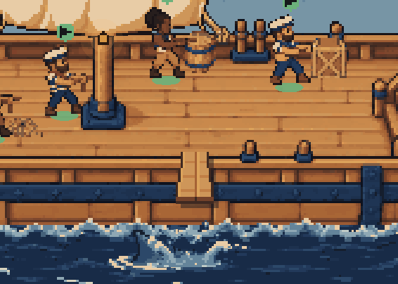 | 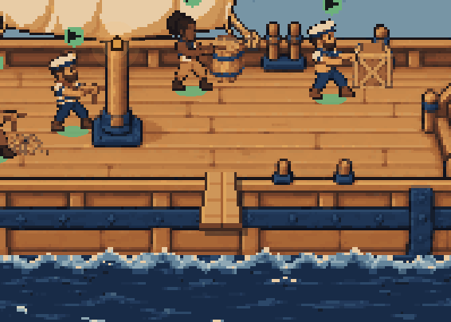 |

The canvas harness's fixture fleet, a moving deck at noon, dark theme; a working crewmate's card moved to
Done. Each beat is pictured at its moment on Playwright's paused clock (`host.jsx`'s `plankTimes` steps the
deck's own crew logic to find it). The whole deck with the plank: [dark](deck-plank-dark.png),
[light, 16:30](deck-plank-light.png).

## How it plays

From the poll that takes the card off the deck:

1. **The walk.** The sailor's badge and mark go at once — its card has left — and it walks the deck's own
   A* paths to the plank's foot, open deck just behind the gunwale (`PLANK.foot`, 250,118). No teleport.
2. **The plank** (`plankExit` in `client/deck-plank.ts`, from the foot, about 2.6 s in all): a step up over
   the gunwale (160 ms), out along the plank towards the viewer at the deck's walking pace (531 ms), a
   teeter at the end, rocking foot to foot (300 ms), and a jump — a little up, then down — into the near sea
   straight below the tip (420 ms).
3. **The water.** The splash's `impact` then `burst`; the sailor goes under it, then bobs up head and
   shoulders out. The shark's `fin` closes in from 40 px off (560 ms), `surface` (160 ms), `chomp` over the
   swimmer — whose last frame is the one before (180 ms) — and `submerge` (200 ms) with a second `burst` over
   the spot. Then nothing: the sprites are destroyed.

The plank, the sailor walking it and the ship ride the bob; from the jump on, the sailor, the shark and the
splash are in the `overboard` layer over the near sea, outside the bob, anchored in the water as the shark's
art asks (`docs/ship-deck-art/shark/README.md`).

## Several at once

| Second on the plank, third waiting, first's fin out | After |
| --- | --- |
| 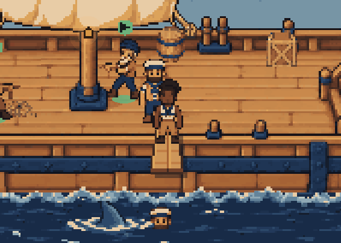 | 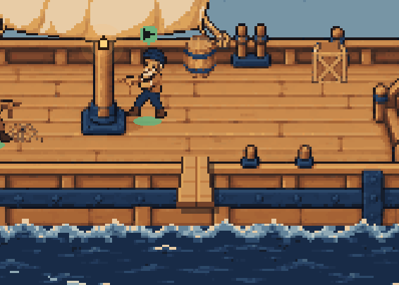 |

Three cards gone from the board in one poll. They queue in the order they left, beside the plank's foot,
each in its own spot; the next steps up only once the one before has hit the water, so there is one sailor
on the plank and one shark in the water at a time — here the gaps were 1485 and 1584 ms, against the
1411 ms from the foot to the splash. The sharks come from the left and the right by turns, mirrored about
their anchor, and the sailors land a few pixels apart.

## A focused sailor leaving

| Focused | Its card goes to Done: panel closed, camera out, it walks |
| --- | --- |
| 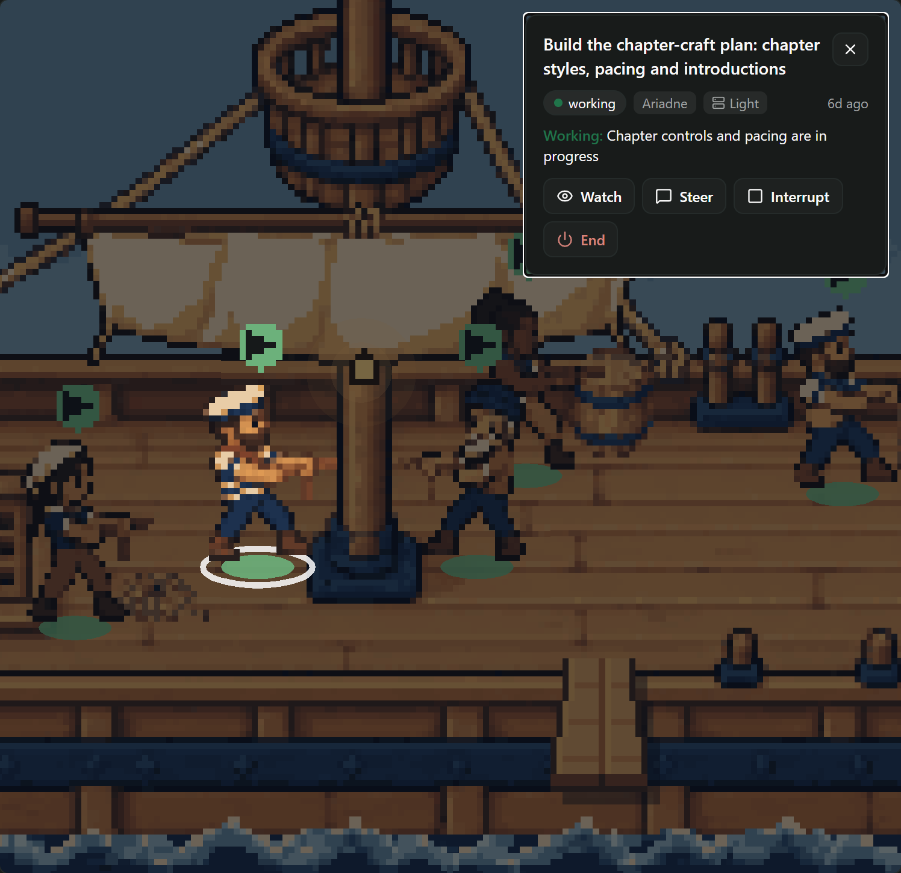 | 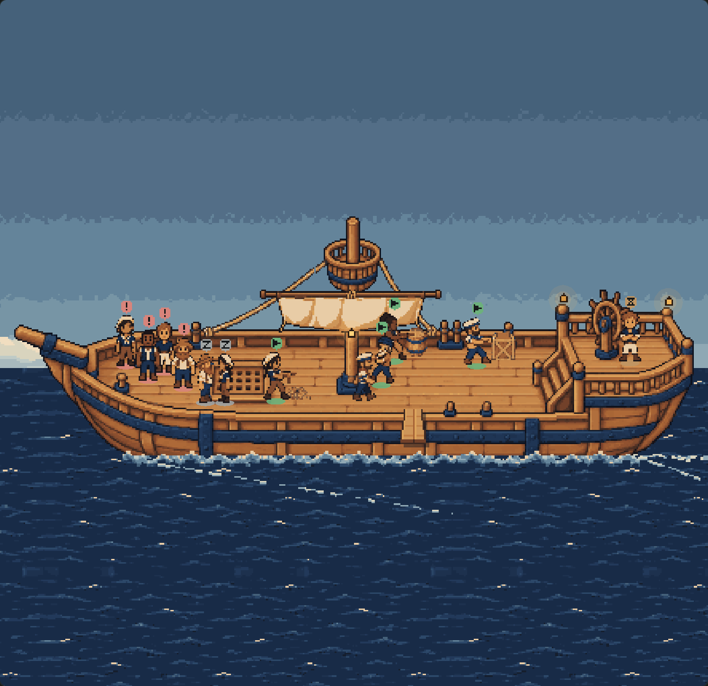 |

The pane already lets go of the focus when its sailor leaves the deck (`client/ship-deck.tsx`). The camera
pulls back out over its usual half-second while the sailor sets off; a sailor on its way out is never under
the pointer (`sailorAt` skips it), so it cannot be clicked back into focus. Over the side it is a different
sprite (its key gains `~n`), so a card that comes back meanwhile brings a new sailor up the hatch.

## Reduced motion

| Before | 220 ms after the poll | Gone |
| --- | --- | --- |
| 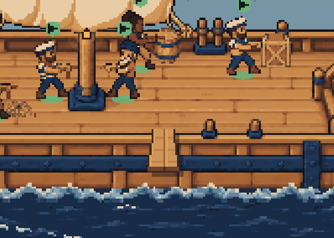 |  | 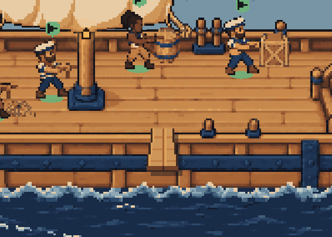 |

No walk, no plank, no shark: the sailor fades out where it stood over 600 ms (`FADE_MS`). A still deck has no
frame loop, so while anyone fades it is drawn again every 50 ms from a timer (`watchFades` in
`client/deck-pixi.ts`) that stops itself once nobody is fading, and never draws while the window is hidden.
The canvas stays `data-firstmate-deck-motion="still"`. Reduced motion turned on mid-sequence fades whoever is
still in sight where they are and drops the shark at once.

## Which departures take the plank

Every one, for now: a card that went to Done, failed, had its worker closed, or left the board. The deck's
scene says why each card is off the deck (`departureOf`), and `PLANK_DEPARTURES` in `client/deck-plank.ts` is
the one place that decides: `new Set(["done"])` there keeps the plank for finished work and sends the rest
down the hatch, as every departure once went. A lost feed is not a departure: stale crew stay greyed where
they stood.

## What it costs

- **Art served, not bundled**: the four shark keys and two splashes ride `firstmate.deck.extras` beside the
  sail and the looks, 14 PNGs and about 35 KB together (46 KB as base64). `extras.json`'s new `exit` names
  them with their sizes, water anchors and the shark's mouth; the manifest is optional and so is each image —
  without them a sailor still walks the plank and drops into the sea.
- **The bundle**: Paseo's compiler, then `hermesc` with its default flags, both parse it; no `class`
  ([compile-results.json](compile-results.json): 16 KB over main's client bundle).
- **Frames**: no new loop. The fps cap, pause-while-hidden and the software renderer's 12 fps are untouched;
  under reduced motion only a fade draws, at 20 a second for 0.6 s.

## Where the water is, and the fit

The water below the tip is as far in front of the hull's waterline as the tip is in front of the gunwale:
row 168. The shark's lowest pixel is two rows under its anchor, so it is all on the canvas in any pane up to
2.4 times as wide as it is tall under the deck's exact fit (`client/deck-plank.test.ts`). The fit itself is
unchanged; in a wider, shorter pane a row or two of the shark's ripple is cut.

## What a pixel artist could still improve

- **The plank** is drawn in code from the hull's own colours: two boards, an end, a cast shadow. A drawn
  plank with real grain and perspective, and an iron or a rope holding its inboard end, would read better.
- **Poses**: there is no jump, fall or swim pose in the atlas. The sailor jumps in a walking pose, and swims
  as its front view cut at the water. A leap with arms up, a flailing fall, and a treading-water head would
  carry the gag.
- **The shark** has four keys and no inbetweens (`docs/ship-deck-art/shark/README.md`): the fin slides rather than
  swims, and there is no jaw-closing frame. A fin wake, a lunge inbetween and a closing bite would smooth it.
- **The splash** is the same two keys at the landing and the bite; a bigger bite burst and some ripples
  that spread after would help.

## Reproducing

```
node docs/ship-deck-canvas/compile.mjs   # the branch's bundle, through Paseo's compiler
node docs/ship-deck-plank/render.mjs     # headless Edge; writes the pictures and render-results.json
```

`docs/board-list/` holds the harness's own dependencies (`npm ci` there first).
