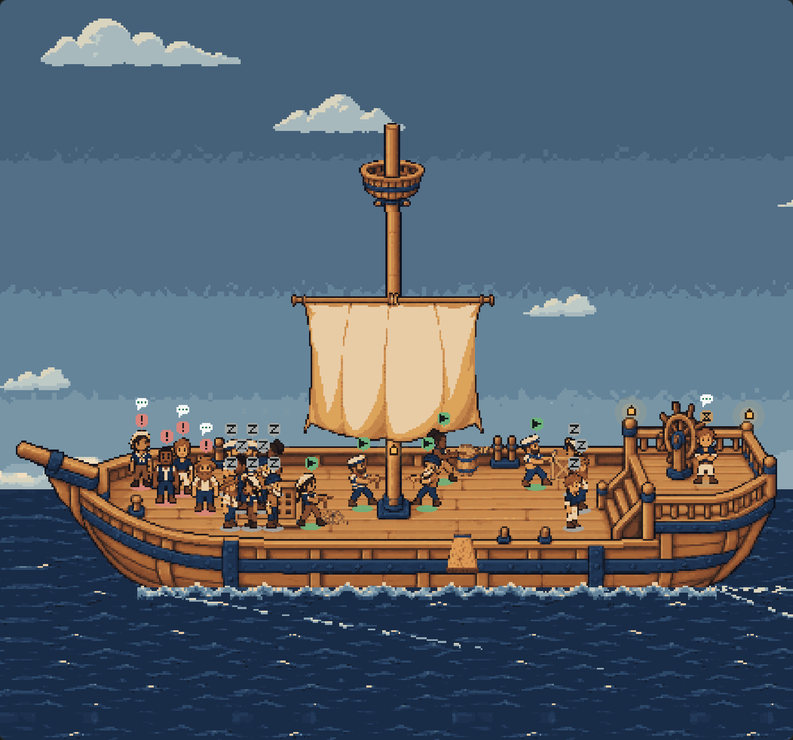
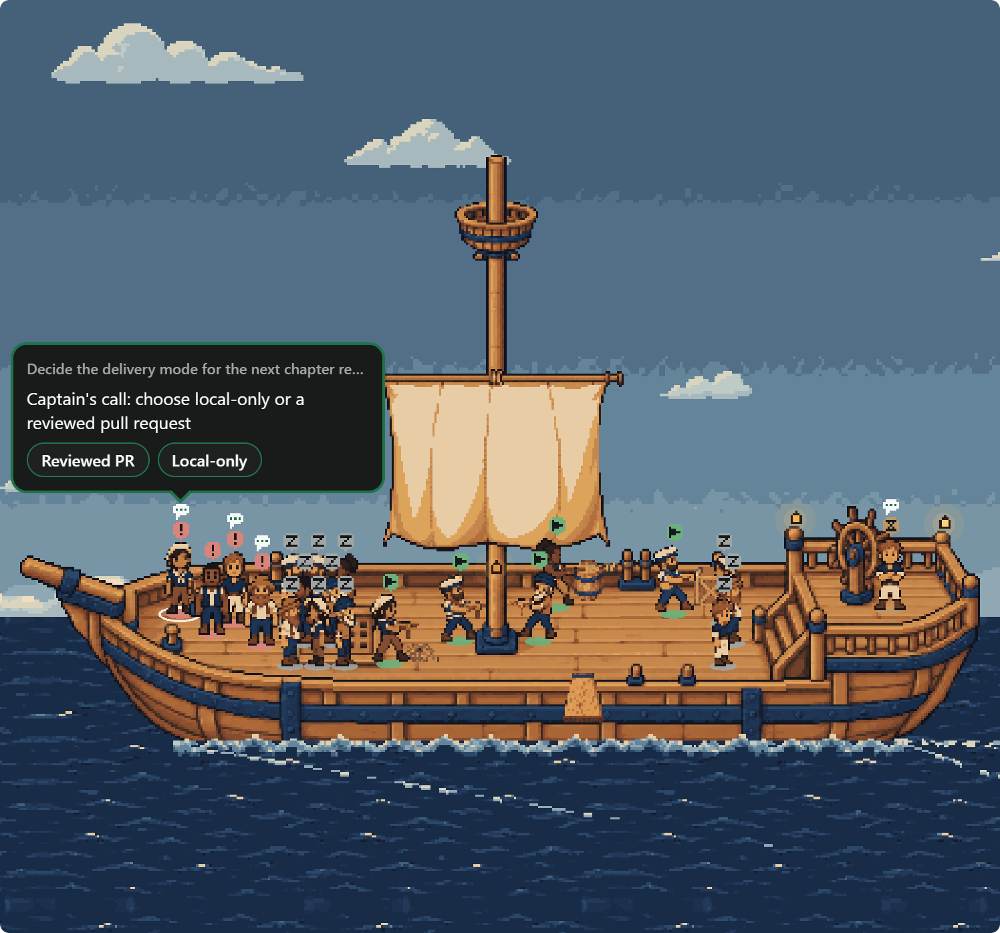
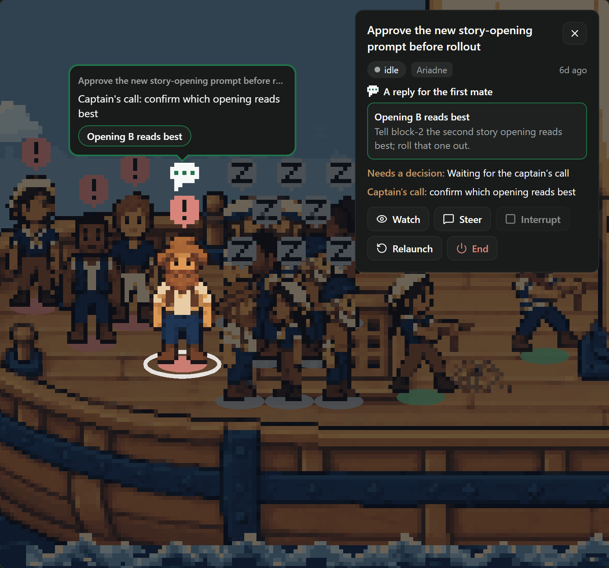
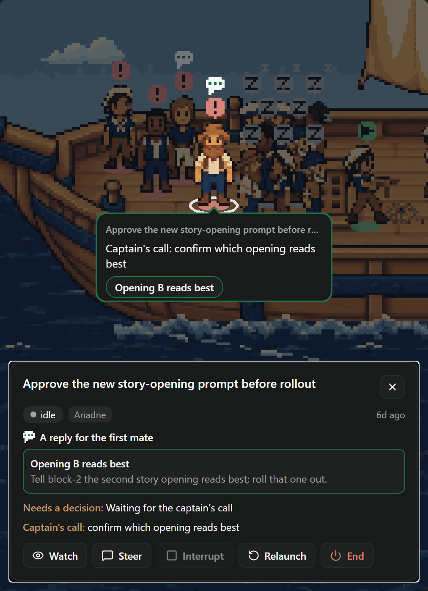

# Replies on the deck: evidence

On the board, the first mate's suggestions are buttons above the crew: a press sends their words to the first
mate as the captain's. Now, when a suggestion is about one crewmate's work, the deck hangs it over that
crewmate's sailor: a **marker** says at a glance who has something for the captain, and pointing at it opens a
**speech bubble** with each reply as a chip. A chip sends the reply the way the board's button does.

| Markers on the whole deck | The bubble on hover |
| --- | --- |
|  |  |

| Focused: bubble and panel | Narrowed while focused |
| --- | --- |
|  |  |

The crowded fleet of `docs/ship-deck-rest/` with five suggestions naming four crewmates (block-0, block-1 with
two replies, block-2, and work-5 waiting by the helm), dark theme at noon. The whole screen focused:
[dark](focused-1440-dark.png); before: [dark](deck-1440-dark.png); the bubble in the [light theme at
08:00](bubble-light.png); [after a reply is picked](after-pick.png).

## Where the replies come from, and how they go

- **The data is the board's.** A reply is one of `fleet.suggestions` — `data/suggestions.md`, which the
  strip above the board shows. Nothing new is read or written. `cardReplies` (`client/deck-replies.ts`) hangs
  a suggestion over a card when its label or prompt names the card's task id (as a whole word, `fm/<task>`
  included), its pull request (the URL, `repo#42` or `owner/repo#42`), or its agent id (whole, or its first
  eight characters). A suggestion naming no one stays on the strip only; one naming two crewmates hangs
  over both.
- **The send is the board's.** A chip — in the bubble or the focus panel — calls the screen's `suggest`,
  the strip's own: `useMateSender`'s gate (one message on its way at a time), `firstmate.mate.ask` with the
  reply's words, the failure toast, and the chat unfolding to show it go out. The deck adds only a
  "Sending to the first mate: …" toast. Checked in the browser: one call, `firstmate.mate.ask`, with exactly
  the reply's prompt.
- **Answered at once.** `suggest` marks the reply's words answered (`answeredReplies`, module scope like the
  send gate) and unmarks them if the send fails. The deck drops every reply of a crewmate once any one is
  picked — they are most often the alternatives to one question — so the marker and bubble clear on the
  click, not a turn later when the first mate rewrites the file. A reply picked on the strip clears the deck
  too. Once the file drops the picked reply it is forgotten, so the same words coming back later are offered
  again.
- **Disabled, with the reason.** While a message is on its way, or with no first mate aboard, every chip is
  disabled, says why as its tooltip and accessibility hint, and the bubble and panel say it in a line
  (`replyBlockedText`).

## How the marker reads

- A **white speech bubble with three dots** in the theme's accent, its tail down to the badge: unlike the
  badges, which are coloured squares with a glyph, it reads as "this one has something to say". It bobs a
  pixel now and then, out of step per sailor; under reduced motion it holds still (two frames a second apart
  are identical).
- It is drawn in the sailor's own layer like the badge, so the pieces in front cover it, and the pointer
  finds the sailor on it. It rides the focused sailor into the spotlight.
- **Never on another sailor** (`askMarks`): the frontmost sailor chooses first, over its badge, else beside
  it on the right, else on the left (mirrored, tail still at the badge), wherever it covers no other sailor,
  badge included, and no marker already placed. Where nothing round the badge is clear — sleepers packed a
  badge apart, a full place's spots three rows apart — the marker is the badge's own edge in white, which
  takes no room the badge did not. With every one of the 21 crewmates asking: no clashes, 7 framed.
- Not on a stale (greyed) sailor, one still climbing out of the hatch, or one leaving by the plank.

## How the bubble behaves

- **On hover, for one sailor at a time**: the bubble replaces that sailor's hover label (it names the card
  too), so with several asking there is only ever one bubble. It hangs over the marker, by its bottom, centred
  on the sailor and kept inside the canvas; with no room above it hangs below the feet, and it scrolls rather
  than leave the canvas. A sleeper's hangs under the near rail like its label, over no one.
- **It waits for the pointer**: `BUBBLE_LINGER_MS` (600 ms) after the pointer leaves the sailor, and as long as
  it is over the bubble. It listens with the DOM's own pointer enter and leave on a plain view: react-native-web's
  `Pressable` ends its own hover when the pointer reaches a `Pressable` inside it, which in the first browser
  run took the bubble down just as the pointer reached a chip.
- **Focused, always**: the canvas reports where the focused sailor stands while it has replies (through the
  zoom and every resize), and the bubble hangs there, kept to the room the panel leaves — left of it beside,
  above it docked. Tab cycles through the bubble's chips and the panel and never leaves them; Esc closes as
  before. The panel lists the same replies under the card's glance, each with the start of its words.
- It is the app's own text over the canvas, the canvas host still childless; nothing in it is Pixi.

## What was checked

`render.mjs` drives the compiled bundle (`node docs/ship-deck-canvas/compile.mjs` first) in headless Edge;
`render-results.json` has the results, no page errors or warnings:

1. Exactly the four named crewmates wear the marker, each clear of every other sailor; the legend says
   "4 with replies for you".
2. Hover on block-1: its bubble, no label, inside the canvas, off the sailor, two chips. The pointer crosses to
   a chip (twelve steps) and the bubble stays; the click sends one `firstmate.mate.ask` with the reply's
   prompt, and the bubble and marker clear ("3 with replies for you").
3. A click focuses block-2: the panel and the bubble show the same reply, the bubble left of the panel and
   inside the canvas; fourteen Tabs stay in bubble and panel, both visited.
4. Narrowed to 1000 px while focused: the panel docks, the bubble stays above it, inside the canvas.
5. Reduced motion: the canvas is `still`, and frames a second apart are identical.
6. Every crewmate asking: 21 markers, no clashes.
7. The light theme at 08:00.

`client/deck-replies.test.ts` holds the matching, the answered store, the bubble's placement and the markers
on every crowding of the deck the motion tests use; `client/deck-environment.test.ts` the marker drawn,
bobbing, still and cleared through a stand-in Pixi, and the focused sailor's report; `client/ship-deck.test.ts`
the bubble, its linger, the chips, the disabled reason, the panel's replies and clearing on a pick.

`compile-results.json`: Paseo 0.11's compiler builds the client bundle at 557,317 bytes (+21,617 over main, with the tall mast), without `class` syntax, and Hermes
parses it.

## What a designer or artist could still do

- **The marker is code pixels.** A pixel artist's speech-bubble icon, or a sailor pose that turns to the
  captain with a raised hand, would say "wants you" with more character than a glyph over the badge.
- **The framed fallback** on a packed deck is quieter than the bubble; a designer may prefer to thin the crowd
  instead (a separate row for askers, or a wider rest area).
- **The bubble is the app's surface** with an accent border and a CSS-rotated tail. A hand-drawn bubble
  frame (served like the other art) with a softer, comic tail would sit better against pixel art, and its
  fixed 280 px width could follow the reply count.
- **The matching is by name.** A first mate that writes suggestions without the task id or pull request gets
  no marker; a structured `(for: <task>)` field in `suggestions.md` would be exact, but changes the file's
  format, which was out of scope here.
