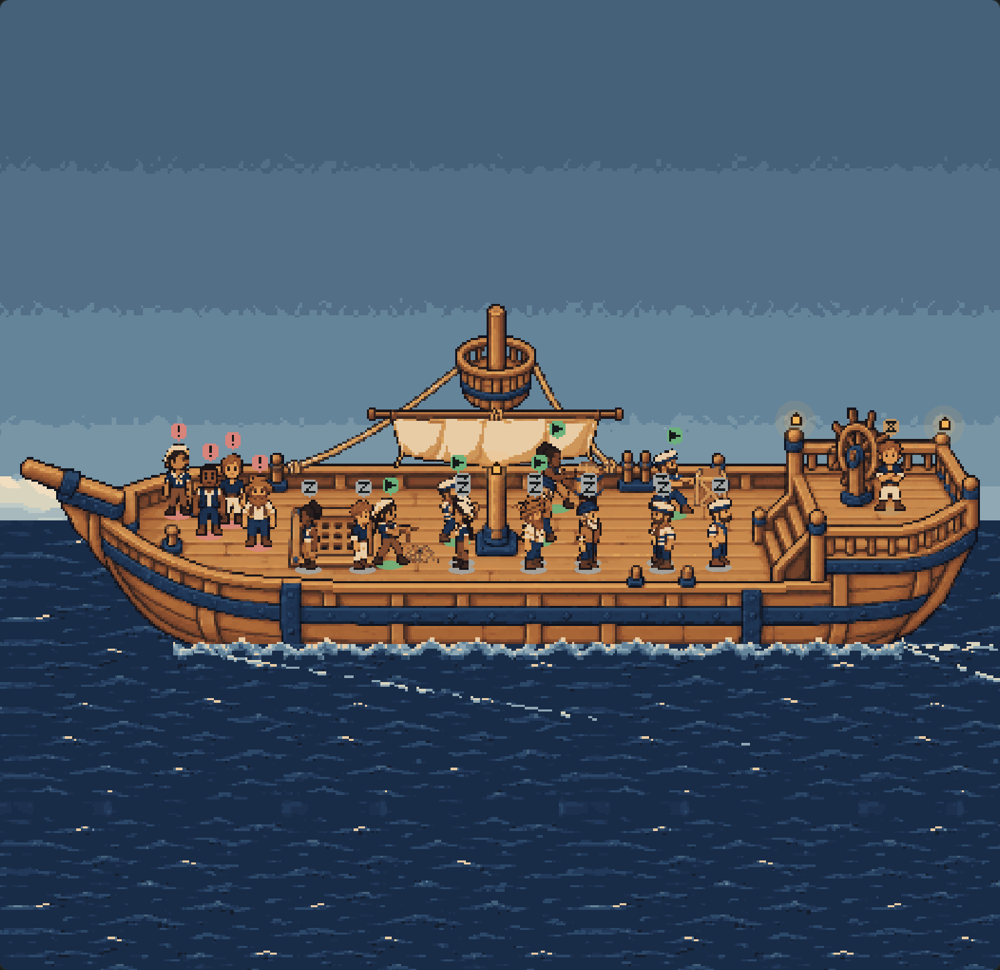
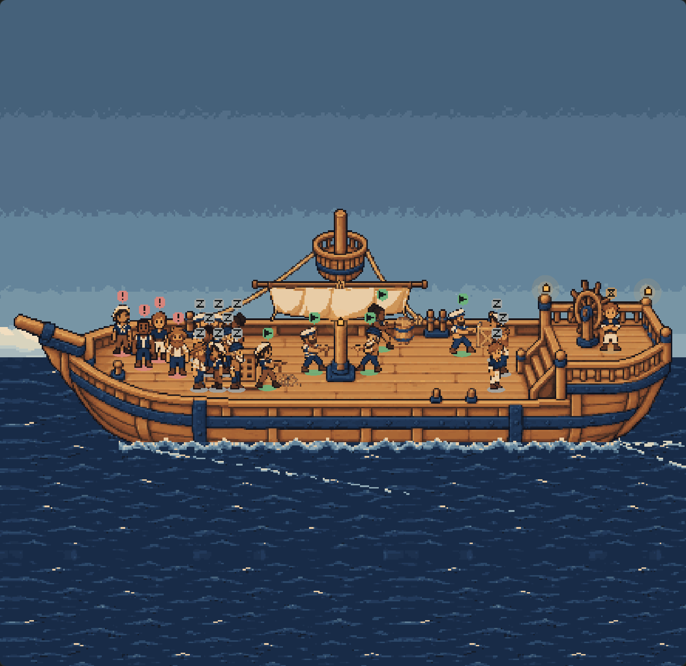
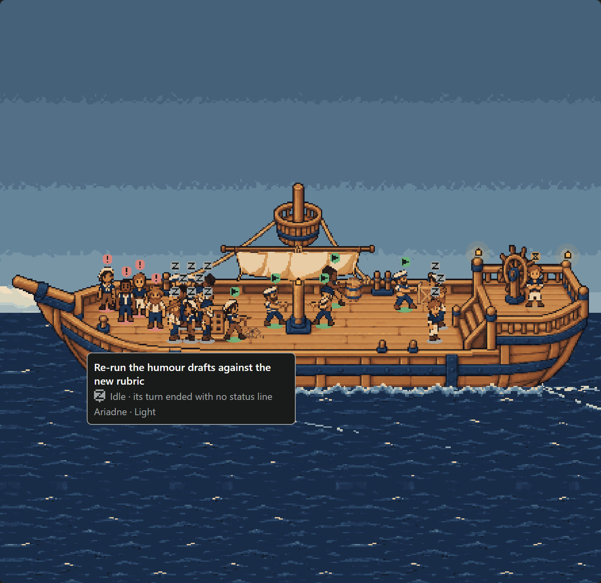
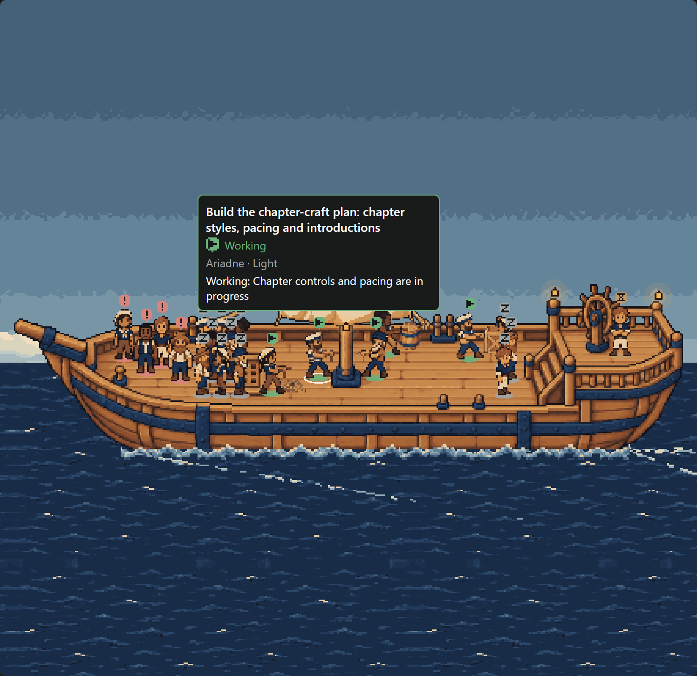
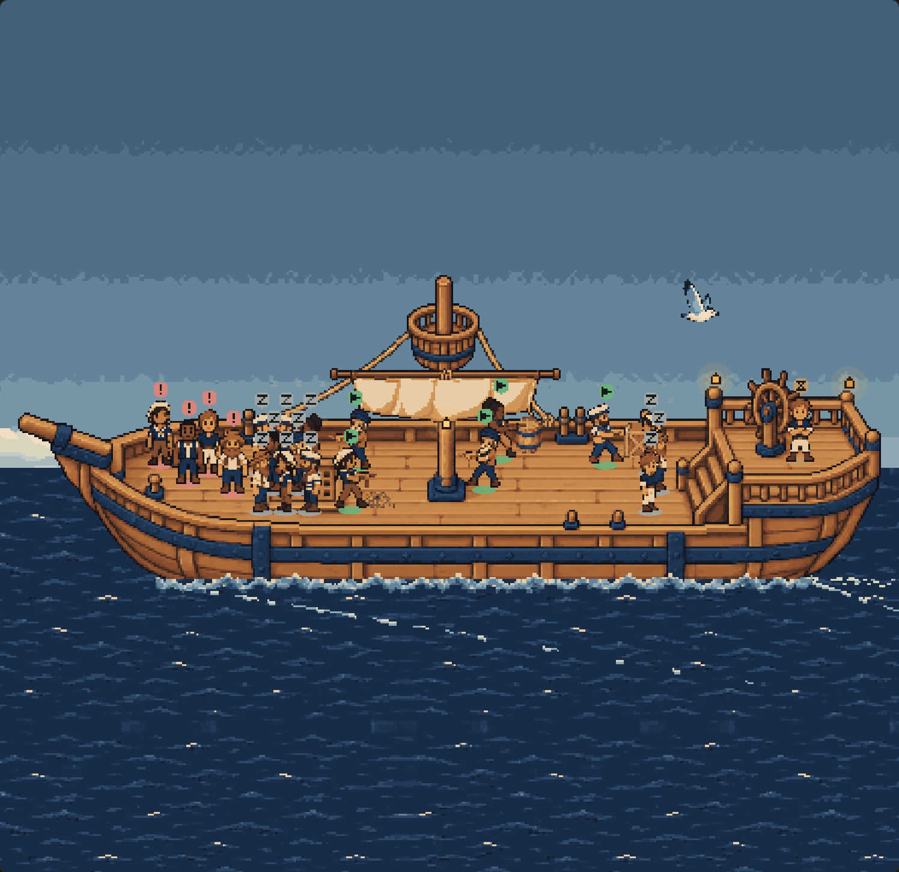

# Idle crew rest off the working deck: evidence

On the live deck every idle crewmate stood along the near rail amidships, at the front of the deck, right in
front of the stations. With more sleepers than workers, the crew at work were hidden behind a row of Z badges.
Now an idle crewmate **walks to a rest area** and dozes there, its at-ease pose, badge and drifting z unchanged.
When it is given work it walks back to a station. Working, waiting and blocked crew keep their places.

| Before (main) | After |
| --- | --- |
|  |  |

The same crowded fleet in both: eleven idle, five working, one waiting, four blocked (`host.jsx` adds nine
sleepers to the fixture fleet). Still deck, noon, dark theme.

## Where they rest

`REST_AREAS` in `client/deck-geometry.ts` holds two areas:

- **The foredeck by the hatch**, between the bow's spots (blocked) and the first stations. It is the only open
  stretch of main deck that no other place uses.
- **The foot of the quarterdeck stairs**, aft of the crate's station.

There are thirteen rest anchors (`rest-1`…`rest-13`), filled **in their listed order**, not nearest first, so a
crowd stays tidy wherever its sleepers come from:

1. the foredeck's front row along the near rail (3);
2. its back row, nineteen rows behind, which leaves each sleeper's head and badge clear of the front row (3);
3. the foot of the stairs (3);
4. only then the foredeck's middle and far rows, in the gaps (4).

Past thirteen, `restSpot` packs more sleepers into the rest areas at least a badge's width across or a badge's
height down from every other sleeper (`REST_SPACING`), so no badge covers another. Only when that runs out
does it fall back to a closer spacing, and even then it stays inside the rest areas. Idle crew are never sent
onto the working deck.

## Hover and labels

Every sailor's hit box includes its badge, and the frontmost sailor wins, as before. A sleeper's label no longer
goes over its head. It **hangs below the deck's near rail** (`REST_LABEL_ROW`, row 122), under every sailor's
feet: the walkable deck ends at row 119. There it covers the hull's side and nothing on deck: no other sleeper
packed around the hovered one, no crew at work beside them, and not the sail or the mast. Across, it is
centred on the sailor and held inside the canvas as before. On a canvas too short to fit it there, it goes where
any label goes. Working, waiting and blocked crew are labelled as before.

| A back-row sleeper | A sailor at work |
| --- | --- |
|  |  |

## The walk

State is still shown at once, and the walk catches up along the existing A* paths at 32 px a second, with no
teleport. In `render.mjs` step 3, a working crewmate (the mast's fore station) goes idle on the next poll and a
sleeper is given work at the same moment. They cross mid-deck, and after the walk the pointer finds each one
at a rest spot and at a station.

| Mid-walk | Arrived |
| --- | --- |
|  |  |

## What was checked

`npm test` (`client/deck-motion.test.ts`, `client/deck-polish.test.ts`, `client/ship-deck.test.ts`):

- every rest anchor sits in a rest area, on open deck, off the stairs and in front of the near rail (the atlas's
  own pixels), and every path between any two anchors stays on deck;
- with **every** other place's anchors held and 1, 3, 6, 13, 16, 20 or 24 sleepers aboard: each sleeper is in a
  rest area on its own spot, overlaps no working, waiting or blocked sailor, and is found by the pointer
  somewhere in its badge. Every awake sailor stays in reach too. With 32 they are still all in the rest areas;
- the rest spots fill in order whatever a sleeper's previous place, a spot given up goes to the next sleeper,
  and the walk to rest and back moves at most a frame's stride each frame;
- a sleeper's hover reports a floor and an awake sailor's does not; the label hangs there when it fits and
  falls back otherwise; no sailor is drawn below `REST_LABEL_ROW`.

`node docs/ship-deck-canvas/compile.mjs` and then `node docs/ship-deck-rest/render.mjs` (headless Edge, Paseo
0.11's own compiler, `render-results.json`):

1. **The crowded deck**: no sleeper's box overlaps an awake sailor's, and the legend reads "11 idle — resting
   off watch".
2. **Hover**: the pointer on the middle of each of the 21 sailors' badges finds that sailor. Each sleeper's
   label lies inside the canvas and over no sailor.
3. **The walk**: as above.

`compile-results.json`: the branch's client bundle still parses under Hermes with its default flags, with no
`class` syntax and no Pixi. It is 1.9 KB larger than main's.

**Regressions** (`regression-results.json`), from the earlier harnesses run on this branch with their own outputs
left as committed:

- **Tweaks**: still deck against the independent 2D composite, **31,549 of 31,549** art pixels match. Sail and
  wake move, 31 draws a second, and both sleepers breathe with their feet still.
- **Polish**: hover, resize and badges pass. Pointing at the middle of each of the fixture's 12 sailors now finds
  11 of them as themselves. In the committed results from before this change it found 9, and two of the misses
  were working sailors with a sleeper standing in front of them. The remaining miss is two working neighbours
  at the mast.
- **Environment**: passes.
- **Default and motion**: both stop at their first step. That step asserts the screen as it was behind the
  removed `FIRSTMATE_SHIP_DECK` switch, so it was failing before this change.

## For a pixel artist

The rest areas are the only open deck the hull has. With more than six sleepers the foredeck is a crowd,
staggered so every badge shows but with bodies overlapping. A **sitting or lying doze pose**, about half a
standing sailor's height, would let the same spots show whole sleepers. So would a **bench, coiled-rope seat or
hammock** prop in the rest areas, which would also make "resting" read without the badge. Neither is in the
atlas. The hull itself offers no below-deck view.
