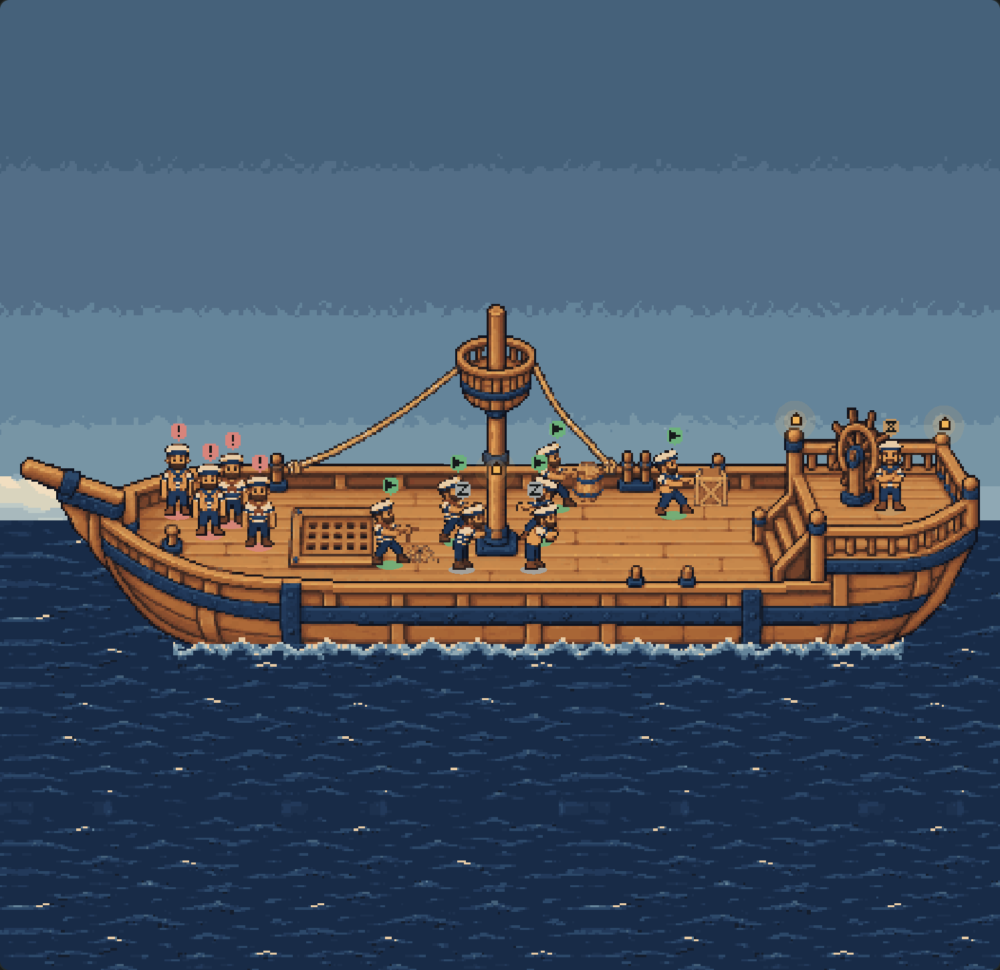
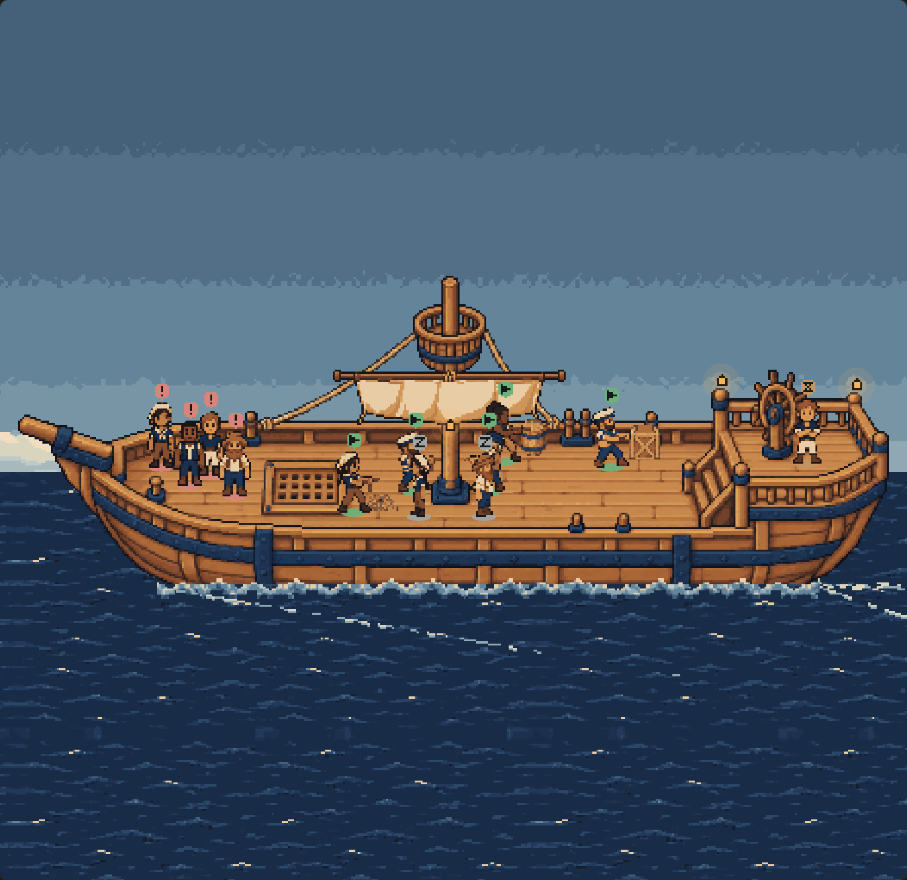
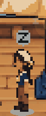
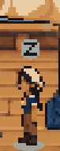
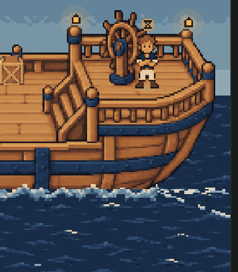
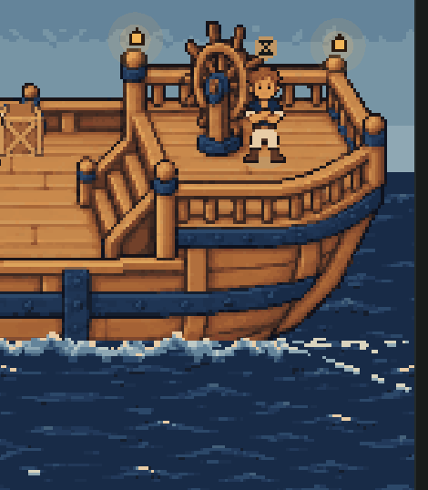

# The ship deck under sail: evidence

> The Deck has since become a standard feature, and the `FIRSTMATE_SHIP_DECK` switch this describes is gone
> (`docs/ship-deck-default/README.md`). What follows is the evidence as it stood when it was written, behind the switch.

Four changes to the Deck, all still behind `FIRSTMATE_SHIP_DECK` and desktop only: the generated sail on
hull C's mast, a wake, a look per crewmate, and an idle sailor that reads as at rest. The art is the
assets-2 expansion (`docs/ship-deck-art/assets-2/README.md`), served by a new `firstmate.deck.extras` from
`art/ship-deck/extras.json`.

| Before (main) | After |
| --- | --- |
|  |  |

## What animates

| Part | Drawn | Moving deck | Reduced motion | Software renderer |
| --- | --- | --- | --- | --- |
| Sail (`sails/main-sail.png`, 2 × 114 × 27) | At hull (154, 46), over the hull and masthead, behind the deck layer | Rest and billow alternate every 850 ms; rides the ship's bob, not the masthead's sway | Rest frame | As moving |
| Mast occluder (`sails/mast-occluder.png`) | In the mast piece's place, (202, 48), row 110 | — | — | — |
| Wake (code, `client/deck-wake.ts`) | Over the near sea, under the foam strip: churn astern from the stern's waterline, and the bow and stern waves' near arms angling down and aft | Foam scrolls aft at the sea's 10 px/s through a fixed outline, redrawn only when it moves a whole pixel | Still | Still (like the sea) |
| Crew looks (`crew-variants/*.png`) | Each sailor's sprite, at the atlas's own base-lane frames | Walk, haul, fret as before | — | — |
| Idle, at ease | `side-idle` in profile, facing fore or aft by seed; badge and drifting z as before | Feet still; head and shoulders (top 12 rows) drawn a pixel lower for 2 s of every 4.2 s | Standing whole, no z | As moving |

The ship bobs and the masthead sways as before. Lanterns, the gull, the sky and the hover label are unchanged.

| In | Out |
| --- | --- |
|  |  |

| Stern, still | Stern, moving |
| --- | --- |
|  |  |

## How the crew's looks map

Eight looks: the atlas's own two outfits (`base`, `outfit`) and the six extra ones in `extras.json` order —
`bosun`, `old-salt`, `navigator`, `carpenter`, `rigger`, `deckhand`. A sailor wears
`looks[fnv1a(identity) % looks.length]` (`lookFor` in `client/deck-extras.ts`), where `identity` is the
card's agent id (a remote worker's `serverId:workerId`, a card without either its key). So the same crewmate
looks the same on every poll and every time the deck opens, whoever else is aboard. Two crewmates can
share a look; across a dozen ids it spreads over at least five (the test checks it). A relaunched crewmate
keeps its card but is a new agent, and dresses as one. A look whose image did not load is left out of the
list, and the crew is dressed from the rest; with no extras at all it is the two atlas outfits.

The fixture's twelve on deck, from `render-results.json`: blocked `deckhand`, `navigator`, `carpenter`,
`bosun`; idle `navigator`, `carpenter`; working `base`, `old-salt`, `rigger`, `outfit`, `navigator`;
waiting `deckhand`.

## Depth

Back to front: sky, stars, gull, far sea | hull, masthead, **sail** | the deck layer (props, sailors, depth
pieces with the **occluder** for the mast, lanterns) by row | near sea, **wake**, foam | React label and legend.
The sail hangs behind every sailor. The occluder is the mast with its rows behind the cloth (hull y 48–72)
cleared, so the mast still covers a sailor behind it from the cloth down, and never paints over the sail.
A sailor standing behind the mast shows its head in front of the sail, as the asset pack's README asks.

## What was checked

`node docs/ship-deck-tweaks/render.mjs` (after `node docs/ship-deck-canvas/compile.mjs`), headless Edge,
Paseo 0.11.0's own compiler, `render-results.json`:

1. **Switch off**: the screen's DOM is main's, character for character, at 1440 and 390 px; the extras
   are never asked for.
2. **Depth, still**: the reduced-motion canvas against an independent 2D composite — hull, sail, props,
   crew in their looks, depth pieces with the occluder, badges — every art pixel above the foam, outside
   the marks and lanterns: **31,500 of 31,500 match**, 2,334 of them the sail's. The sail holds one frame.
3. **Motion**: the sail's cloth shows its states and the water astern changes on every sample (12 of 12
   each); 32 draws a second.
4. **Breathing**, on a paused clock with only the idle crew aboard, read at art-pixel centres: each idle
   sailor's legs take three positions (the ship's bob) and, at one of them, its head two — it breathes with
   its feet still.

The earlier harnesses — `docs/ship-deck-motion/render.mjs`, `docs/ship-deck-polish/render.mjs`,
`docs/ship-deck-environment/render.mjs` — pass on this branch too (`regression-results.json`): the switch
off, the still deck against its reference (32,054 of 32,054 at 3.37 device pixels an art pixel), the hover
label, resizing, the sky through the day, the frame cap. Their own screenshots were left as committed.

`compile-results.json`: the branch's client bundle is 11.5 KB larger than main's, has no `class` syntax,
and parses under react-native 0.81.5's `hermesc` with its default flags. The art is not in it.

`npm test` covers the rest: `client/deck-extras.test.ts` (the served art fits the atlas's frames, the
occluder sits on the mast, the looks, the billow, the wake's shape and scroll, the at-ease pose and
breath) and the stand-in Pixi in `client/deck-environment.test.ts` (the scene graph, the occluder, the
looks' textures, the breath's two parts, the wake layer, teardown).

## What still wants a human pixel artist

- **Idle.** `side-idle` standing still and a one-pixel settle of the head and shoulders are the best the
  generated frames allow. A drawn at-ease cycle — a slump against the rail, a yawn, a shift of weight, eyes
  closing — would say "idle" without the badge and the z. The `leaning` frame is not used for idle any more:
  its arm reaching forward read as someone about to act.
- **The breath's seam.** Drawn in two parts at a fractional scale, a sailor's body can land a device
  pixel differently from the whole sprite as a breath starts or ends. It is hard to see, and an artist's
  frames would not need the split.
- **The sail** is two generated states, mostly a change of cloth shading: a shimmer more than a billow.
  A drawn billow cycle, and a rig that answers the masthead's sway, would sell the wind.
- **The crew** are generated drawings fitted to the existing frames (the asset pack's verdicts:
  usable-with-cleanup). Faces are rough at 32 px, leaning and profile slots narrow some builds, and there
  is still no walk cycle or back view.
- **The wake** is code-drawn whole-pixel foam in two palette tones. Painted foam fitted to hull C's stern
  and bow, with a proper curl at the bow, would read better, as would foam that darkens at night.

## Only an install can confirm

As before, the harness is Chromium with react-native-web, not the Paseo desktop app. Install the plugin
from this branch, restart the daemon with `FIRSTMATE_SHIP_DECK=1`, reload, open FirstMate and press
**Deck**: the sail on the mast, foam astern, the crew in several looks, and idle crew in profile at the rail
breathing. In DevTools the console should carry no `[firstmate]` warning about the sail or crew looks.
