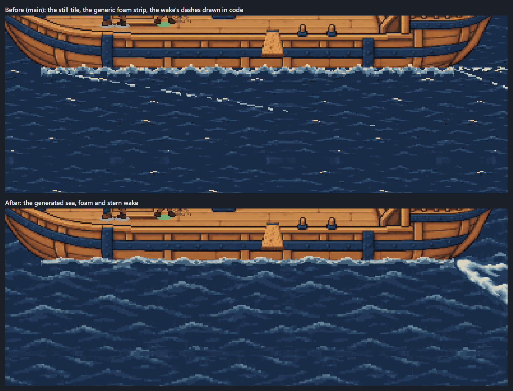
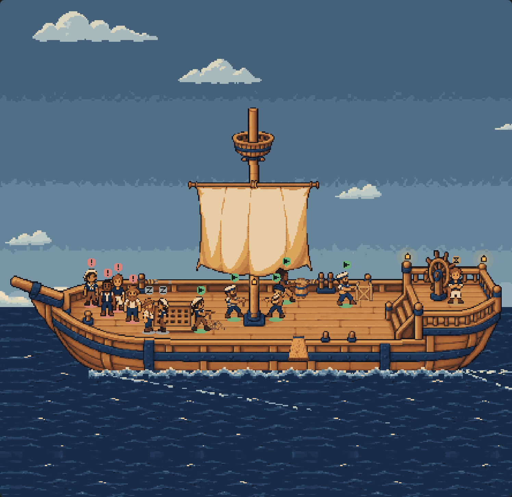
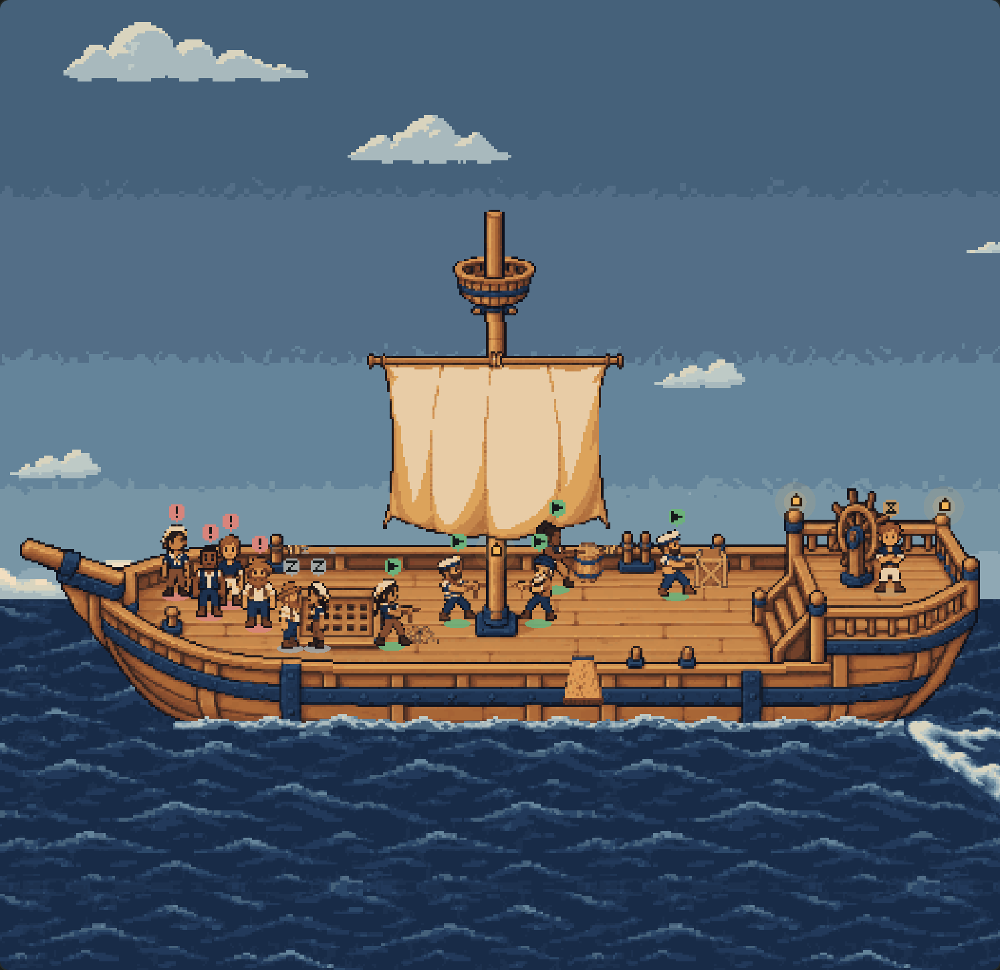
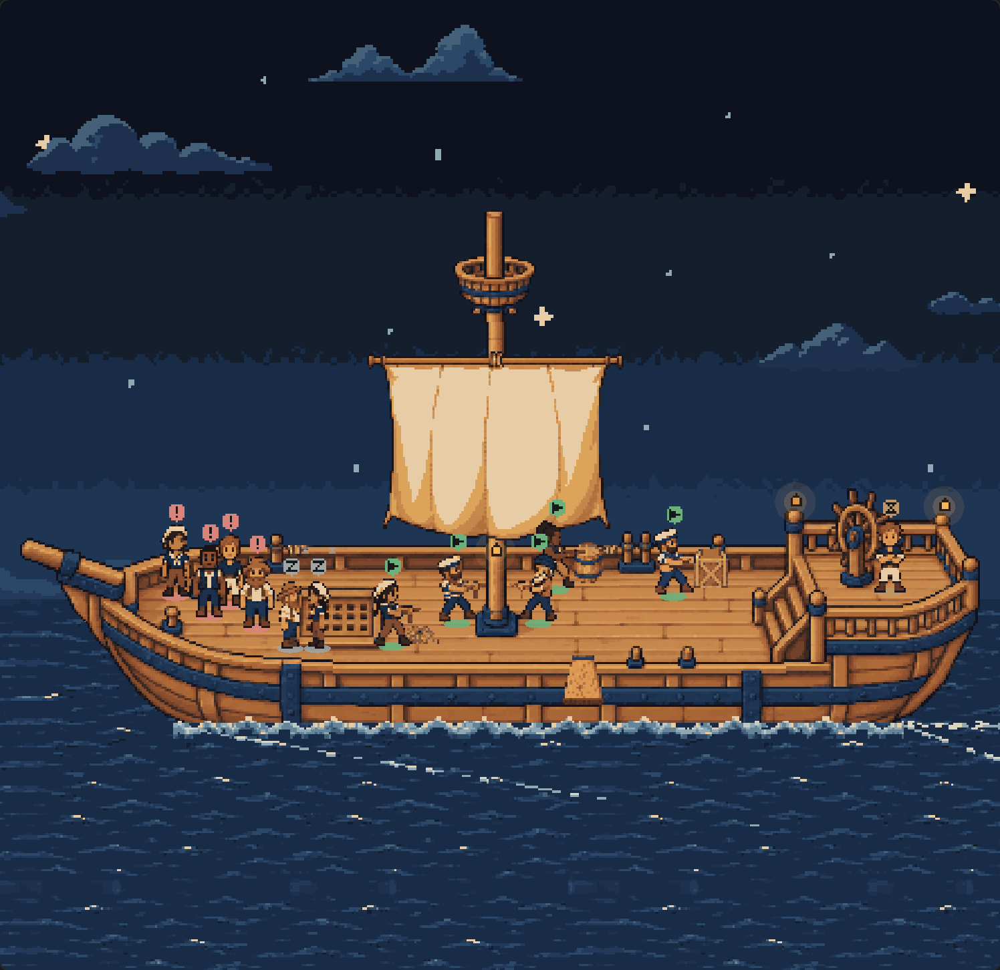
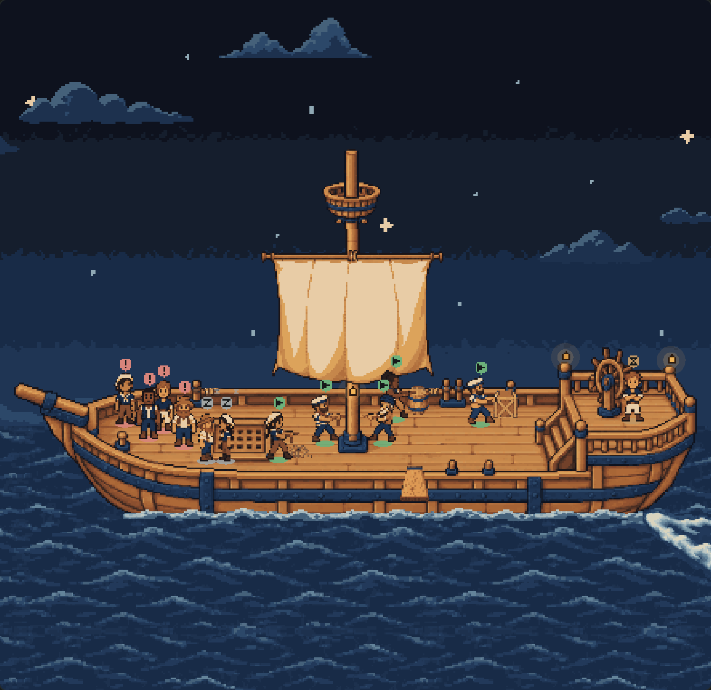
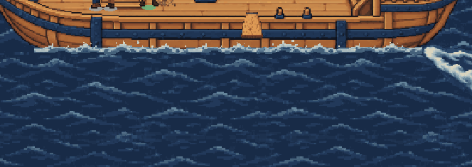

# The animated water: evidence

The deck's sea was one still tile drifting sideways, and its wake was dashes drawn in code. It now draws **the
generated water** (`art/ship-deck/water/`, from `fm/deck-water-art`): four sea frames, three waterline foam
frames and a three-frame stern wake, served with the extras (`extras.json`'s `water`) and placed exactly where
the art's own manifest says. Nothing was drawn or adjusted by hand; `client/deck-water.test.ts` holds
`extras.json` to the art's manifest — frames, sizes, timing, the horizon, the foam's top and span, the wake's
anchor.

| Before (main) | After |
| --- | --- |
|  |  |
|  |  |

The canvas harness's fixture fleet, 1440 × 900, dark, noon and 02:00. After, [dusk](after-deck-dusk.png) and
[light at 16:30](after-deck-light.png); [the water at night, close](after-water-night.png).

## The motion

Stills cannot show it, so here it is animated (three seconds, a frame every 120 ms on the fake clock; any browser
plays the animated PNG): [after](after-water-animated.png), [before](before-water-animated.png).

And [the same close-up at 0, 240, 480 and 720 ms](cycle.png), before and after: before, only the drift moves;
after, every 240 ms the sea's wavelets change shape, the foam's crests shift and the wake's eddies churn.

- **The sea** plays its four frames in order, 240 ms each, looping (a 960 ms cycle), every tile of both bands on
  the same frame, and still drifts right at 10 px/s in whole pixels. The far sea starts at the horizon (row 96),
  the near sea at the waterline (row 151) from the tile's row 55, so the two bands share one tile origin.
- **The foam** plays its three frames (720 ms), from row 142 with its row 9 on the waterline — three rows higher
  than the old strip — repeating sideways only across the hull (columns 68 to 392), drifting at 6.25 px/s as before.
- **The wake** is one 240 × 96 sprite, its anchor (8, 8) on the stern's water contact (392, 151), cycling its
  three frames (720 ms) in place: it never drifts with the sea, as the art's manifest asks. Its foam knot overlaps
  the stern by four rows. The code wake is gone where it loaded; it stays as the fallback.
- **Depth:** sky < clouds < gull < far sea < ship and crew < near sea < wake < foam < the plank's sailor, shark
  and splash < the veil and labels. The shark and splash still sit in the near sea, drawn over it, the wake and the foam
  ([on the board](plank-1-on-the-board.png), [splash](plank-2-splash.png), [chomp](plank-3-chomp.png)).
- **Still:** under [reduced motion](after-still.png) every part holds its calm first frame and the sea does not
  drift (the harness compares two screenshots a second apart); on a software renderer's lite plan the same, as the
  sea's drift already was. Nothing draws while the deck is hidden, and the 30 fps cap is the loop's, unchanged.
- **Night:** the water is drawn untinted, like the old tile and the hull: its palette is the environment's navy,
  and it reads under the night sky without change. The clouds are the only part recoloured with the sky.
- **How lively it is lives in one place:** `WaterMotion` in `client/deck-water.ts` — `pace` multiplies how fast
  every part's frames play, `drift` how fast the sea and foam slide. The deck draws `CALM_WATER` (both 1, the art
  as delivered).

## Panes and the wake

| Pane | Shows columns | Rows |
| --- | --- | --- |
| 1440 × 900 | -9 to 435 | -170 to 261 |
| [2300 × 560, wide and short](after-pane-wide-short.png) | -200 to 627 | -85 to 176 |
| [1000 × 1100, narrow](after-pane-narrow-tall.png) | -9 to 435 | -348 to 439 |
| [1203 × 911 at 1.25×](after-pane-fractional.png) | -9 to 435 | -209 to 300 |

The wake runs from column 384 to 624. In the usual width-bound pane the deck shows to column 435, so the knot and
the start of both arms are in view and the rest trails off the edge, as the old code wake's churn did. A wide pane
shows its full length ([after](after-wake-wide.png), [before](before-wake-wide.png)), cut below row 176.

## Everything else, still there

[Click to focus](after-focused.png) and [back out](after-focus-back-out.png); the plank and the shark; the sail,
the trimmed mast, the idle crew resting on the foredeck, the clouds, stars and lanterns; resize. No page errors or
warnings ([render-results.json](render-results.json)).

**The bundle** ([compile-results.json](compile-results.json)): Paseo 0.11's compiler builds it, 4,907 bytes
bigger than main's, and React Native 0.81's `hermesc` parses it with default flags: no `class`. The ten frames
(about 45 KB) are served by `firstmate.deck.extras`, never bundled.

## What a pixel artist could still improve

- **Foam breakup.** The crests breathe unevenly between frames and the baseline reads as a thin ribbon at some
  poses (the art's own *usable-with-cleanup* verdict). Hand-placed crests that follow the hull's curve would sit
  better.
- **The wake's flow.** Its eddies morph between three key poses rather than travelling aft; in-betweens, or a
  longer cycle with foam flecks moving down the arms, would read as water streaming away. Its far tips change
  silhouette slightly between frames.
- **Sea repetition.** The larger wavelets recognisably repeat every 256 columns across a wide pane.
- **Night water.** There is no night variant, so the sea keeps its daytime blues under the stars; a darker set of
  frames, or a per-phase palette like the clouds', would let it follow the sky.
- **A bow wave.** The asset is a stern V only and deliberately drops the old code's long bow-wave arm; a small
  bow splash at column 68 would show the ship cutting the water at the front too.

## Reproducing

`node docs/ship-deck-canvas/compile.mjs` (writes both bundles), then `node docs/ship-deck-water/render.mjs`.
Needs Edge and `docs/board-list`'s dev dependencies.
