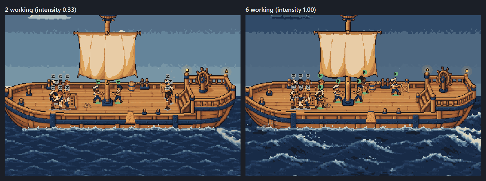
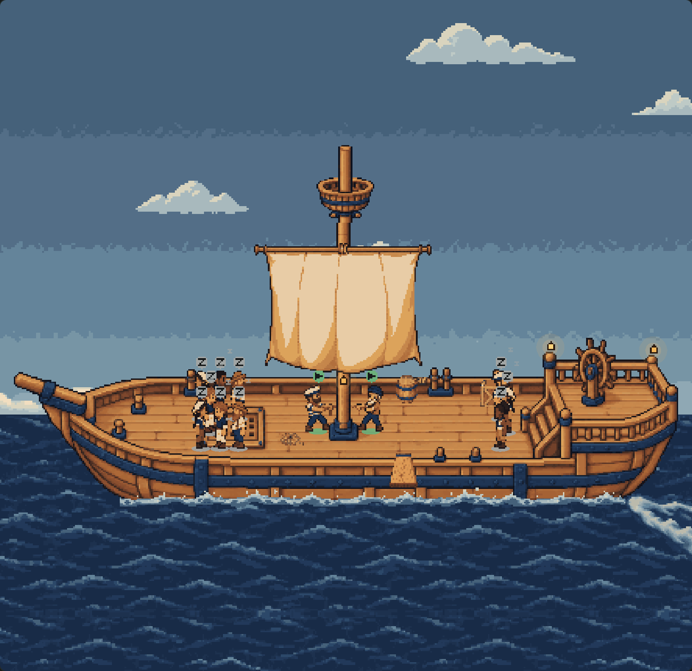
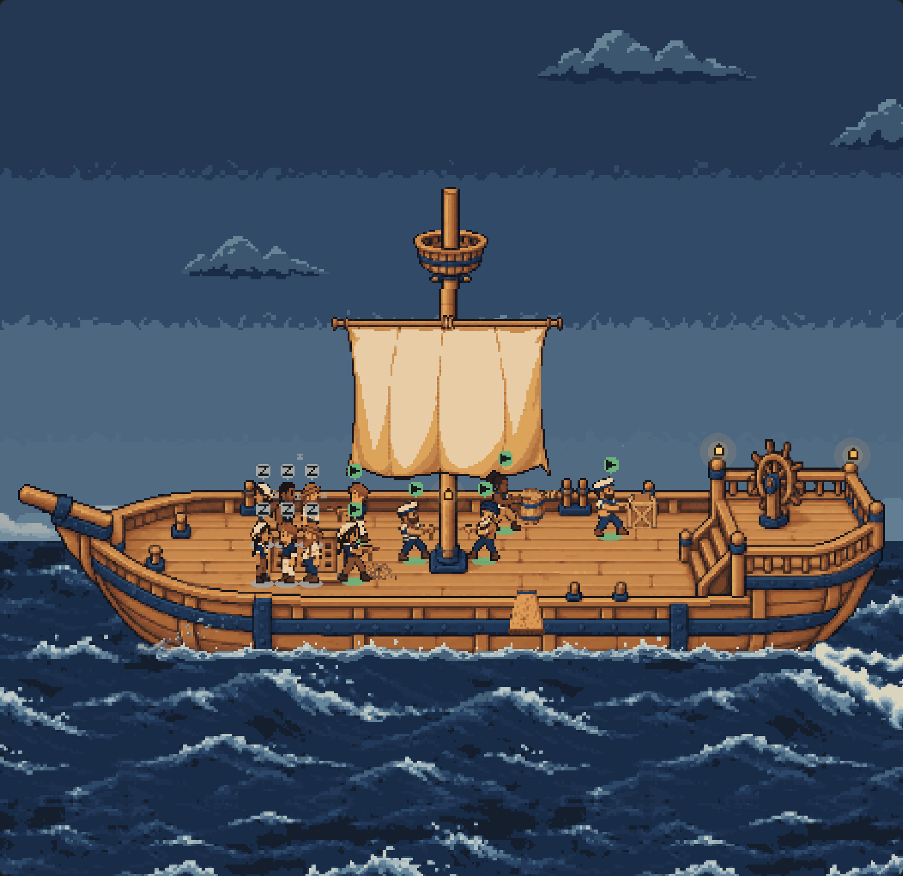
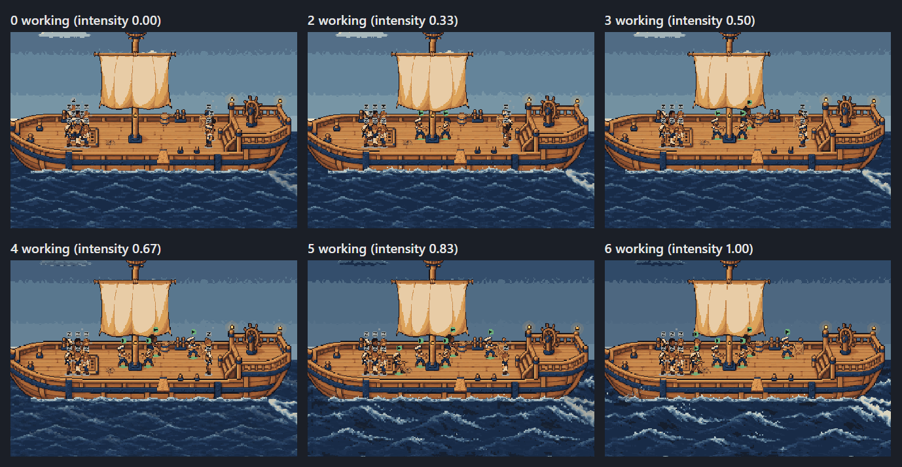

# A busy fleet sails into a storm: evidence

The deck's weather already follows the work (`docs/ship-deck-atmosphere/`). At the top of the dial the calm scene now
cross-fades into the generated heavy weather (`art/ship-deck/storm/`, made on `fm/deck-storm-art`; its sources and
review renders stay in `docs/ship-deck-art/storm/`): thunderheads, an overcast sky, a rough sea, a heavy wake,
spindrift at the bow and, at the very top, a faint distant fork of lightning. Nothing was drawn or adjusted in code;
every frame is the generated set, and each lines up with what it lays over exactly as delivered.

| Two working (calm, as before) | Six working (the storm) |
| --- | --- |
|  |  |

Stills cannot show the motion. Three seconds of each, 150 ms a frame on the fake clock (any browser plays an APNG):
[calm](animated-calm.png), [storm](animated-storm.png); and [the storm rolling in](storm-rolls-in.png), a frame a
second for fifteen seconds after four more crewmates go to work. The share of open-sea pixels changing frame to frame
is **0.30** calm and **0.45** in the storm ([render-results.json](render-results.json)).

## How it ramps with the crew

| Working | Intensity | Thunderheads | Overcast | Rough sea | Heavy wake | Spray at the bow | Lightning |
| --- | --- | --- | --- | --- | --- | --- | --- |
| 0–3 | 0 – 0.5 | — | — | — | — | — | — |
| 4 | 0.67 | 46% | 26% | 26% | 1% | — | — |
| 5 | 0.83 | 99% | 65% | 90% | 66% | 17% | — |
| 6+ | 1 | 100% | 70% | 100% | 100% | 65% | 28%, about 2 a minute |

Three or fewer working is exactly the deck as it was. The weather's intensity eases over a few seconds
(`EASE_SECONDS`), so the storm rolls in — 0.33 → 0.66 → 0.82 → 0.91 → 0.95 at each second — and back out as gently.

## Where it is tuned: data, not code

Every threshold is in `art/ship-deck/extras.json`, beside the art. The deck has two generic mechanisms, and the heavy
weather is just the first data set for them:

- **Variants** (`client/deck-variants.ts`): `{ variantOf, frames, frameSize, blend, opacity }` — a second frame set over
  the animated `sea` tile, the `foam` strip, the `wake`, a `cycle:<id>` or a `cloud:<id>`, on that element's own clock
  and frame index (no new clocks, so a cross-fade never shimmers). `opacity` is a curve of `[intensity, value]` points,
  eased between. `over` hides an opaque element once the variant is whole; `crossfade` fades a transparent one out.
  A variant that does not line up (frame count or size), or whose image did not decode, is dropped alone.
- **Cycles** — a looping sprite at a place, with an opacity curve: the spindrift at the bow.
- **Mood overlays** — over the time of day's sky, tinted with the sky's mood, faded by the night's share so night is
  never brightened; the stars go in as far as the overlay would show by day. The overcast is one.
- **Flashes** (`client/deck-flash.ts`): `{ frames, frameMs, frameAlpha, anchor, place: "under-cloud", opacity,
  perMinute }`, seeded like the gulls and capped at four a minute whatever the data says. The lightning is one.

## Motion and the rest

- **Reduced motion** stays wholly calm: with six working, the still deck's sea is byte for byte the idle still deck's,
  and held a second later ([still-busy.png](still-busy.png)).
- **Software renderer** (lite): the variants show on their elements' first frames at their opacity; no flash ever.
- **Day and night**: [the storm at night](storm-night.png) keeps the night sky; the thunderheads take the storm's own
  night colours.
- **Lightning**, read off the canvas's new `data-firstmate-deck-flash` attribute: three flashes in ninety seconds at
  the busiest ([lightning.png](lightning.png) shows one beside the moment before).
- **Depth**: overcast over the sky and under the stars; lightning over the stars and behind the clouds; each variant
  just over its element; the spray over the foam and below the crew, who never stand that low.
- **Bundle**: Paseo 0.11's compiler builds the branch, Hermes parses it with default flags, and it has no `class`
  syntax ([compile-results.json](compile-results.json)); the art goes through `firstmate.deck.extras`, never the bundle.
- Click to focus and back out works in the storm, with no page errors or warnings.

Run `node docs/ship-deck-canvas/compile.mjs`, then `node docs/ship-deck-weather/render.mjs` (needs
`docs/board-list`'s `npm install` and Edge).

## What a pixel artist could still improve

- **The heavy wake** morphs its interior eddies and tips between its three frames instead of carrying them downstream.
- **The spindrift** is a short burst looped as a cycle: its curl and droplets change shape, and the loop restarts
  visibly at the bow. In-betweens with proper trajectories, or a rest frame, would read as gusts.
- **The rough sea**'s broad swells repeat recognisably across a wide pane, and its crests shimmer between four poses.
- **The lightning** is a small stylised fork at 28%; there is no sheet-lightning glow over the clouds.
- **The thunderheads** are single silhouettes cross-faded over the calm clouds, not a morph: midway both show faintly.
- **The overcast** is one daytime treatment; dawn and dusk under it are the calm palettes greyed, not their own.
