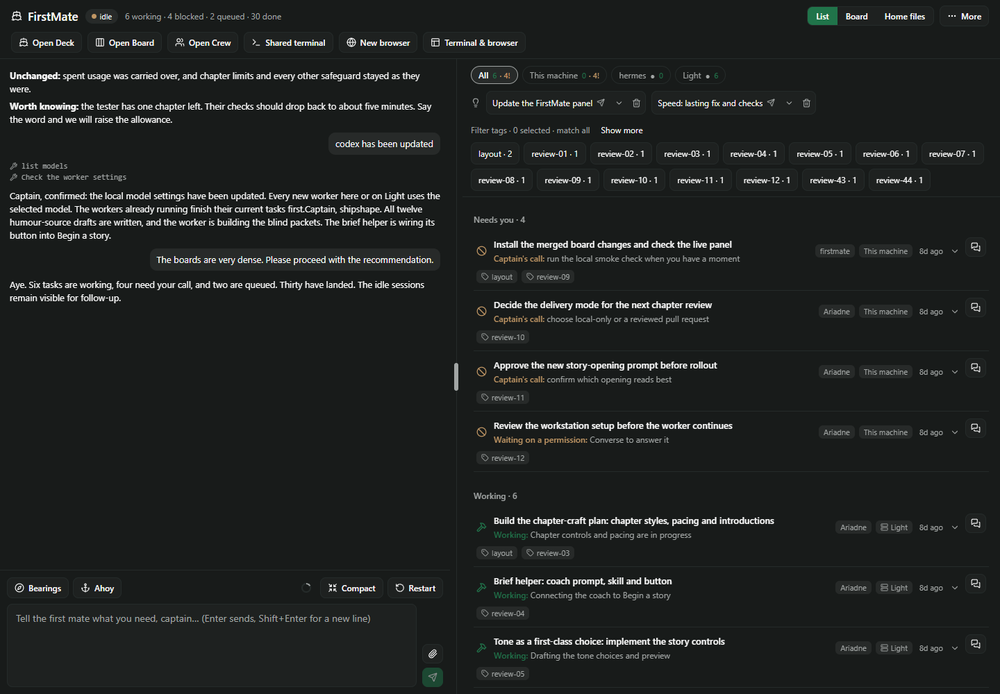
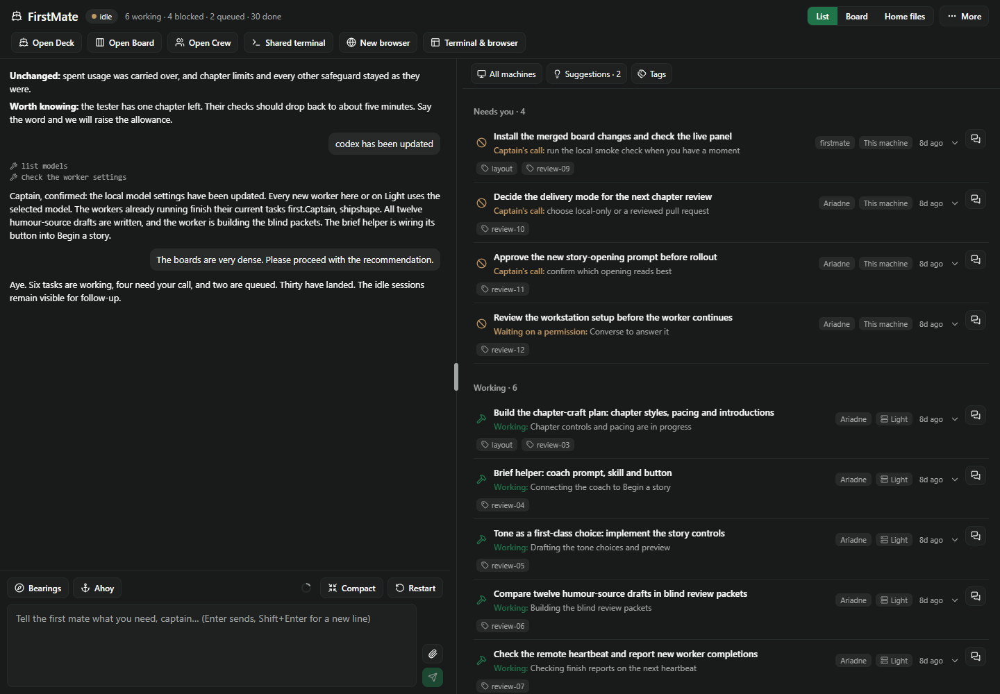
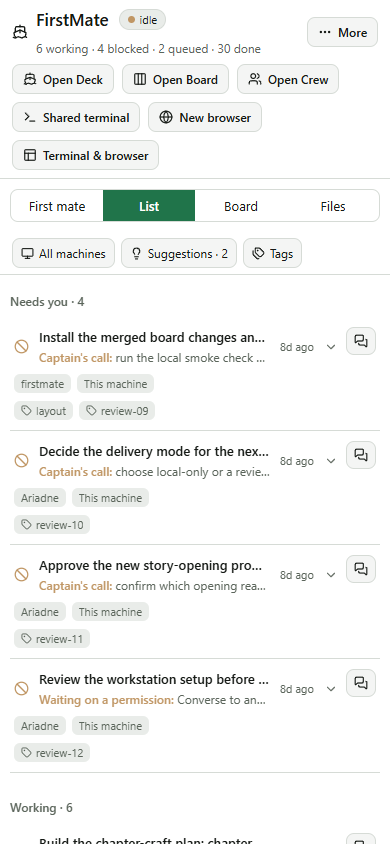
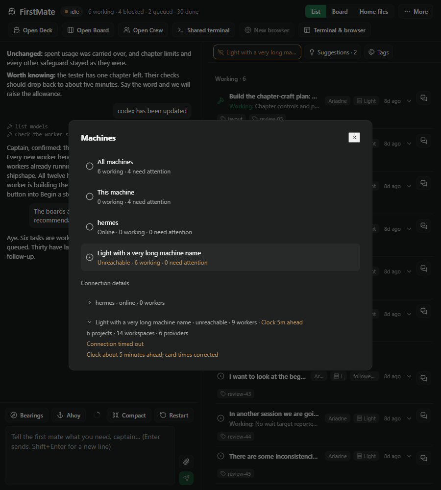
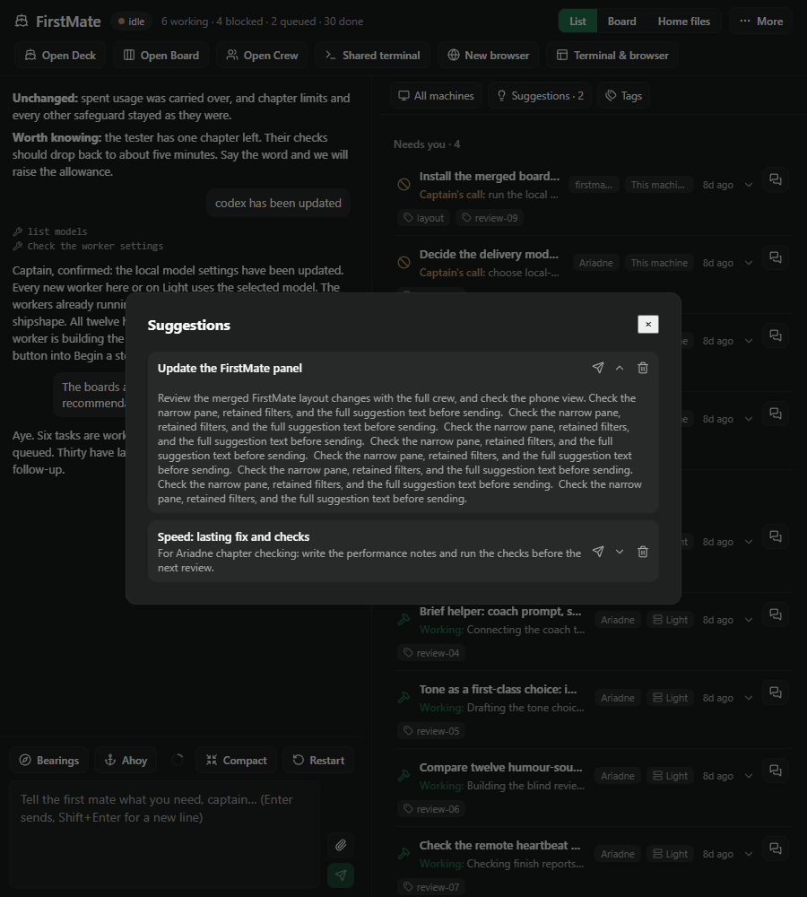

# Right-pane density — third slice

Machines, suggestions and filter tags previously stacked above the tasks. They now share a compact
toolbar with three buttons. Machines shows the current scope and warns if it is unreachable;
Suggestions shows the available count; Tags shows the active count and highlights an applied filter.
Full selected tag names remain in the tooltip. Each button opens the host's Modal, preserving the
existing machine/filter rules, suggestion send/removal gate and connection details.

The dialogs retain machine selection and working/attention counts, expandable connection health,
full suggestion previews and separate send/remove actions, tag overflow, match-all selection and
clear. Opening a suggestion dialog never sends a message. Empty suggestions and tags keep stable
buttons with explanatory empty states; no saved remote hosts means no machine button.

## Space recovered

Measured against merged main `c04f35e`, with identical fixture data and the same 45% chat split:

| Viewport | Before: List height | After: List height | Recovered |
| --- | ---: | ---: | ---: |
| 1440 × 1000 | 716 px | 872 px | 156 px |
| 900 × 1000 | 716 px | 872 px | 156 px |
| 390 × 844 | 413 px | 569 px | 156 px |

Both themes give the same measurements. The controls shrink from **199 px to 43 px** in this busy
fixture. Long machine names truncate with the full name in the tooltip and dialog; the toolbar can
wrap when the pane is narrower. The phone's workspace launcher is reserved for slice 4.

Before:

After:

## Review and validation

Self-review covered shared filter ownership, the existing batched settings save, first-mate sending
and suggestion-removal gates, dialog dismissal/focus return, empty states and offline hosts. This
adds no setting, RPC, dependency or dispatch path. The deck, scenes and canvas are unchanged.

- Full suite: **90 files, 1,075 passed, 3 skipped**. Typecheck, pack lint (36 checks), changed-code
  formatting and `git diff --check` pass.
- Real Paseo 0.11 compiler: both bundles compile; the client has **zero `class` tokens** and passes
  React Native 0.81.5 Hermes with default flags.
- `node docs/tab-cleanup/render-density.mjs`: real components with synthetic host APIs, in light and
  dark themes at all three sizes. Measures before/after height; exercises keyboard opening, Escape
  and focus return, selected machine state, host/tag parity across List and Board, persisted filters,
  tag overflow/clear, full suggestion preview, send exactly once, removal without sending, removal
  of the final suggestion, empty data, long host names, offline errors and clock skew. No page
  overflow, browser errors or canvas mounts.
- `node docs/tab-cleanup/render-list.mjs`: repeats slice 2's List/Board, Done, conversation/draft,
  local/remote steer, Files/chat and workspace-navigation regression checks through the new dialogs.

Reproduce with `npm ci`, `npm ci --prefix docs/board-list`, the replay commands above and
`node docs/shell-phase1/check-bundle.mjs`. Generated images/results live in `.generated/density/`.
These are browser fixtures; native device rendering is not claimed. Dialog focus and scrolling on
device are provided by the existing host Modal.

