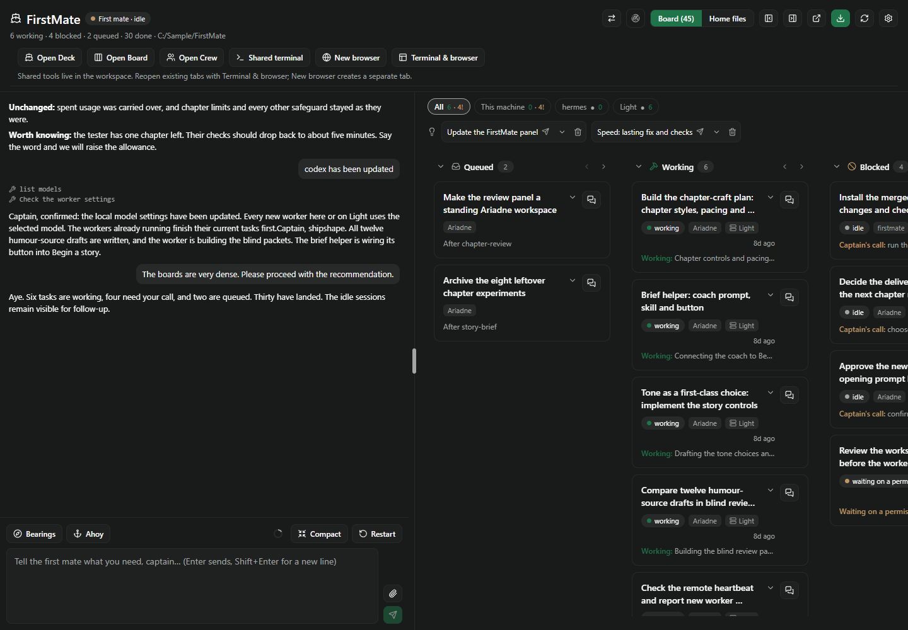
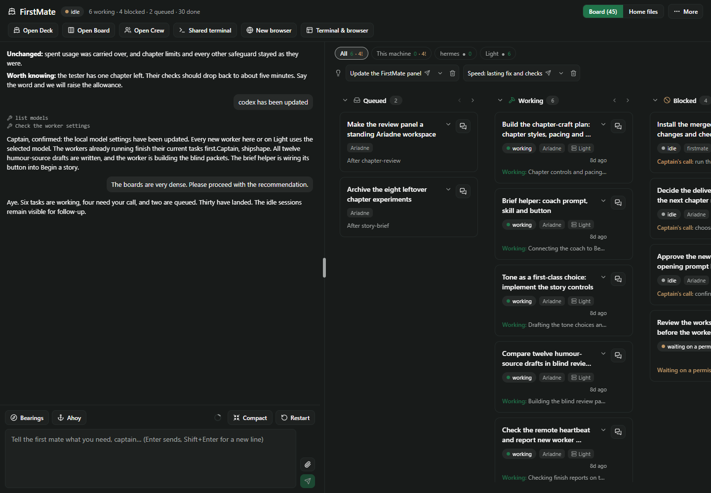
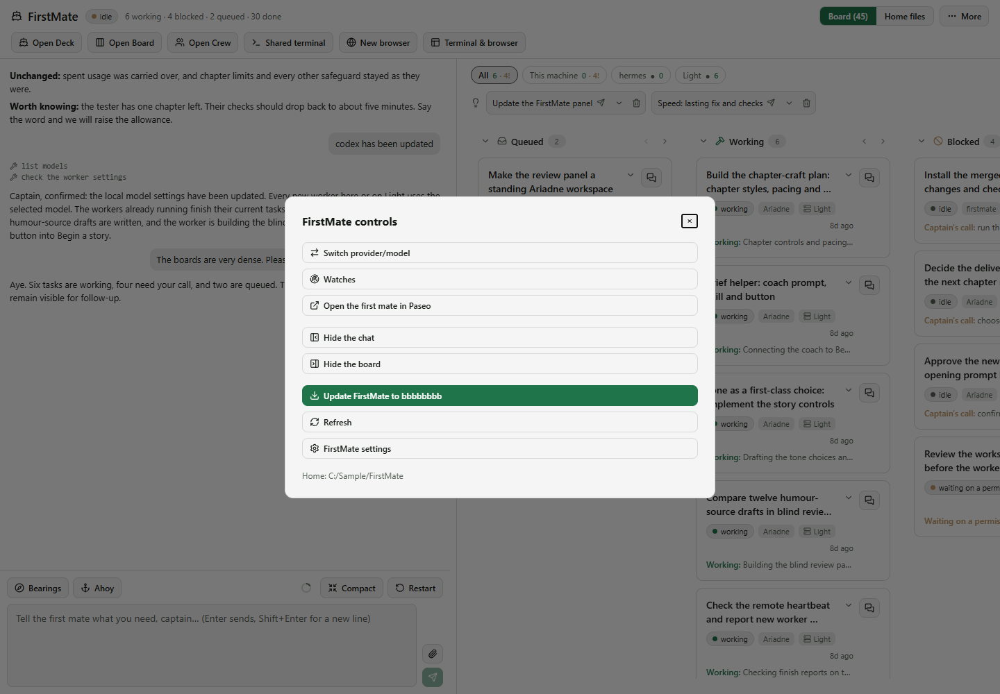
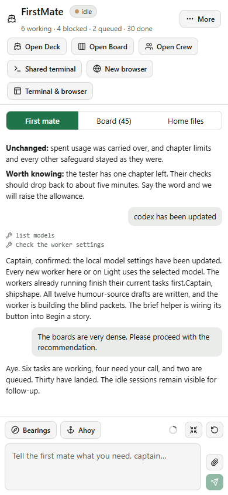

# Header cleanup — first slice

Home's header put the title/status, task counts/directory, a wide control cluster, workspace shortcuts
and shared-tool instructions above the conversation. The title, mate status and counts now share one
row (wrapping within the title area at narrow widths). Board/Home files stays visible beside **More**.
More opens the host's accessible modal with labelled secondary actions and the full selectable home
path. The workspace shortcut row keeps its actions but drops its inset border and explanatory blurb.
Missing-home guidance, tooltips and the browser creation dialog retain the necessary context.

This slice changes Home only. List access, the right-pane toolbar and the compact workspace launcher
are the next three separate PRs. No deck/canvas/scene code or pack changes.

## Validation

`npm test -- --maxWorkers=4`: 90 files, 1,088 passed, 3 skipped. Typecheck, pack lint (51 checks),
changed-code formatting and whitespace checks pass. Paseo 0.11's real compiler builds both halves;
the complete client contains zero `class` tokens and parses under RN 0.81.5 Hermes's default flags.

`node docs/tab-cleanup/render-header.mjs` mounts the real Home and controls with synthetic host APIs.
It compares against `6b11d4d` at 1440×1000, 900×1000 and 390×844, in light and dark themes. The complete
header, including workspace shortcuts, falls from **146 to 85 px** at both desktop widths and from
**270 to 179 px** on phone. No horizontal page overflow or browser errors.

The replay checks keyboard open/Escape/focus return, provider and Watches opening with only one
dialog present, full-conversation and settings navigation, pane collapse/restore, and one update
request through the existing sender. Review caught and fixed focus return from the secondary dialogs:
their old trigger disappears with More, so they explicitly return focus to the persistent More button.
Migration recovery and failing-watch colour remain on More; migration state still polls independently
of whether the menu is open. Updates are checked when the menu opens and while it remains open.

These are browser fixtures, including the phone viewport; native sheet presentation still requires
an installed-device check. No live daemon, user workspace resources or deck canvas was used.

Reproduce: `npm ci`, `npm ci --prefix docs/board-list`, the render command above, and
`node docs/shell-phase1/check-bundle.mjs`. Generated captures and measurements are under `.generated/`.

