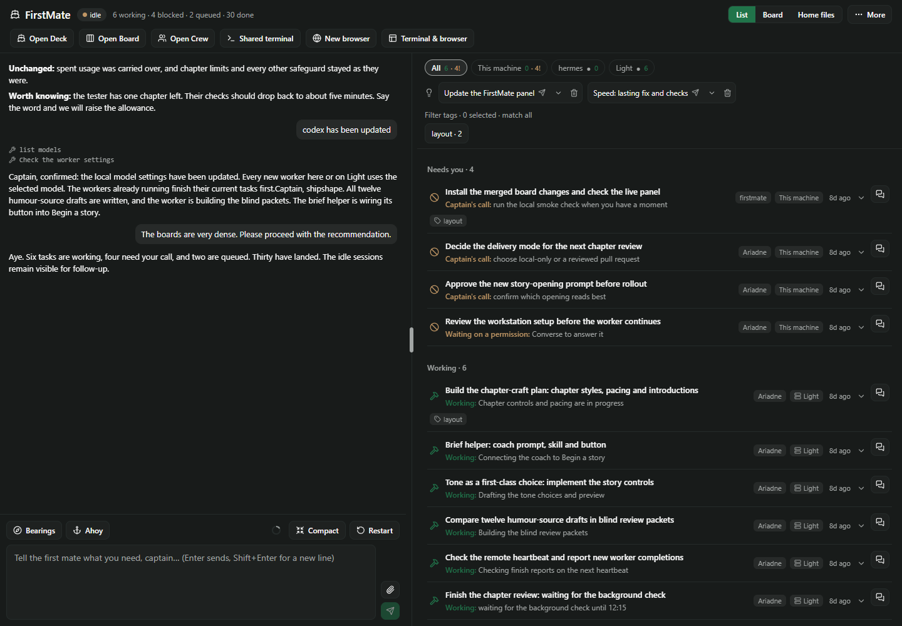
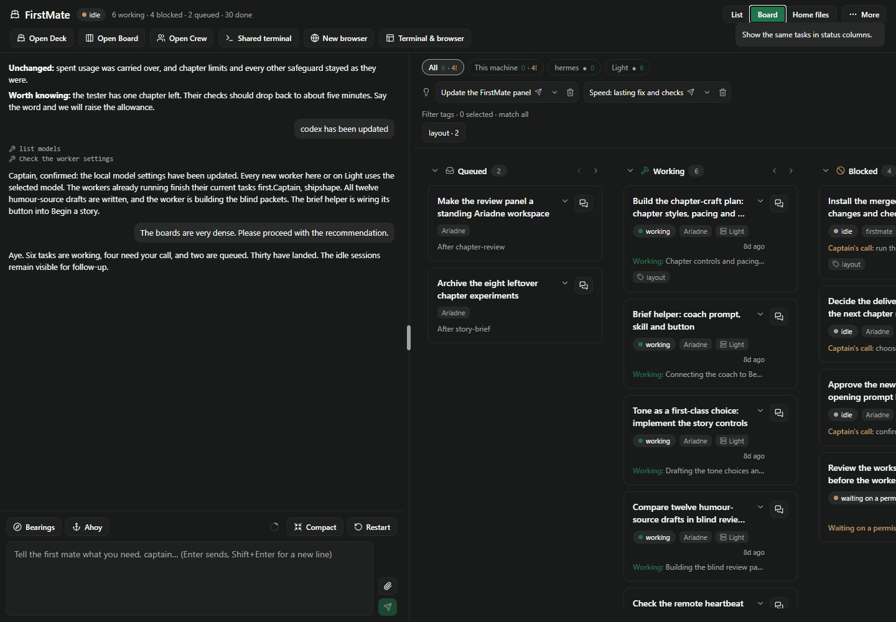
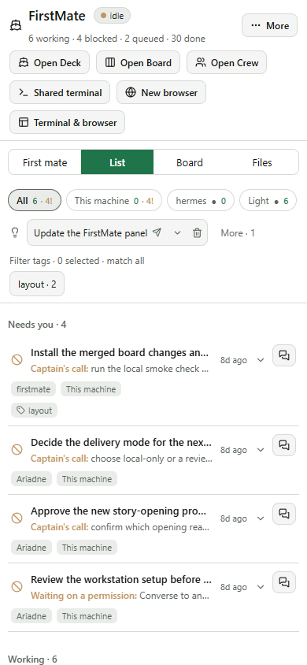
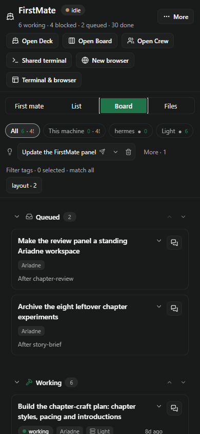

# Home List view — second slice

Home hard-coded Board even though it already had the grouped List component and a saved `crewView`
preference. The existing switch now offers **List | Board | Home files**, with List first and the
existing default for an unset preference. A saved Board choice is respected. Compact Home offers
**First mate | List | Board | Files** in its existing tab row, without another toolbar.

Both task views use the same filtered cards, actions and worker conversation. Switching views keeps
an open conversation and its draft; pressing the selected task view again returns to its tasks.
Done remains collapsed in List until expanded. The standalone Board and Crew destinations retain
their fixed layouts, and opening either then returning Home restores Home's chosen view.

Self-review checked shared data/filter ownership, preference persistence through the existing batched
settings save, conversation/draft lifetime, compact chat/Files navigation and the dedicated workspace
destinations. No new settings schema, data fetch, dispatch path, dependency or deck change.

## Validation

- Full suite: **90 files, 1,075 passed, 3 skipped**. Typecheck, pack lint (36 checks), changed-code Prettier and
  `git diff --check` pass.
- Real Paseo 0.11 compiler: both halves compile; client has **zero `class` tokens** and passes RN
  0.81.5 Hermes with default flags.
- `node docs/tab-cleanup/render-list.mjs`: real Home components with synthetic host APIs, at 1440×1000,
  900×1000 and 390×844 in light and dark themes. Default List, keyboard toggle, selected state,
  persisted Board reload, host/tag filter parity, Done expand/collapse, conversation/draft retention,
  local and remote steer routes, Files/chat access and workspace-view round trips pass. No page
  overflow, nested List scroller, unexpected navigation or browser errors.
- The header remains **85 px** on desktop and **179 px** on phone, including workspace shortcuts.
  Right-pane density and the phone launcher are the next two slices. Phone screenshots are browser
  fixtures; native device rendering is not claimed.

Reproduce with `npm ci`, `npm ci --prefix docs/board-list`, the replay command above and
`node docs/shell-phase1/check-bundle.mjs`. Generated images/results live in `.generated/list/`.

