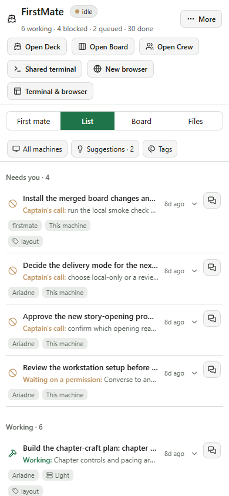
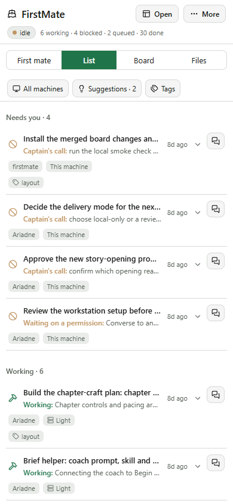
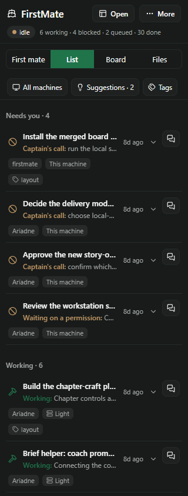
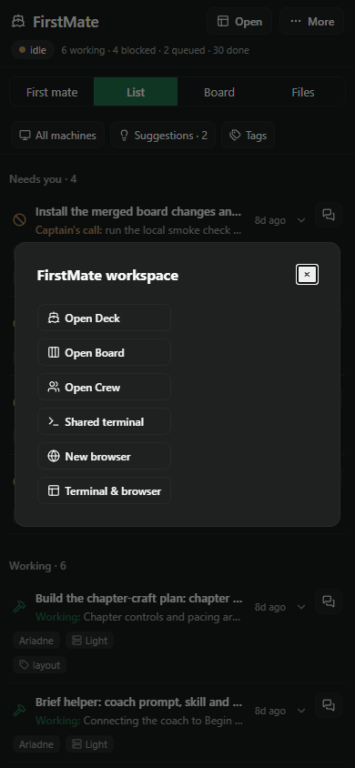

# Mobile launcher — fourth slice

On narrow layouts, six workspace shortcuts wrapped into several persistent header rows. They now
open from one **Open** button beside **More**. The host's **FirstMate workspace** dialog retains Deck,
Board, Crew, Shared terminal, New browser and Terminal & browser. The title keeps its own line;
status and task counts share a quiet row underneath, readable even at 320 px.

This uses the existing compact rule: the host's compact layout or an available width below 638
points. It therefore also works when a desktop pane is narrowed. Wide layouts retain their direct
shortcuts. List/Board/Files and the first-mate chat remain in their existing compact tab row.

## Space recovered

Measured against merged slice 3, `d1e9d02`, with identical fixture data and browser capability:

| Viewport width | Header before | Header after | Recovered |
| --- | ---: | ---: | ---: |
| 320 px | 179 px | 74 px | 105 px |
| 390 px | 179 px | 74 px | 105 px |
| 600 px | 123 px | 74 px | 49 px |
| 900 px | 85 px | 85 px | 0 px |

Light and dark themes give the same measurements. Phone height is 844 px; wider fixtures are 1000 px.

Before:

After:

## Review and validation

Self-review covered the responsive breakpoint, existing home-workspace guard, native-resource gates,
dialog lifetime and focus. `NativeToolButtons` now lets its buttons appear inside the launcher while
its browser dialog remains a sibling. Opening New browser closes the launcher first; dismissing the
browser dialog returns focus to Open. Pending terminal state survives launcher dismissal/reopening,
and successful workspace navigation closes the launcher. Leaving Home still prevents a late terminal
response from navigating. The server contracts, resource-creation rules and deck implementation are unchanged.

- Full suite: **90 files, 1,075 passed, 3 skipped**. Typecheck, pack lint (36 checks), changed-code
  formatting and `git diff --check` pass.
- Actual Paseo 0.11 compiler succeeds for both bundles. The client has **zero `class` tokens** and
  parses with React Native 0.81.5 Hermes using default flags.
- `node docs/tab-cleanup/render-mobile.mjs`: real components with synthetic host APIs at all four
  widths in both themes. Checks menu dismissal/focus, every workspace destination, sibling browser
  dialog/cancel/validation/error/retry, exactly one browser creation, pending terminal gate across
  menu reopening, no resources created on render, unavailable browser/home states, breakpoint
  resizing, no late navigation after unmount, existing tabs and More access. No horizontal page
  overflow or unexpected browser errors. Deck navigation is recorded at the host boundary without
  mounting a canvas or scene.
- `node docs/tab-cleanup/render-list.mjs`: List/Board, Done, shared filters, conversation/draft,
  local/remote steer, Files/chat and workspace round trips pass through the new mobile launcher.

Reproduce with `npm ci`, `npm ci --prefix docs/board-list`, the replay commands above and
`node docs/shell-phase1/check-bundle.mjs`. Generated images and results live in `.generated/mobile/`.
These are browser fixtures; native-device rendering is not claimed. The existing host Modal owns
device presentation, scrolling and dismissal. This change was not installed or merged by the worker.
